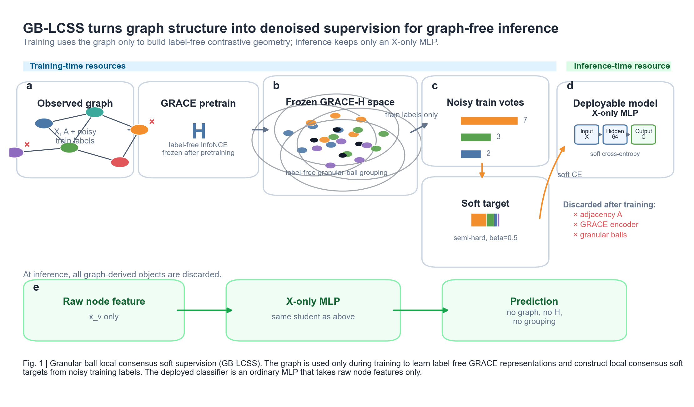

# 粒球局部共识软监督：带噪标签下的无图推理节点分类

**Granular-Ball Local-Consensus Soft Supervision for Noisy-Label Node Classification with Graph-Free Inference**

---

## Highlights

- GB-LCSS 面向训练标签噪声与无图推理并存的节点分类场景。
- 冻结图对比表征中的粒球将局部标签共识转化为软监督。
- 分类器推理仅使用节点属性，无需图结构或预训练表征。
- GB-LCSS 在多数噪声设置下优于同骨干抗噪方法。
- 共识教师蒸馏将仅属性学生提升至具有竞争力的 GCN 水平。

---

## 摘要

训练阶段可访问图结构而推理阶段只能使用节点属性，是隐私约束、关系缺失和低时延需求下常见的部署场景。当训练标签受到噪声污染时，现有图标签去噪方法仍依赖邻接信息，而现有无图推理方法通常以干净训练标签为前提，对噪声监督的鲁棒性尚缺乏系统研究。为此，本文提出粒球局部共识软监督（Granular-Ball Local-Consensus Soft Supervision，GB-LCSS）框架。GB-LCSS 在无监督图对比学习获得的冻结表征空间中构造粒球，通过球内标签共识生成软监督目标，进而训练仅以节点属性为输入的 MLP 分类器。在五个完成全噪声谱评测的数据集上，GB-LCSS 在绝大多数噪声设置中取得了优于同骨干抗噪方法的分类性能。作为扩展，共识教师蒸馏在保持仅特征推理的同时，将学生模型性能提升至具有竞争力的 GCN 水平。结果表明，GB-LCSS 为训练标签含噪且要求无图推理的节点分类任务提供了一种简单有效的监督构造方法。

**关键词**：标签噪声；节点分类；无图推理；图对比学习；粒球计算；知识蒸馏

---

## 1 引言

图神经网络（Graph Neural Network，GNN）通过消息传递聚合邻域信息，已成为节点分类的主流方法 [1,2]。然而，部署端并不总能获得完整的边关系，在线消息传递还会引入邻居检索与多跳传播开销 [3]。在现有无图推理研究中，训练阶段可以利用图结构，而推理阶段的学生模型只使用节点属性，不再访问邻接关系或执行消息传递 [3,14]。本文也沿用这一设置：测试时分类器只使用节点属性，不使用邻接矩阵、邻居节点、图编码器输出或其他图衍生表征。GLNN [3] 及其后续研究表明，通过知识蒸馏、结构编码或结构感知训练，多层感知机（Multilayer Perceptron，MLP）能够在该设置下获得接近 GNN 的分类性能 [5--7,29,30]。

当训练标签受到噪声污染时，这一部署设置面临新的困难。人工标注、自动采集和多源数据整合都可能引入错误节点标签，深度模型还会在训练过程中逐渐拟合这些错误监督 [8]。NRGNN、RTGNN、DND-NET 和 RNCGLN 等图标签噪声方法通过图传播、双网络互校或伪标签机制提高鲁棒性 [9--12]，但其去噪过程或最终推理仍依赖邻接矩阵。另一方面，已有 GNN-to-MLP 和 X-only 节点分类工作大多以干净训练标签为前提，研究重点集中于结构知识迁移、特征扰动、特征缺失或标签稀缺 [3,5--7,14,15]。GSDN [14] 考虑了非对称标签噪声情形，但尚未在统一标签噪声协议下与通用抗噪策略进行系统比较。因此，如何利用训练期图结构抵抗标签噪声，同时获得推理期仅依赖节点属性的分类器，尚未得到系统研究。

现有无图推理方法主要在输入、表征或预测层面向 MLP 传递结构知识 [3,5--7,14,15]，其监督信号通常来自原始训练标签，或来自由这些标签训练的教师。当训练标签含噪时，标签错误也可能通过结构感知训练或知识蒸馏传递给学生模型。这意味着，仅传递图结构知识还不够，还需要利用图结构构造更可靠的监督信号。基于这一思路，本文从无监督图对比表征的局部几何结构中提取标签共识，并据此生成软监督，以降低模型对单个含噪标签的依赖。

本文提出粒球局部共识软监督（Granular-Ball Local-Consensus Soft Supervision，GB-LCSS）框架。GB-LCSS 首先在冻结的无监督图对比表征空间中构造粒球 [34]，再由球内训练节点的含噪标签分布和多数类共同形成组级目标，并按照置信度将其与节点原始标签进行软混合。共识越强，组级目标在最终软标签中的权重越大。共识较弱时，则更多保留节点的原始标签。软目标在分类器训练前一次性生成，用于训练 X-only MLP。整个过程不依赖干净标签或模型预测反馈，训练后的分类器仅使用节点属性。

在 11 个数据集的统一评测和其中 5 个数据集的完整噪声谱实验中，GB-LCSS 在多数设置下优于采用相同 X-only MLP 骨干的通用抗噪方法。基础 GB-LCSS 只在训练节点上构造软目标，图结构信息也只能通过这些节点传递给 X-only MLP。为使更多节点获得监督，并向学生传递更丰富的结构信息，本文进一步引入共识教师蒸馏：先使用 GB-LCSS 目标训练图结构教师，再将教师对所有节点的逐节点预测蒸馏给 X-only 学生。该扩展仍只使用原有的含噪训练标签，不额外使用干净标签，学生在测试时也仍然只使用节点属性。在多个代表性数据集上，X-only 学生的精度接近或超过相同噪声设置下的 GCN 基线。

本文采用转导节点分类协议。主实验中的比较方法使用相同的 X-only MLP 骨干，并且只以训练节点的含噪标签作为监督。推理依赖图结构的方法仅作为跨部署条件参照。

本文的主要贡献如下：

1. 面向训练标签含噪且推理端只能使用节点属性的节点分类问题，提出 GB-LCSS 框架。该框架利用训练期图结构构造监督信息，而分类器在推理时仍只使用节点属性。
2. 设计粒球划分与置信度软目标机制。粒球划分不使用标签，球内含噪训练标签用于形成组级目标。共识置信度决定组级目标与节点原始标签的混合比例，整个过程无需干净标签或模型预测反馈。
3. 在 11 个图数据集和多种噪声协议下验证 GB-LCSS 的有效性与适用范围，并通过随机分组对照分析局部几何结构的贡献。共识教师蒸馏进一步将覆盖全部节点的教师预测传递给学生，在保持 X-only 推理的同时提高分类精度。

---

## 2 相关工作

### 2.1 通用标签噪声学习

通用标签噪声学习主要从样本选择、鲁棒损失、标签修正和半监督训练等角度减弱错误监督。Co-teaching 由两个网络相互选择小损失样本，JoCoR 在共同样本选择的基础上约束双网络预测一致性 [17,18]。SCE 组合交叉熵与反向交叉熵，ELR 抑制模型对噪声标签的后期记忆，ANL 和 LogitClip 分别通过负学习目标与 logit 范数约束提高损失鲁棒性 [19--22]。DivideMix 将样本划分为有标签与无标签部分并进行半监督训练，FINE 根据类内特征主方向识别可靠样本，CT 则利用训练过程中的置信度轨迹估计标签可靠性 [23--25]。这些方法为本文提供了同骨干抗噪参照，但其原始设计面向独立样本，不利用训练阶段的图结构构造监督信息。

### 2.2 图上标签噪声学习

图上标签噪声学习需要同时处理标签稀疏性、节点依赖性以及错误监督沿图结构传播的问题。UnionNET 聚合结构邻近节点的标签以估计节点类别分布，并据此进行样本重加权和标签修正 [46]。NRGNN 通过边预测和伪标签挖掘扩充可靠监督，RTGNN 采用双网络、自强化标签修正和一致性约束治理噪声 [9,10]。DND-NET 将高阶图传播与简单分类器解耦，并结合邻居不确定性生成鲁棒伪标签 [11]。它采用简单分类器，但输入仍是图传播特征，因此不属于严格的 X-only 推理。RNCGLN 则联合图对比学习与标签自纠正，同时考虑标签和结构扰动 [12]。

近期方法进一步利用拓扑样本选择、结构重构和多视图一致性。TSS 将图拓扑引入小损失样本选择，以保留类边界附近的有效节点 [47]。TFR 通过拓扑特征重构抑制对噪声标签的过拟合，并据此筛选伪标签 [40]。ProCon 结合特征相似性和邻接关系确定语义 peer，再利用 peer 标签一致性识别噪声并更新类原型 [41]。GD² 依据节点自身视图与结构视图的预测差异检测噪声 [42]。GNN-CFGD 利用训练记忆和混合模型划分可靠节点，再通过图连接与置信度细分补充监督 [44]。

蒸馏方法 BO-NNC 以多个自监督图模型作为教师，通过双层优化学习教师权重并改进标签 [58]。SAMTD 则根据结构和预测一致性对多个教师进行加权 [45]。另一类方法直接提高拓扑或聚合过程的鲁棒性。GTA 通过增补可信边和删除不可信边调整图拓扑 [59]，MILAB 以信息瓶颈约束邻居聚合，并通过对抗扰动下的预测一致性估计节点可靠性 [50]。HALF 面向异质图，根据局部同质性融合低通与高通损失以识别含噪节点 [51]。这些方法与本文处理相同的图节点标签噪声任务，但其噪声识别、监督传播或最终推理通常仍依赖图结构。

### 2.3 GNN-to-MLP 蒸馏与无图推理节点分类

无图推理研究允许在训练阶段利用图结构，同时避免在部署阶段执行消息传递。早期工作 Graph-MLP 通过邻域对比约束训练 MLP，GSDN 则在预测层进行邻域自蒸馏 [4,14]。SimMLP 以自监督方式对齐 MLP 表征和图上下文表征，ES-MLP 进一步通过边拆分机制适配同质图与异质图 [15,33]。NOSMOG 还引入位置与结构特征以增强 MLP [5]。这些方法减少了推理阶段的图计算，但资源边界并不完全相同。NOSMOG 依赖预先生成的 DeepWalk 位置嵌入。SA-MLP 的主要结构分支以邻接矩阵行为输入，其在线变体则另行估计潜在结构 [27]。因此，NOSMOG 与 SA-MLP 的主要设定不能直接视为与本文严格 X-only 设置具有相同的推理资源条件。

另一条路线是将 GNN 的知识蒸馏给 MLP。GLNN 将 GNN 教师的预测传递给仅使用节点属性的学生，建立了基本的 GNN-to-MLP 范式 [3]。后续方法扩展了蒸馏内容和训练方式。FF-G2M 分解低频与高频知识，VQGraph 通过结构 tokenizer 和离散 codebook 表达局部结构，PGKD 传递类原型，TINED 联合教师参数注入与 Dirichlet energy 蒸馏 [6,26,28,43]。KRD 根据特征扰动下的熵稳定性选择可靠的教师知识点 [7]。AdaGMLP、ProGMLP 和 SALE-MLP 分别研究标签稀缺下的自适应蒸馏、精度与推理代价调节，以及结构感知潜在表征 [29--31]。Yu 等 [32] 从神经正切核角度分析了软标签蒸馏向 MLP 传递低频图偏置的过程，其理论对象是 GNN logits，本文将其作为结构知识迁移的类比性解释。

上述工作证明了训练期图知识可以迁移至轻量学生，但大多以可靠训练监督为基础，研究重点是蒸馏效率、结构知识迁移、特征扰动、特征缺失或标签稀缺。Graph-MLP、GSDN、SimMLP 和 ES-MLP 的训练目标没有直接处理训练标签的识别或修正。GSDN 包含非对称标签噪声实验，但其原始目标并未显式识别或修正训练标签噪声。KRD 衡量的是教师知识在特征扰动下的稳定性，而非节点训练标签是否正确。PGKD 的类原型依赖训练标签或教师预测形成的类别分组。相比之下，GB-LCSS 先在冻结的无监督图表征上进行不读取标签的粒球划分，再使用球内含噪训练标签构造软监督。其基础版本不需要 GNN 教师，蒸馏扩展才沿用 GNN-to-MLP 路线，并以 GB-LCSS 目标训练教师后向 X-only 学生传递全节点预测。

### 2.4 粒球计算与噪声学习

粒球计算以较少的超球体信息粒替代细粒度样本，并通过多粒度表示兼顾计算效率与噪声鲁棒性 [34]。在分类任务中，GBkNN 在粒球集合上依据查询点到球的距离执行近邻分类，粒球采样则利用球的纯度和边界结构选择代表性样本 [34,37]。VPGB 从粗粒度视角联合完成含噪数据的属性约简与分类 [52]。MgCNL 根据粒球标签置信度筛选可靠样本，MgBIF 聚合球内标签形成伪标签后再进行样本选择 [35,36]。GEAF 进一步采用不依赖标签纯度的自适应粒椭球划分，在局部粒内识别并修正错误标签 [53]。这些方法主要将粒结构用于分类、样本过滤、标签修正或可靠训练集构造。

粒球也开始用于图学习。监督式粒球图粗化和 GBGC 都将粒球作为超节点压缩训练图，前者依据标签纯度分裂，后者依据图的多粒度结构自适应形成粗化结果 [54,55]。MGGR 则利用粒球递归分解图内子区域，并通过层次编码器完成图级分类 [56]。这些方法说明粒球能够承载图结构，但其目标主要是图粗化、训练加速或图级表示，最终模型仍依赖图结构。

粒球与深度模型的结合进一步拓展了其抗噪角色。GBRAIN 在文本分类中动态构造粒球，并以球中心和球级标签形成粗粒度训练表示，从而减弱错误标签对模型的影响 [57]。G-GBC 以 CNN 提取特征，利用高斯混合模型和 Mahalanobis 距离自适应生成粒球，并通过球纯度与权重参与抗噪训练 [48]。BNO-GB 采用无监督、标签无关的粒球聚类，并以球级和样本级指标区分干净样本、分布内噪声和分布外噪声，随后优化开放意图表征 [49]。GB-LCSS 与上述工作的区别在于，它在冻结的无监督图表征上完成不读取标签的粒球划分，再利用球内含噪训练标签构造软监督。粒球不作为最终分类器或图粗化单元，也不与下游模型联合更新。训练完成后，分类器只接收节点属性。

---

## 3 方法

### 3.1 问题设定

给定图 G=(V, E)，节点特征矩阵 X∈R^{N×d}，其中 N 为节点数、d 为特征维数。训练子集 V_L 的标签以噪声率 ρ 被污染，记含噪标签为 Ỹ_L。污染过程服从 uniform、pair 或 instance-dependent 三种噪声模型之一。验证与测试标签保持干净，仅用于模型选择与评测。学习目标是训练分类器 f_θ，使其在干净测试集上的精度最大化，同时满足部署约束：推理时 f_θ 只接受节点自身特征 x_v 作为输入，不使用邻接矩阵，也不使用任何由图派生的嵌入。训练阶段允许访问完整图，这是无图推理文献的标准资源约定 [3,6,14]。

### 3.2 GB-LCSS：粒球局部共识软监督

GB-LCSS 包含四个步骤，整体流程见算法 1。



**步骤一：冻结对比表征。** 采用 GRACE [16] 在 (X, A) 上无监督预训练：通过边丢弃与特征掩码构造两个增广视图，以 InfoNCE 目标最大化同一节点跨视图表征的一致性，得到节点表征 H∈R^{N×d_h} 后冻结。正式实验中 Cora 的 d_h=128，其余完整噪声谱数据集的 d_h=256。预训练使用完整图的邻接与全部节点特征，但不接触任何标签，因此标签噪声不进入表征学习目标。无图约束仅施加于推理端。选择无监督对比目标并非只出于实现便利：第 5.4 节测试的多任务联合训练、噪声标签微调与训练后网络隐层三类替代方案，在当前协议下均呈现较低的局部可聚类性，部分设置的后续分组从数十个塌缩为单个。该结果说明线性可分性与局部可聚类性并不等价，并为本管线采用冻结 GRACE 表征提供经验依据。它不构成监督表征普遍破坏局部簇的通用定律。

**步骤二：局部共识分组。** 对行 L2 归一化后的表征 Ḣ 执行递归二分。首先将全体节点视为初始粒球，每次选取平均中心距离最大的候选球，并使用 2-means 尝试划分。若划分使加权平均中心距离的改善超过阈值 δ，且两个子球的规模均不小于下限 n_min，则接受划分，否则该球停止分裂。该过程持续至没有可分裂的球或球数达到上限 B_max。全部数据集共用同一套固定参数（B_max=64，n_min=32，δ=0.05）。实际分组数为 52 至 64。Cora 等小图由几何准则自行停止分裂，Cora 产生 52 至 53 个球。CoraFull、Coauthor-CS 和 Amazon-Photo 等较大图则达到 64 个球的预算上限，节点规模越大，单个球覆盖的节点通常越多。第 5.3 节的消融表明，球式分组与同一表征空间中的 kNN 和 kmeans 共识精度接近。因此，本文将粒球定位为一种无需按数据集扫描邻域尺度的固定预算实现，而不将其表述为不可替代的精度来源。

**步骤三：半硬共识软标签。** 对每个分组 B_j，统计其中训练节点的含噪标签分布 p_j 与多数类 m_j，构造组级目标

　　q_j = (1−β)·p_j + β·onehot(m_j)，　β = 0.5。

每个训练节点 v 的最终软标签由原始含噪标签与组级目标按置信度混合：

　　ỹ_v = (1−α_j)·onehot(Ỹ_v) + α_j·q_j，

其中融合权重由组内投票裕度经随机基线修正给出：α_j = max(0, (r_j − 1/C)/(1 − 1/C))，r_j 为组内多数类票占比，C 为类别数。组内多数越显著，共识目标的权重越大。当投票不优于随机（r_j ≤ 1/C）或组内训练节点不足时，软标签退回原始含噪 one-hot，不做修正。默认实现中，节点 v 自身的含噪标签既参与 p_j 的统计，也出现在外层 onehot(Ỹ_v) 中。因此，默认目标应准确理解为“外部局部共识与组感知平滑的混合”，而不是纯粹由其他节点纠正 v。第 5.3 节进一步报告 leave-one-out 版本：对每个 v 使用 \(T_j\setminus\{v\}\) 重算 \(p_{j,-v}\)、\(m_{j,-v}\)、\(r_{j,-v}\) 与 \(\alpha_{j,-v}\)，从而严格排除自票。该消融仍稳定优于随机分组和显式标签平滑，支持外部共识具有独立贡献。

这一构造假设冻结表征的局部几何与真实类别大体一致。在此条件下，错误标签通常只占球内训练节点的少数，其影响可由标签投票减弱。当该条件不成立时，GB-LCSS 可能失效，表 2 中的边界数据集呈现了这种情况。β=0.5 是在开发阶段比较 Cora、CiteSeer 和 PubMed 的 uniform 0.2 与 uniform 0.4 结果后选定并冻结的，后续数据集和噪声类型均沿用该值，选择记录见附录 D.2。目标构造只使用训练子集的含噪标签，不使用验证标签、测试标签或模型预测。因此，GB-LCSS 不会形成模型预测反复进入训练目标的自强化回路。

**步骤四：仅特征学生。** 以软交叉熵在 {(x_v, ỹ_v)} 上训练两层 MLP（隐层宽度 64）。由于输入维数和类别数不同，完整噪声谱数据集上的学生参数量分别为 Cora 92,359、CiteSeer 237,574、CoraFull 562,182、Coauthor-CS 436,687 与 Amazon-Photo 48,392。推理即普通前向传播，不涉及邻接、表征编码器或分组结构。

### 3.3 复杂度分析

本文实现的递归二分在每次成功分裂前扫描当前分区，并至多执行 B_max−1 次分裂。保守地记，其分组阶段开销为 O(B_max·N·d_h + T_2means)，其中 T_2means 表示全部二均值迭代的累计开销。当 B_max=64 固定时，该开销关于节点数 N 近似线性。软标签构造为 O(|V_L|·C)。学生网络单节点推理开销为 O(d·F + F·C)（F 为隐层宽度），不随图边数增长。本文用于精确对照的 kNN 实现显式计算训练节点间相似度矩阵，其开销为 O(|V_L|²·d_h)。这一二次复杂度仅描述当前精确实现，采用索引或近似最近邻算法时可降低搜索成本。GRACE 预训练是独立的一次性成本。同一份 H 在同一数据集的全部噪声类型与噪声率之间复用，因为预训练过程不读取标签。

为区分一次性预处理与部署成本，我们在同一 ROCm GPU 上另做 seed 0 下游计时。构球时间与下游训练墙钟时间分开报告，推理延迟为训练后最佳模型的 100 次 full-batch 前向均值。GRACE 预训练不混入下表的下游墙钟，但在三预训练种子重训中单独记录：Cora、CiteSeer 与 CoraFull 的平均预训练时间分别为 0.07、0.13 与 74.48 分钟，峰值 allocated 显存分别为 0.40、0.67 与 12.73 GiB，平均 checkpoint 大小分别为 4.97、24.73 与 54.09 MiB。该成本为每个数据集一次性支出。同一份 H 在该数据集的全部噪声设置之间复用。

| 数据集 | 方法 | 参数量 (K) | FP32 参数 (MiB) | 下游墙钟 (s) | 构球 (s) | 推理 (ms/全图) | 吞吐 (M 节点/s) | 峰值推理显存 (MB) |
|---|---|---:|---:|---:|---:|---:|---:|---:|
| Cora | MLP+CE | 92.4 | 0.35 | 2.16 | 0 | 0.388 | 6.97 | 126.2 |
| Cora | GB-LCSS | 92.4 | 0.35 | 5.20 | 4.18 | 0.389 | 6.95 | 126.2 |
| Cora | GCN | 92.2 | 0.35 | 2.39 | 0 | 2.171 | 1.25 | 160.4 |
| CiteSeer | MLP+CE | 237.6 | 0.91 | 1.32 | 0 | 1.121 | 2.97 | 193.4 |
| CiteSeer | GB-LCSS | 237.6 | 0.91 | 4.99 | 3.62 | 1.111 | 3.00 | 193.5 |
| CiteSeer | GCN | 237.4 | 0.91 | 2.02 | 0 | 2.364 | 1.41 | 196.1 |
| CoraFull | MLP+CE | 562.2 | 2.15 | 8.83 | 0 | 15.120 | 1.31 | 821.7 |
| CoraFull | GB-LCSS | 562.2 | 2.15 | 13.34 | 4.49 | 14.987 | 1.32 | 827.7 |
| CoraFull | GCN | 562.1 | 2.14 | 7.15 | 0 | 10.996 | 1.80 | 846.8 |

GB-LCSS 与 MLP+CE 使用相同的学生模型，因此参数量、推理延迟和显存几乎一致。其额外成本主要来自约 4 秒的一次性构球。MLP 在 Cora 和 CiteSeer 上的推理速度快于 GCN，但 CoraFull 的高维稠密特征使其前向计算反而更慢。因此，本文强调的部署优势是不读取邻接矩阵和图衍生嵌入，而不是在所有数据集上都具有更低延迟。计时只覆盖 GPU 上的 full-batch 前向过程，未包含在线邻居检索或单节点服务链路。完整 CSV 见补充材料。

### 3.4 扩展：共识 teacher 蒸馏

仅使用训练节点监督的 GB-LCSS 受监督覆盖的限制：20% 的训练节点无法为其余 80% 的节点提供直接监督，绝对精度与 GCN 存在差距。当部署需要更高绝对精度且训练期预算允许时，可将同款共识软标签用于训练一个以 [X‖H] 为输入的 GCN 教师，再将教师对全部节点的软预测蒸馏给同一个仅特征学生。该扩展保持推理端不变。第 6 节的实验表明，它在多个数据集上可达到或超过同协议 GCN 的精度，但共识目标的额外贡献具有数据集依赖性。

**算法 1** GB-LCSS：基于粒球的局部共识软标签生成与 X-only MLP 训练

```
输入: 图 G=(V,E,X)，含噪训练标签 Ỹ_L，训练掩码 M_train，类别数 C，
      构造参数 B_max, n_min, δ，混合系数 β
输出: 仅特征分类器 f_θ，软标签矩阵 Ỹ

 1: 以 GRACE 在 G 上无监督预训练，得到冻结表征 H，行 L2 归一化得 Ḣ
 2: 初始化粒球集合 𝓑 ← {全体节点}
 3: while |𝓑| < B_max 且存在可分裂球 do
 4:     取平均中心距离最大的球 GB_i，若 |GB_i| < 2·n_min 则标记不可分裂并 continue
 5:     以 2-means 将 GB_i 划分为 GB_i1, GB_i2
 6:     if min(|GB_i1|,|GB_i2|) ≥ n_min 且加权平均中心距离改善 > δ then
 7:         𝓑 ← 𝓑 ∪ {GB_i1, GB_i2} \ {GB_i}
 8:     else 标记 GB_i 不可分裂
 9: end while
10: 初始化 Ỹ_v ← onehot(Ỹ_v^noisy)（全部训练节点）
11: for GB_j ∈ 𝓑 do
12:     T_j ← GB_j ∩ M_train，若 |T_j| 过小则跳过（保留原始标签）
13:     p_j ← T_j 内含噪标签分布，m_j ← argmax p_j，r_j ← max p_j  // 默认含 v 自身投票
14:     α_j ← max(0, (r_j − 1/C)/(1 − 1/C))
15:     q_j ← (1−β)·p_j + β·onehot(m_j)
16:     for v ∈ T_j: Ỹ_v ← (1−α_j)·onehot(Ỹ_v^noisy) + α_j·q_j
17: end for
18: 以软交叉熵在 {(X_v, Ỹ_v)} 上训练两层 MLP f_θ
19: return f_θ, Ỹ
```

第 1—9 行只使用表征几何，不接触标签。第 10—17 行只使用训练节点的含噪标签。第 18 行训练的学生在推理时只接收原始特征 X。leave-one-out 消融仅将第 13—16 行改为对每个 v 从 T_j 中排除 v 后重新计算分布与权重，其余流程完全相同。

---

## 4 实验设置

**数据集与开发顺序。** 实验覆盖 11 个数据集，全部在 uniform 0.4 下完成统一的五种子评测，结果见表 1 和表 2。方法开发在 Cora 与 CiteSeer 上进行。β 与构造参数冻结后，再在 CoraFull（19,793 个节点，70 类）[38]、Coauthor-CS（18,333 个节点，15 类）[39] 和 Amazon-Photo（7,650 个节点，8 类）[39] 上完成五种噪声设置。由于这三个数据集也参与了 uniform 0.4 筛选，14/15 表示参数冻结后的完整噪声谱计数，而不是完全未参与筛选的数据集结果。计入两个开发数据集后，相应计数为 24/25。所有数据集均按 20%/10%/70% 划分。其余六个筛选数据集包括 PubMed、Amazon-Computers、Cora_ML、Attributed-Wiki、CiteSeerFull 和 Coauthor-Physics，统一列于表 2，其中也包含 GB-LCSS 未取得优势的情况。PubMed 已完成完整噪声谱评测，其学生容量边界在第 5.3 节讨论。

**表 0** 数据集统计。边数按无向边计。同质性为 clean class label 在非自环边两端一致的比例，仅用于描述数据集，不参与训练、超参数选择或目标构造。训练节点数按 20% percent split 计算。

| 数据集 | 节点 | 无向边 | 特征维数 | 类别 | 训练节点 | 边同质性 |
|---|---:|---:|---:|---:|---:|---:|
| Cora | 2,708 | 5,278 | 1,433 | 7 | 541 | 0.810 |
| CiteSeer | 3,327 | 4,552 | 3,703 | 6 | 665 | 0.736 |
| CoraFull | 19,793 | 63,421 | 8,710 | 70 | 3,958 | 0.567 |
| Coauthor-CS | 18,333 | 81,894 | 6,805 | 15 | 3,666 | 0.808 |
| Amazon-Photo | 7,650 | 119,081 | 745 | 8 | 1,530 | 0.827 |
| PubMed | 19,717 | 44,324 | 500 | 3 | 3,943 | 0.802 |
| Amazon-Computers | 13,752 | 245,861 | 767 | 10 | 2,750 | 0.777 |
| Cora_ML | 2,995 | 8,158 | 2,879 | 7 | 599 | 0.789 |
| Attributed-Wiki | 2,405 | 8,990 | 4,973 | 17 | 481 | 0.669 |
| CiteSeerFull | 4,230 | 5,337 | 602 | 6 | 846 | 0.949 |
| Coauthor-Physics | 34,493 | 247,962 | 8,415 | 5 | 6,898 | 0.931 |

**噪声协议。** 噪声仅注入训练标签，验证与测试标签保持干净。对 (C) 类问题，uniform 噪声的转移矩阵满足 (P_{ii}=1-\rho)、(P_{ij}=\rho/(C-1),i\ne j)，其中 (\rho\in\{0.2,0.4,0.6\})。pair 噪声固定 (\rho=0.4)，代码中的类映射为 (i\rightarrow(i-1)\bmod C)，即 (P_{ii}=1-\rho)、(P_{i,(i-1)\bmod C}=\rho)。instance-dependent 噪声同样固定 (\rho=0.4)：先为训练节点 (v) 从截断到 ([0,1]) 的正态分布 (q_v\sim\mathcal{N}(\rho,0.1^2)) 采样个体翻转率，再由特征 (x_v) 与按真实类索引的随机线性映射 (W_{y_v}\) 产生非真类分数。令真类分数为负无穷后，经 softmax 得到非真类相对概率，最终 (P_v(y_v)=1-q_v)，其余概率总和为 (q_v)。所有随机矩阵、翻转率与标签采样均使用与该次下游运行相同的 seed。同一数据集/seed 的全部方法共享 split/noise hash。验证集用于所有方法的模型选择，这一协议与 NoisyGL 基准 [13] 一致。Small-loss、Co-teaching 与 JoCoR 的 forget-rate schedule 采用注入时已知的合成噪声率。CE、SCE、ELR、LogitClip 与 GB-LCSS 不使用该先验。因而本文结果评估的是“已知合成污染率”协议，不能直接外推到噪声率未知的真实标注流程。

**对比方法。** 全部方法共用同一个两层 MLP 骨干（隐层 64、dropout 0.5、学习率与权重衰减一致）。完整噪声谱正式排名覆盖 7 个保持方法身份的同骨干对照，包括交叉熵 CE、small-loss、Co-teaching [17]、JoCoR [18]、SCE [19]、ELR [20] 和 LogitClip [22]。在代表性的 uniform 0.4 设置上，另外加入 ANL-CE [21]、GMM+CT [25] 和 FINE [24] 的忠实度重跑，用于检验主结论是否依赖较弱的历史代理。其中，ANL-CE 保留 NCE+NNCE+L1 目标，GMM+CT 保留逐类置信差轨迹、Mann--Kendall 趋势检验及其与低损失双高斯选择器的并集，FINE 保留逐 noisy class 的未中心化 SVD 主方向、归一化投影评分和逐类双高斯选择。三者均使用本文统一的 MLP/Adam 节点分类协议，因此标注为 MLP-adapted，而不是对原图像训练流程的逐项复现。完整 DivideMix 依赖双网络、MixMatch、co-refinement 和 co-guessing，本文未移植其完整管线。现有单网络 GMM 损失重加权仅标为 DivideMix-inspired proxy，不参与 DivideMix 的正式性能排名。本文还设置随机分组对照（shuffled），保持 GB-LCSS 的其余流程不变，仅随机打乱分组归属，以检验原始几何分组是否提供额外信息。历史 `mlp_anl`、`mlp_ct` 和 `mlp_fine` 代理结果仅保留在附录机制表中，不计入已发表方法的正式排名。

**报告口径。** 全部主表结果为 5 个配对随机种子的均值与标准差，并报告逐种子方向计数、配对均值差及其 95% 置信区间。主检验族预先限定为 GB-LCSS 相对 MLP+CE、随机化分组与预声明强对照 JoCoR 的比较。每一比较族内使用 Holm 方法校正。其余方法间检验只作探索性分析，不据此作显著性结论。由于 n=5 时 Wilcoxon 双侧精确 p 值下限为 0.0625，本文不以其单独判定显著性，也不再以“差异小于一倍标准差”定义统计等价。未通过校正的接近结果统一表述为“数值接近，五种子证据不足以区分”。主表中每个数据集的 5 个下游种子共用同一份冻结 H，因此其误差条条件于该 H。为估计预训练随机性的额外影响，我们另在 Cora、CiteSeer 与 CoraFull 的 uniform 0.4 上完成 3 个 GRACE seed×3 个下游 seed 的分层实验，保持 GB-LCSS、构造参数与协议冻结。该补充实验用于分解 H-seed 与下游 seed 方差，不替代主表的五种子估计。实验在单卡 AMD RX 7700 XT（ROCm）上完成。

**表征资产与复现边界。** 每个数据集跨噪声设置和下游种子复用同一份 H，并在补充材料给出 H 的形状、配置来源与 SHA256。Cora、CiteSeer 与 CoraFull 现已为三个预训练种子归档 encoder/projector checkpoint、optimizer 状态、逐 epoch loss、H、配置、时间与峰值显存。Coauthor-CS 与 Amazon-Photo 仍仅保留 H、metadata 与预训练 loss，缺少对应 encoder checkpoint。归档 H 足以复现全部既有下游结果，但后两个数据集尚不能从 clean checkout 精确重建其原始预训练过程。该差异在 artifact manifest 中逐数据集披露。

---

## 5 实验结果与分析

### 5.1 与标签噪声学习策略的比较

表 1 给出开发阶段选定的五个全谱数据集在 uniform 0.4 下的 7 个正式同骨干对照、GB-LCSS 与随机化分组。表 2 紧接着报告其余六个筛选数据集，二者合起来构成 11 数据集的标准设置全景。其余四种噪声设置的完整结果与逐种子记录见附录 A（表 A.1–A.5）。历史代理另列为机制探索，不进入正式胜出统计。

**表 1** uniform 0.4 噪声下的测试精度（%，5 种子均值±标准差）。所有训练方法采用相同的 X-only 两层 MLP。粗体为每列最高均值。

| 方法 | Cora | CiteSeer | CoraFull | Coauthor-CS | Amazon-Photo |
|---|---:|---:|---:|---:|---:|
| MLP+CE | 44.24±2.62 | 43.50±3.02 | 31.98±0.98 | 88.42±0.62 | 73.90±1.80 |
| Small-loss | 51.95±1.97 | 49.70±3.07 | 33.04±0.50 | 89.06±0.88 | 77.25±1.62 |
| Co-teaching [17] | 46.83±1.78 | 46.24±2.89 | 34.39±0.24 | 88.80±0.97 | 78.21±1.00 |
| JoCoR [18] | 51.72±1.30 | 49.91±3.37 | 35.70±0.32 | 89.38±0.61 | 79.57±0.53 |
| SCE [19] | 43.60±1.86 | 42.09±3.47 | 29.29±0.45 | 88.37±0.53 | 76.08±3.11 |
| ELR [20] | 44.28±1.38 | 43.17±3.95 | 32.14±0.67 | 88.29±0.73 | 73.93±2.12 |
| LogitClip [22] | 48.79±1.49 | 47.29±3.26 | 34.69±1.17 | 88.94±0.24 | 76.29±2.00 |
| 随机化分组 | 43.63±1.62 | 42.35±2.74 | 32.27±0.81 | 87.60±1.03 | 72.06±2.97 |
| GB-LCSS | **55.59±1.50** | **53.83±2.75** | **37.33±0.81** | **90.62±0.57** | **81.64±0.93** |

额外的 ANL-CE、GMM+CT 与 FINE 忠实度重跑没有改变表 1 的最强对照，完整数字见附录 B。GMM+CT 在三个数据集上的最终选择比例约为 0.98--1.00，因而退化为近似保留全部训练样本。本文将其视为该方法迁移到 full-batch MLP 协议后的行为，不事后调整阈值。

GB-LCSS 在 Cora、CiteSeer、CoraFull 和 Amazon-Photo 的全部 20 个设置中取得最高平均精度，在 Coauthor-CS 的 5 个设置中有 4 个取得最高平均精度。仅统计参数冻结后完成完整噪声谱评测的三个数据集时，该计数为 14/15。计入两个开发数据集后，计数为 24/25。CoraFull 和 Coauthor-CS 在 uniform 0.2 下与最强对照的差值分别为 +0.17 和 −0.25 个百分点，现有五种子结果不足以区分这些差异。PubMed 和 Amazon-Computers 上的负结果列于表 2。

随机分组用于分离局部几何结构与一般目标软化的作用。保持其余流程不变并仅打乱分组归属后，25 个设置的精度均有下降，在 CoraFull 上下降 2.67 至 5.97 个百分点。这表明仅进行目标软化不足以获得原始几何分组带来的增益。GB-LCSS 相对 MLP+CE、随机分组和 JoCoR 的平均增量分别为 +7.16、+7.83 和 +2.87 个百分点。Holm 校正后达到显著水平的设置数分别为 24/25、25/25 和 8/25。因此，相对随机分组的证据最为充分。GB-LCSS 相对 JoCoR 的优势方向较为一致，23/25 个设置中至少有 4/5 个种子同向，但多数单独设置未达到校正后的显著水平。

GB-LCSS 在结构化噪声下的优势更大，pair 0.4 和 instance 0.4 下的领先幅度普遍超过同噪声率的 uniform 设置。一种可能解释是，当错误标签集中到相似类别时，样本选择所依赖的损失分离信号会减弱，而几何共识不依赖训练损失。本文尚未直接验证这一中介机制，因此只将其作为与结果一致的解释。

**表 2** 数据集广度与边界审计（uniform 0.4，测试精度 %，5 种子均值±标准差）。本表列出全部未进入五数据集全谱表的筛选数据集，包括方法失败的案例。这些数据集不计入胜出统计。

| 数据集 | GB-LCSS | 最强对照 | 随机化分组 | GB-LCSS−最强对照 | GB-LCSS−随机化分组 |
|---|---:|---:|---:|---:|---:|
| PubMed | 71.90±0.88 | JoCoR 77.84±1.10 | 62.72±4.49 | −5.94 | +9.18 |
| Amazon-Computers | 75.53±0.87 | JoCoR 76.81±0.85 | 69.89±1.19 | −1.28 | +5.64 |
| Cora_ML | 55.78±3.37 | Small-loss 55.56±3.42 | 49.07±4.10 | +0.22 | +6.71 |
| Attributed-Wiki | 65.42±1.20 | LogitClip 67.83±1.51 | 59.48±1.91 | −2.41 | +5.94 |
| CiteSeerFull | 59.40±1.73 | JoCoR 59.48±1.60 | 46.25±3.18 | −0.08 | +13.14 |
| Coauthor-Physics | **93.11±0.25** | JoCoR 93.09±0.28 | 88.90±2.05 | +0.02 | +4.21 |

表 2 展示了 GB-LCSS 的适用边界。在 PubMed、Amazon-Computers 和 Attributed-Wiki 上，原始几何分组仍优于随机分组，但该结构增益不足以超过最强的同骨干策略。GB-LCSS 在 Cora_ML、CiteSeerFull 和 Coauthor-Physics 上与最强对照数值接近，差值均不超过 0.25 个百分点。噪声率还会进一步影响其相对优势。CiteSeerFull 在 uniform 0.2 下领先 2.28 个百分点，但在 uniform 0.6 下落后 4.71 个百分点。Coauthor-Physics 在这两个噪声率下分别落后 0.69 和 2.29 个百分点。这六个数据集仅用于边界分析，不计入胜出统计。

### 5.2 与无图推理方法族的比较

表 3 将标签噪声协议扩展到代表性的无图推理方法族。GLNN-style 保留 GNN 教师到 X-only MLP 的响应蒸馏。Graph-MLP 保留专用网络与 NContrast 目标。FF-G2M 保留低频邻域和高频边差异蒸馏。GSDN 为核心机制适配。KRD 与 VQGraph 缺少原方法完整训练流程，标为 inspired proxy 且不参与排名。各行的忠实度等级在表注中说明。

**表 3** 无图推理机制比较（uniform 0.4，测试精度 %，5 种子均值±标准差，全部方法推理仅使用节点特征）。protocol port/reimplementation 表示保留论文核心目标后迁移到统一噪声协议，不等同于官方调参复现。带 inspired proxy 标记的行不参与已发表方法的性能排名。完整表与 uniform 0.6 结果见附录 I。

| 方法 | 训练资源 | Cora | CiteSeer | CoraFull | Coauthor-CS | Amazon-Photo |
|---|---|---:|---:|---:|---:|---:|
| MLP+CE | 含噪标签 | 44.24±2.62 | 43.50±3.02 | 31.98±0.98 | 88.42±0.62 | 73.90±1.80 |
| Graph-MLP (protocol port) | +多跳邻接 NContrast | 64.91±2.04 | 59.87±1.73 | 44.51±0.55 | 89.97±0.39 | 80.44±0.65 |
| GSDN-inspired (mechanism adaptation) | +邻域自蒸馏 | 55.97±4.29 | 50.36±3.39 | 35.80±0.66 | 86.55±0.78 | 73.31±2.00 |
| GB-LCSS | +图（经冻结表征） | 55.59±1.50 | 53.83±2.75 | 37.33±0.81 | 90.62±0.57 | 81.64±0.93 |
| GLNN 式蒸馏 | +GNN 教师+无标签节点 | 77.95±2.62 | 66.09±1.38 | **58.74±0.82** | 93.20±0.09 | 89.86±0.77 |
| FF-G2M (common-backbone reimplementation) | +GNN 教师+LFD/HFD | 77.65±2.97 | 65.80±0.49 | 56.58±0.93 | 91.58±0.24 | 84.82±0.84 |
| KRD-inspired reliability proxy | +GNN 教师+全局可靠性筛选 | 71.77±2.20 | 64.96±1.03 | 47.12±0.95 | 91.39±0.49 | 85.17±0.94 |
| VQGraph-inspired token proxy | +GNN 教师+软码本代理 | 78.89±2.34 | 65.64±1.72 | 58.52±0.77 | 93.25±0.09 | **90.54±0.85** |
| GB-LCSS 蒸馏扩展（球式共识教师） | +球式去噪共识教师+无标签节点 | **80.60±0.69** | **69.40±1.08** | 58.22±0.69 | **93.75±0.22** | 90.49±1.05 |

注：CoraFull 的 train-only、Graph-MLP/GSDN 与蒸馏家族结果均为本轮新增的同协议 5 种子结果。所有方法使用 percent 0.2/0.1/0.7 划分，且 uniform 0.4 噪声仅注入训练节点。

Graph-MLP 在三个引文数据集上高于 train-only GB-LCSS，在 Coauthor-CS 与 Amazon-Photo 上分别低 0.65 和 1.20 个百分点，说明全图边关系训练的收益具有数据集依赖性。GLNN-style 的较大精度增量主要来自教师对全节点的监督覆盖。GB-LCSS 蒸馏扩展在 Cora、CiteSeer 与 Coauthor-CS 上高于 GLNN-style，在 CoraFull 上则更低。FF-G2M 的正式核心目标重实现低于 GB-LCSS 蒸馏扩展 1.64--5.67 个百分点，而 KRD/VQGraph 代理不参与已发表方法排名。表 4 进一步显示，票数匹配 kNN 教师与球式教师的六个差值均不超过 1 个百分点且互有胜负，球式分组因而不被表述为不可替代的精度来源。

### 5.3 消融与机制分析

**自票、外部共识与显式平滑。** 默认 p_j 包含节点自身的含噪标签，因此原始几何分组优于随机分组尚不能单独排除“自标签回流加平滑”的解释。本文设置三类严格对照。第一类是 leave-one-out GB-LCSS（LOO），即对每个训练节点从投票池中移除其自身后重算分布、半硬多数与 α。第二类在 LOO 的基础上随机打乱分组。第三类是不使用局部分组的均匀标签平滑和含噪训练先验平滑（ε=0.1）。全部对照采用相同的 X-only MLP、数据划分、噪声和五个配对种子。

| 数据集 | 当前 GB-LCSS | LOO-GB-LCSS | LOO-随机分组 | 均匀平滑 | 先验平滑 | LOO−当前 |
|---|---:|---:|---:|---:|---:|---:|
| Cora | 55.59±1.50 | **57.15±0.84** | 42.79±1.11 | 44.69±2.90 | 44.89±2.38 | +1.56 |
| CiteSeer | 53.83±2.75 | **55.21±2.34** | 41.62±2.80 | 43.69±3.31 | 43.43±2.99 | +1.37 |
| CoraFull | **37.33±0.81** | 37.18±0.48 | 32.18±0.73 | 32.59±1.12 | 32.63±0.84 | −0.15 |
| Coauthor-CS | **90.62±0.57** | 90.61±0.62 | 87.46±1.08 | 88.25±0.80 | 88.04±0.73 | −0.01 |
| Amazon-Photo | 81.59±0.91 | **82.07±1.15** | 72.83±2.67 | 74.18±1.72 | 74.72±1.44 | +0.47 |
| PubMed | 71.69±0.81 | **72.02±0.37** | 63.38±4.60 | 63.67±5.08 | 64.25±4.52 | +0.32 |

LOO 在六个数据集上的平均精度比默认目标高 0.60 个百分点。其中，Cora、CiteSeer 和 PubMed 的五个种子均为正向，CoraFull 和 Coauthor-CS 则略有下降。LOO 在全部六个数据集上均高于两种显式平滑和 LOO 随机分组，Brier 分数也全部下降，例如 Cora 从 0.488 降至 0.450。该结果表明，排除节点自身的标签后，共识监督仍然有效，其他球内训练节点提供了独立信息。不过，LOO 同时提高了纠正率和误伤率，Cora 的 CDR 从 0.215 升至 0.302，且六个数据集上的差异经 Holm 校正后均未达到显著水平。因此，本文保留预注册的默认目标，并将 LOO 作为机制验证而不是默认算法。默认目标更准确地说是外部局部共识与组感知平滑的组合，其中组感知平滑起到保守修正的作用。

**分组形式的可替代性与共识票数。** 将球式分组替换为同一表征空间中的 kNN（k=20）或 kmeans（簇数与球数匹配）后，学生精度总体接近，kNN 在 uniform 0.4 下高出 0.3 至 2.6 个百分点。进一步实验表明，每个共识单元内的有效票数是影响结果的重要因素。默认构造下，每个球平均包含约 10 个训练节点。将最小球规模从 32 提高到 64 后，每个球的平均票数增加至约 24，球式分组与最优 kNN 的差距相应缩小。CiteSeer 上的差距从 2.58 缩小至 0.77 个百分点，PubMed 上则数值持平。尽管较大球的标签纯度更低（0.477 对 0.505），其下游精度反而更高，说明约 20 个标签票形成的多数共识可能比约 10 个标签票的高纯度分组更可靠。kNN 实验得到了一致现象，四个测试数据集的最优 k 均为 20，而 k=5 因票数不足而低于球式分组，Cora 上分别为 53.93 和 55.59。验证集选择可以较准确地找到最优 k。基于这些结果，本文不将“无需选择 k”作为精度优势，而将其视为工程便利。球式构造以近线性代价，在不逐数据集扫描邻域尺度的情况下达到接近最优 kNN 的精度。构造参数在合理范围内形成约 ±1 个百分点的平台，只有过大的分裂阈值（δ=0.1）会导致分组塌缩，详见附录 D.1。

**三种表征空间的对照。** 同一套 β=0.5 共识公式作用于三种空间时得到不同数值结果：在原始特征空间上，递归二分退化为单一分组，方法失效。在原图邻接空间上，以含噪标签沿边两步传播的分布作为组级目标，精度比 GRACE 表征空间共识低 6.9 至 8.3 个百分点（三个数据集全部 5/5 种子同向）。这一现象与标签沿边传播可能扩散噪声的解释一致，但本文没有通过干预实验确立因果机制。作为补充，用含噪监督训练的普通 GCN 隐层替代 GRACE 构造分组时，6/6 设置仍优于随机分组，但仅 1/6 设置以超过 0.5 个百分点的幅度优于 GRACE。因而，在本文测试的三种空间中，冻结 GRACE 表征的结果最稳定。该结论不外推为所有监督或自监督表征的普遍排序。

**学生容量与 PubMed 边界的重新定性。** 将全部方法的学生换成线性分类器后出现了一个信息量很大的反转。GB-LCSS 的线性版本在五个数据集上均值优于线性 CE 与线性随机分组对照（PubMed 上相对线性 CE 为弱正，+0.68 个百分点、4/5 种子，其余数据集差距明确），说明共识监督的增益不依赖 MLP 的非线性容量。为保持同一噪声设置内的配对比较，在 uniform 0.2 下，PubMed 上线性 Small-loss 为 69.60，而同设置的 MLP Small-loss 为 81.88。在 uniform 0.4 下，线性 DivideMix-lite 为 66.32，而历史 MLP DivideMix-inspired proxy 为 78.28。后一个数值仅用于同一实现家族内的学生容量机制对照，不进入表 2 或正式方法排名。表 2 的 PubMed 行采用 uniform 0.4 正式排名口径，因此最强对照仍为 JoCoR 77.84。GB-LCSS 线性版本在 PubMed 的五个设置中均高于对应的最强线性选择方法，差值为 7.4 至 14.3 个百分点。一个与结果一致的解释是：样本选择依赖“干净样本先被拟合”产生的损失分离信号，而线性学生的噪声记忆能力较弱，该信号可能随之减弱。共识监督不使用训练损失作为筛选依据，因而对学生容量的依赖较小。据此，PubMed 边界更适合解释为学生容量与策略族的交互现象：弱 MLP 下选择族占优（边界表如实保留该结果），线性学生下关系反转。两点限定需要说明：线性选择族为本文的移植实现，其退化幅度可能部分源于移植。低噪声下线性 CE 本身已相当强。

**H-access 参照与资源分层。** H 是由完整图预训练得到的强结构表征，直接把它交给分类器构成必要但不同资源的参照。表中所有数值均为 uniform 0.4、五种子。“推理输入 H”表示部署必须持有预计算的图派生嵌入，对于新节点或图更新还需重新运行图编码器，因而不属于本文严格的 X-only 部署类。

| 分类路线 | 推理输入 H | Cora | CiteSeer | PubMed |
|---|:---:|---:|---:|---:|
| GB-LCSS（X-only） | 否 | 55.59 | 53.83 | 71.90 |
| H-only 线性分类头 | 是 | 78.61 | 68.87 | 83.87 |
| H-only MLP 分类头 | 是 | 73.09 | 68.69 | 84.05 |
| MLP[X‖H]+CE | 是 | 48.54 | 51.66 | 83.68 |
| MLP[X‖H]+Small-loss | 是 | 57.70 | 56.30 | **84.83** |
| MLP[X‖H]+JoCoR | 是 | **60.13** | **58.60** | 84.79 |

该表修正了早期版本中“H 必须经监督侧转化才有用”的过强表述。虽然 [X‖H]+CE 在 Cora 上仅达到 48.54，但 [X‖H]+JoCoR 达到 60.13，高于 X-only GB-LCSS。这说明直接使用 H 的分类器可以获得更高精度，但推理端需要持续持有图衍生嵌入，新节点加入或图更新后还需重新运行编码器。因此，本文的主要比较限定在严格 X-only 的资源范围内。第 6 节进一步研究如何在推理时不携带 H 的条件下保留其信息。借助教师和无标签节点这一更高训练资源路线，学生在三个数据集上分别达到 80.60、69.40 和 85.01，数值上不低于表中的 H-access 方法。

**低标签率。** 训练标签比例从 65% 降至 5% 的六点曲线（附录 H）显示，GB-LCSS 相对最强选择方法的优势从 0.2 至 1.4 个百分点总体扩大到 5.6 至 6.7 个百分点：标签越稀缺，单个错误标签的破坏力越大，局部共识的修复价值越高。

**干净标签下的表现。** 在已测的旧五数据集上，零噪声下 GB-LCSS 相对 CE 的差异为：Cora +0.44、CiteSeer +2.33、PubMed +0.02、Coauthor-CS −0.88、Amazon-Photo −1.20 个百分点。在特征强可分且标签完全干净的条件下，半硬共识可能带来约一个百分点的代价，本方法面向标签含噪的场景。CoraFull 的零噪声补点尚未进入本版主文。

**测试特征噪声。** 按无图推理文献的标准协议对测试特征施加高斯扰动（附录 E），GB-LCSS 的相对优势在 Cora、CiteSeer 与 Amazon-Photo 上保持到最高扰动水平，但其绝对退化在小图上比 CE 更陡（Cora 全程降幅 34.0 对 22.8 个百分点）：共识目标加深了模型对特征所承载结构的依赖，这是机制的自然代价。GB-LCSS 不是特征噪声的防御机制，对特征质量的依赖是所有仅特征方法的共同边界。

### 5.4 冻结无监督对比表征的经验选择

四组实验呈现出一致现象。将权重为 0.1 的含噪交叉熵加入 GRACE 预训练后，分组从 52 个塌缩为 1 个，类别纯度从 0.79 降至 0.30，下游精度下降 12.6 个百分点。使用训练后 MLP 的隐层重新构造分组时也出现单组塌缩。CCA-SSG 和 GraphMAE 的嵌入具有更高的线性探针精度，但在当前分组参数下同样塌缩为单组。含噪监督 GCN 的隐层保留了部分局部结构，但结果不够稳定，详见第 5.3 节。这些结果说明，线性可分性与局部可聚类性并不等价，较高的线性探针精度不能保证表征适合构造局部共识。在本文测试的表征中，只有冻结 GRACE 表征在当前分组协议下保持可用。由于实验没有完全分离监督信号、维度、尺度和分组参数的影响，附录 G 的可视化仅作为辅助证据，不用于推断具体因果机制。

**跨 GRACE 预训练种子的分层方差。** 为检验结果对预训练随机性的敏感程度，本文在 Cora、CiteSeer 和 CoraFull 上分别训练 3 份 H，并为每份 H 运行 3 个下游种子。不同 H-seed 下平均精度的标准差分别为 0.53、0.07 和 0.44 个百分点，与下游种子方差处于相近量级。在任一 H 下，GB-LCSS 相对随机分组的增量均不低于 11.43、11.61 和 4.73 个百分点，相对 CE 和 JoCoR 的增量也均为正。不同 H 产生的具体分区差异较大，跨 H-seed 的 adjusted Rand index 仅为 0.25 至 0.37，但下游增量保持相对稳定。这一结果提示，方法更可能依赖局部共识的统计性质，而不是某个特定分区。由于预训练种子数为 3，该实验只能覆盖有限的预训练随机性。

---

## 6 扩展：以共识教师蒸馏弥合精度差距

Train-only GB-LCSS 的绝对精度受监督覆盖限制。即使把 Cora 的训练比例提高到 65%，uniform 0.4 精度也只有 64.0，仍低于使用 20% 标签的 GCN 约 14 个百分点。BO-NNC 和 SAMTD 通过构造多个教师并学习教师权重提高含噪节点分类的鲁棒性 [45,58]。本文不引入多教师组合，而是使用 GB-LCSS 软目标替代单一教师的原始含噪监督，再将教师的全节点预测传递给 X-only 学生。该设计沿用无图推理的教师蒸馏范式 [3]，同时保留本文的共识监督构造方式。

具体流程分两步。第一步训练教师：教师为两层 GCN，其输入为原始特征与行归一化冻结表征的拼接 x̃_v = [x_v ‖ h̄_v]——此处的 H 即第 3 节用于构造局部分组的同一份冻结表征。训练目标为共识软标签上的软交叉熵，仅在训练节点上计算：

L_T = −(1/|V_L|) Σ_{v∈V_L} ỹ_vᵀ · log softmax(g_φ(x̃_v, A))，

其中 g_φ 为教师网络，ỹ_v 为第 3 节生成的共识软标签。教师以留出的干净验证集精度选择检查点。第二步蒸馏学生：教师对全部 N 个节点（含无标签节点）输出软预测 p_v = softmax(g_φ(x̃_v, A)/τ)，学生以蒸馏损失

L_S = −(1/N) Σ_{v∈V} p_vᵀ · log softmax(f_θ(x_v)/τ)

该损失在全部节点上计算，温度 τ=1。学生结构和早停协议与第 3 节完全一致，推理端保持不变。本文没有在学生损失中保留 GLNN 原版的真标签交叉熵项，因为该项会在标签噪声条件下把错误标签直接传给学生。表中的 GLNN 式基线采用相同适配，以保证比较的一致性。该适配也有利于基线减弱标签噪声的影响。

**表 4** 共识教师蒸馏（测试精度 %，5 种子均值±标准差）。学生均为同一仅特征 MLP，仅教师不同。kNN 行按每个 seed 的平均球内训练票数匹配 k，以控制有效共识票数。完整增益分解见附录 I。

| 教师 | Cora u0.4 | CiteSeer u0.4 | CoraFull u0.4 | Cora u0.6 | CiteSeer u0.6 | CoraFull u0.6 |
|---|---:|---:|---:|---:|---:|---:|
| GCN(X)+CE（GLNN 式） | 77.95±2.62 | 66.09±1.38 | 58.74±0.82 | 65.50±3.28 | 53.30±4.42 | 51.63±2.02 |
| GCN[X‖H]+CE | 80.23±1.57 | 68.81±1.12 | **59.45±0.63** | 69.44±2.18 | 61.04±3.08 | **52.75±0.88** |
| 随机分组共识教师 | 78.81±1.63 | 68.60±1.14 | 58.98±0.41 | 68.51±1.82 | 61.07±2.76 | 52.20±0.72 |
| kNN（票数匹配）共识教师 | **80.99±1.02** | **69.57±1.46** | 58.95±0.56 | 71.07±2.29 | 61.96±2.98 | 52.73±0.95 |
| 球式共识教师（本文） | 80.60±0.69 | **69.40±1.08** | 58.22±0.69 | **71.27±2.46** | 62.28±2.30 | 51.82±0.86 |

球式共识教师在 Cora/CiteSeer uniform 0.4 上得到 80.60/69.40，高于同协议 GCN(X) 教师。uniform 0.6 下相对 GLNN 式蒸馏的优势扩大到 5.8/9.0 个百分点。票数匹配 kNN 教师与球式教师在六个设置上互有胜负，差值均小于 1 个百分点。CoraFull 则构成边界：球式教师在两个噪声率下均低于 GCN[X‖H]+CE 和 kNN 教师，说明该数据集的蒸馏收益主要来自 H 输入与全节点覆盖，而不是球式目标。

教师臂比较表明，H 输入通常提供主要增量，共识目标的额外收益依赖数据集和噪声率，而球式教师与票数匹配的 kNN 教师具有接近的精度。附录 F 的 cut value 显示，蒸馏学生相对 train-only 学生提高 0.14 至 0.25，且五个种子的方向一致。该结果与软标签蒸馏向纯特征学生传递图偏置的理论分析 [32] 一致，但不能直接证明具体的知识传递机制。

**与图领域专用方法的跨部署参照。** 表 5 比较允许推理使用图的 GCN、NRGNN [9]、TFR [40]、ProCon [41] 和 GD² [42]。这些方法采用与主表相同的划分、噪声和种子并通过噪声范围审计，但部署资源不同，因而只作参照。RTGNN、CRGNN 与 RNCGLN 的可行性或高方差记录留在附录 C。CLNode 的本地实现存在验证标签参与预模型选择的问题，修复前不报告数值。

**表 5** 图领域专用去噪方法参照（uniform 0.4，测试精度 %，5 种子均值±标准差）。图依赖方法推理需要邻接矩阵，与本文部署设定不同，不构成同资源配对比较。该表只呈现已完成五数据集同协议审计的方法。不完整或存在评测卫生问题的方法不以空缺行补入。

| 方法 | 推理需图 | Cora | CiteSeer | CoraFull | Coauthor-CS | Amazon-Photo |
|---|---|---:|---:|---:|---:|---:|
| GCN(X) | 是 | 78.97±1.63 | 64.53±1.54 | 61.28±0.52 | 92.06±0.34 | 90.77±0.43 |
| GCN[X‖H] | 是 | 80.70±1.54 | 67.48±1.39 | 61.42±0.44 | 92.05±0.19 | 91.87±0.64 |
| NRGNN | 是 | 81.76±1.28 | 71.03±1.01 | **62.70±0.63** | 93.56±0.11 | 89.02±1.08 |
| NRGNN[X‖H] | 是 | 81.47±1.28 | 70.74±1.04 | 62.06±0.52 | 93.72±0.18 | 89.53±1.53 |
| TFR-GCN | 是 | 78.75±0.11 | 68.92±1.77 | 42.12±1.14 | 78.36±2.39 | 35.36±9.43 |
| ProCon | 是 | 77.19±2.17 | 61.07±3.32 | 36.42±3.48 | 86.08±6.85 | 20.74±4.82 |
| GD2 | 是 | 76.89±3.51 | 63.07±1.58 | 59.88±0.79 | 91.57±0.18 | 91.04±1.00 |
| **GB-LCSS 蒸馏扩展（学生）** | **否** | 80.60±0.69 | 69.40±1.08 | 58.22±0.69 | **93.75±0.22** | 90.49±1.05 |

注：TFR-GCN、ProCon 与 GD2 为同协议本地 adapted/reimplemented 参考，不声称官方 tuned 复现。所有新补 CoraFull 图依赖行均通过 train-only 噪声审计：验证集与测试集标签零污染，且 `modified_count == modified_train_count`。

图完全可用时，NRGNN 在 Cora、CiteSeer 与 CoraFull 上分别达到 81.76、71.03 和 62.70，蒸馏学生低 1.2、1.6 和 4.5 个百分点。CoraFull 是最清晰的边界。学生在 Coauthor-CS 上与最强图依赖行数值接近，在 Amazon-Photo 上低约 1.4 个百分点。这条扩展的意义不是超过图模型，而是在推理端不访问邻接的前提下，把 X-only 学生带进有竞争力的 GCN 级区间。

---

## 7 结论

本文研究训练标签含噪且推理端无法访问图结构的节点分类问题，并提出粒球局部共识软监督方法 GB-LCSS。该方法利用冻结图对比表征构造粒球，通过球内含噪标签共识生成软监督，最终分类器仅使用节点属性。整个目标构造一次性完成，不包含自训练反馈。在构造参数冻结后完成完整噪声谱评测的三个数据集上，GB-LCSS 在 15 个设置中的 14 个取得最高平均精度。随机打乱分组后，25 个完整设置的精度均有下降。排除节点自身投票后，局部共识仍提供独立增益。共识教师蒸馏进一步将 X-only 学生提升至接近或超过相同噪声设置下的 GCN 基线，同时保持无图推理。

GB-LCSS 也存在明确边界。该方法依赖完整图上的高质量对比预训练，目前仅适用于 transductive 场景。在损失分离较明显的数据集上，例如 PubMed，局部结构带来的增益可能被强样本选择策略吸收。干净标签设置下，GB-LCSS 还可能产生约一个百分点的精度损失。kNN 和 kmeans 可以在同一表征空间中获得接近的局部共识精度，因此粒球的主要价值是以固定预算避免逐数据集扫描邻域尺度，而不是形成不可替代的精度优势。

后续工作将重点研究真实标注噪声下的评测、inductive 表征学习和更大规模的不确定性分析。当前图领域缺少适合该部署设置的公开真实噪声基准，3×3 分层实验也仅覆盖三个数据集，这些限制仍需通过新的数据和实验协议解决。

---

## 8 数据、代码与结果资产

本文使用的图数据集均为公开基准。投稿补充材料归档完整配置、逐种子结果、split/noise hash、统计脚本、冻结 H 及其 SHA256。匿名代码仓库链接在投稿排版阶段补入。Cora、CiteSeer 与 CoraFull 的三预训练种子 checkpoint、H、loss 与成本清单已归档，可重新提取和核验对应 H。Coauthor-CS 与 Amazon-Photo 依赖归档 H 复现下游结果，尚不能从当前 checkpoint 资产精确重建其原始预训练流程。该差异在 artifact manifest 中逐数据集标注，不以“全部数据集端到端可复现”概括现有资产。

---

## 参考文献

[1] T. N. Kipf, M. Welling, Semi-supervised classification with graph convolutional networks, in: Proc. ICLR, 2017.

[2] P. Velickovic, G. Cucurull, A. Casanova, A. Romero, P. Lio, Y. Bengio, Graph attention networks, in: Proc. ICLR, 2018.

[3] S. Zhang, Y. Liu, Y. Sun, N. Shah, Graph-less neural networks: Teaching old MLPs new tricks via distillation, in: Proc. ICLR, 2022.

[4] Y. Hu, H. You, Z. Wang, Z. Wang, E. Zhou, Y. Gao, Graph-MLP: Node classification without message passing in graph, arXiv preprint arXiv:2106.04051, 2021.

[5] Y. Tian, C. Zhang, Z. Guo, X. Zhang, N. V. Chawla, Learning MLPs on graphs: A unified view of effectiveness, robustness, and efficiency, in: Proc. ICLR, 2023.

[6] L. Yang, et al., VQGraph: Rethinking graph representation space for bridging GNNs and MLPs, in: Proc. ICLR, 2024.

[7] L. Wu, H. Lin, Y. Huang, S. Z. Li, Quantifying the knowledge in GNNs for reliable distillation into MLPs, in: Proc. ICML, 2023.

[8] C. Zhang, S. Bengio, M. Hardt, B. Recht, O. Vinyals, Understanding deep learning (still) requires rethinking generalization, Communications of the ACM 64 (3) (2021) 107–115.

[9] E. Dai, C. Aggarwal, S. Wang, NRGNN: Learning a label noise resistant graph neural network on sparsely and noisily labeled graphs, in: Proc. ACM SIGKDD, 2021.

[10] S. Qian, et al., Robust training of graph neural networks via noise governance, in: Proc. WSDM, 2023.

[11] K. Ding, et al., Divide and denoise: Empowering simple models for robust semi-supervised node classification against label noise, in: Proc. ACM SIGKDD, 2024.

[12] Y. Zhu, L. Feng, Z. Deng, Y. Chen, R. Amor, M. Witbrock, Robust node classification on graph data with graph and label noise, in: Proc. AAAI, 2024.

[13] Z. Wang, et al., NoisyGL: A comprehensive benchmark for graph neural networks under label noise, in: Proc. NeurIPS Datasets and Benchmarks Track, 2024.

[14] L. Wu, J. Xia, H. Lin, Z. Gao, Z. Liu, G. Zhao, S. Z. Li, Teaching yourself: Graph self-distillation on neighborhood for node classification, arXiv preprint arXiv:2210.02097, 2022.

[15] Z. Wang, Z. Zhang, C. Zhang, Y. Ye, Training MLPs on graphs without supervision, in: Proc. WSDM, 2025.

[16] Y. Zhu, Y. Xu, F. Yu, Q. Liu, S. Wu, L. Wang, Deep graph contrastive representation learning, in: ICML Workshop on Graph Representation Learning and Beyond, 2020.

[17] B. Han, Q. Yao, X. Yu, G. Niu, M. Xu, W. Hu, I. W. Tsang, M. Sugiyama, Co-teaching: Robust training of deep neural networks with extremely noisy labels, in: Proc. NeurIPS, 2018.

[18] H. Wei, L. Feng, X. Chen, B. An, Combating noisy labels by agreement: A joint training method with co-regularization, in: Proc. CVPR, 2020.

[19] Y. Wang, X. Ma, Z. Chen, Y. Luo, J. Yi, J. Bailey, Symmetric cross entropy for robust learning with noisy labels, in: Proc. ICCV, 2019.

[20] S. Liu, J. Niles-Weed, N. Razavian, C. Fernandez-Granda, Early-learning regularization prevents memorization of noisy labels, in: Proc. NeurIPS, 2020.

[21] X. Ye, X. Li, S. Dai, T. Liu, Y. Sun, W. Tong, Active negative loss functions for learning with noisy labels, in: Proc. NeurIPS, 2023.

[22] H. Wei, H. Zhuang, R. Xie, L. Feng, G. Niu, B. An, Y. Li, Mitigating memorization of noisy labels by clipping the model prediction, in: Proc. ICML, 2023.

[23] J. Li, R. Socher, S. C. H. Hoi, DivideMix: Learning with noisy labels as semi-supervised learning, in: Proc. ICLR, 2020.

[24] T. Kim, J. Ko, S. Cho, J. Choi, S.-Y. Yun, FINE samples for learning with noisy labels, in: Proc. NeurIPS, 2021.

[25] W. Pan, W. Wei, F. Zhu, Y. Deng, Enhanced sample selection with confidence tracking: Identifying correctly labeled yet hard-to-learn samples in noisy data, in: Proc. AAAI, 39 (19) (2025) 19795–19803. https://doi.org/10.1609/aaai.v39i19.34180.

[26] L. Wu, H. Lin, Y. Huang, T. Fan, S. Z. Li, Extracting low-/high-frequency knowledge from graph neural networks and injecting it into MLPs: An effective GNN-to-MLP distillation framework, in: Proc. AAAI, 2023.

[27] J. Chen, M. Bai, S. Chen, J. Gao, J. Zhang, J. Pu, SA-MLP: Distilling graph knowledge from GNNs into structure-aware MLP, Transactions on Machine Learning Research (2024).

[28] T. Wu, Z. Zhao, J. Wang, X. Bai, L. Wang, N. Wong, Y. Yang, Edge-free but structure-aware: Prototype-guided knowledge distillation from GNNs to MLPs, in: Proc. COLING, 2025, pp. 5656–5667.

[29] W. Lu, et al., AdaGMLP: AdaBoosting GNN-to-MLP knowledge distillation, in: Proc. ACM SIGKDD, 2024.

[30] W. Lu, Z. Guan, W. Zhao, Y. Yang, Y. Sun, Z. Liang, Y. Zhan, D. Tao, ProGMLP: A progressive framework for GNN-to-MLP knowledge distillation with efficient trade-offs, in: Proc. AAAI, 40 (29) (2026) 24088–24096. https://doi.org/10.1609/aaai.v40i29.39587.

[31] H. Pal, S. Malik, R. Patel, A. Malhotra, SALE-MLP: Structure aware latent embeddings for GNN to graph-free MLP distillation, in: Proc. IJCAI, 2025, pp. 6003–6011. https://doi.org/10.24963/ijcai.2025/668.

[32] Z. Yu, M. Lin, W. Li, Z. Yin, S. Xiao, S. Lu, Demystifying GNN-to-MLP knowledge transfer: Theoretical grounding and dual-stream distillation method, in: Proc. AAAI, 40 (33) (2026) 28005–28013. https://doi.org/10.1609/aaai.v40i33.40025.

[33] M. Kohn, M. Hoffmann, A. Scherp, Edge-splitting MLP: Node classification on homophilic and heterophilic graphs without message passing, in: Proc. Third Learning on Graphs Conference, PMLR 269 (2025) 11:1--11:21. https://proceedings.mlr.press/v269/kohn25a.html.

[34] S. Xia, Y. Liu, X. Ding, G. Wang, H. Yu, Y. Luo, Granular ball computing classifiers for efficient, scalable and robust learning, Information Sciences 483 (2019) 136–152.

[35] F. Dunkin, X. Li, H. Li, G. Wu, C. Hu, S. S. Ge, MgCNL: A sample separation approach via multi-granularity balls for fault diagnosis with the interference of noisy labels, IEEE Transactions on Automation Science and Engineering 22 (2025) 7748–7761. https://doi.org/10.1109/TASE.2024.3469000.

[36] F. Dunkin, X. Li, C. Hu, G. Wu, H. Li, X. Lu, Z. Zhang, Like draws to like: A multi-granularity ball-intra fusion approach for fault diagnosis models to resists misleading by noisy labels, Advanced Engineering Informatics 60 (2024) 102425. https://doi.org/10.1016/j.aei.2024.102425.

[37] S. Xia, S. Zheng, G. Wang, X. Gao, B. Wang, Granular ball sampling for noisy label classification or imbalanced classification, IEEE Transactions on Neural Networks and Learning Systems 34 (4) (2023) 2144–2155. https://doi.org/10.1109/TNNLS.2021.3105984.

[38] P. Sen, G. Namata, M. Bilgic, L. Getoor, B. Galligher, T. Eliassi-Rad, Collective classification in network data, AI Magazine 29 (3) (2008) 93–106.

[39] O. Shchur, M. Mumme, A. Bojchevski, S. Gunnemann, Pitfalls of graph neural network evaluation, in: Relational Representation Learning Workshop, NeurIPS, 2018. https://www.cs.cit.tum.de/daml/gnn-benchmark/.

[40] Z. Wang, Y. Bei, S. Zhou, Z. Zhou, J. Fan, H. Xue, H. Wang, J. Bu, Learning from graph: Mitigating label noise on graph through topological feature reconstruction, in: Proc. CIKM, 2025, pp. 3261–3270. https://doi.org/10.1145/3746252.3761185.

[41] K. Li, J. Sun, J. Lou, Z. Feng, H. Zhou, C. Wu, G. Xue, W. Zhao, J. Li, Leveraging peer-informed label consistency for robust graph neural networks with noisy labels, in: Proc. IJCAI, 2025, pp. 5598–5606. https://doi.org/10.24963/ijcai.2025/623.

[42] K. Li, J. Lou, J. Sun, H. Zeng, W. Li, C. Wu, Y. Luo, W. Zhao, S. Du, J. Li, GD²: Robust graph learning under label noise via dual-view prediction discrepancy, Advances in Neural Information Processing Systems 38 (2025).

[43] Z. Zhou, Z. Ding, J. Shi, L. Qing, S. Shen, TINED: GNNs-to-MLPs by teacher injection and Dirichlet energy distillation, in: Proc. ICML, PMLR 267 (2025) 78616--78632. https://proceedings.mlr.press/v267/zhou25a.html.

[44] S. Li, B. Zhang, J. Song, G. Ruan, C. Wang, J. Xie, Graph neural networks with coarse- and fine-grained division for mitigating label noise and sparsity, Neural Networks 187 (2025) 107338. https://doi.org/10.1016/j.neunet.2025.107338.

[45] B. Hu, G. Wen, Y. Huang, Y. Liu, X. Zhu, Structure-aware multi-teacher distillation for noise node classification, Information Processing & Management 63 (7) (2026) 104877. https://www.sciencedirect.com/science/article/pii/S0306457326002682.

[46] Y. Li, J. Yin, L. Chen, Unified robust training for graph neural networks against label noise, in: Proc. PAKDD, Lecture Notes in Computer Science 12712 (2021) 528--540. https://doi.org/10.1007/978-3-030-75762-5_42.

[47] Y. Wu, J. Yao, X. Xia, J. Yu, R. Wang, B. Han, T. Liu, Mitigating label noise on graphs via topological sample selection, in: Proc. ICML, PMLR 235 (2024) 53944--53972. https://proceedings.mlr.press/v235/wu24ae.html.

[48] J. Yang, Q. Liu, X. Cao, F. Li, X. Yang, G-GBC: A Gaussian mixture-based granular ball computing method for robust CNN classification under noisy labels, Knowledge-Based Systems 341 (2026) 115754. https://doi.org/10.1016/j.knosys.2026.115754.

[49] Y. Li, X. Ouyang, J. Zhang, C. Pan, L. Ren, X. Yang, Beneficial noise learning for open intent classification via granular-ball representation, Pattern Recognition 177 (2026) 113283. https://doi.org/10.1016/j.patcog.2026.113283.

[50] Z. Liu, H. Yu, X. Luo, Mitigating label noise in graph learning with information bottleneck-guided aggregation and adversarial consistency, Pattern Recognition 180 (2026) 114271. https://doi.org/10.1016/j.patcog.2026.114271.

[51] S. Li, B. Zhang, M. Cao, J. Song, X. Cheng, C. Wang, HALF: A homophily-aware loss fusion for robust learning under label noise in heterophilic graphs, Information Sciences 754 (2026) 123714. https://doi.org/10.1016/j.ins.2026.123714.

[52] X. Peng, P. Wang, S. Xia, C. Wang, W. Chen, VPGB: A granular-ball based model for attribute reduction and classification with label noise, Information Sciences 611 (2022) 504--521. https://doi.org/10.1016/j.ins.2022.08.066.

[53] J. Zhang, X. Sun, B. Huang, T. Wang, H. Li, X. Jia, GEAF: A label noise filtering method based on adaptive partitioning of granular ellipsoids, Information Sciences 742 (2026) 123324. https://doi.org/10.1016/j.ins.2026.123324.

[54] S. Xia, X. Ma, Z. Liu, C. Liu, S. Zhao, G. Wang, Graph coarsening via supervised granular-ball for scalable graph neural network training, in: Proc. AAAI, 39 (12) (2025) 12872--12880. https://doi.org/10.1609/aaai.v39i12.33404.

[55] S. Xia, G. Wang, G. Xu, S. Zhao, G. Wang, GBGC: Efficient and adaptive graph coarsening via granular-ball computing, in: Proc. IJCAI, 2025, pp. 3489--3497. https://doi.org/10.24963/ijcai.2025/388.

[56] J. Ni, S. Xia, Y. Guan, G. Xu, L. Chen, Y. Liu, Y. Wang, Multi-granularity graph refinement via granular ball for graph classification, Neurocomputing 686 (2026) 133713. https://doi.org/10.1016/j.neucom.2026.133713.

[57] Z. Wang, T. Zhang, S. Xia, L. Lin, G. Wang, GBRAIN: Combating textual label noise by granular-ball based robust training, in: Proc. ACM ICMR, 2024, pp. 357--365. https://doi.org/10.1145/3652583.3658084.

[58] Y. Liu, Z. Wu, Z. Lu, C. Nie, G. Wen, Y. Zhu, X. Zhu, Noisy node classification by bi-level optimization based multi-teacher distillation, in: Proc. AAAI, 39 (18) (2025) 19033--19040. https://doi.org/10.1609/aaai.v39i18.34095.

[59] M. Zhou, X. Han, W. Wei, G. Yan, Graph topology adaptive judgment against node label noise, Knowledge-Based Systems 328 (2025) 114162. https://doi.org/10.1016/j.knosys.2025.114162.

---

## 附录索引（投稿时编排为 Supplementary Material）

附录完整内容沿用审阅版与资产包 paper_assets_20260706/，全部 23 项数据对拍通过。

- **附录 A** 完整主表：核心 5 数据集（Cora/CiteSeer/CoraFull/Coauthor-CS/Amazon-Photo）× 5 噪声设置，正式排名包含 GB-LCSS、随机化消融与 7 个完整噪声谱对照。uniform 0.4 另列 ANL-CE、GMM+CT、FINE 三项忠实度重跑。历史代理仅作为机制探索并显式标注，不进入已发表方法胜出计数。附录同时给出 5 种子均值±标准差、配对方向与统计检验，并逐式给出 uniform/pair/instance 转移规则、pair 类映射、截断正态参数和随机种子绑定方式。PubMed、Amazon-Computers、Cora_ML、Attributed-Wiki、CiteSeerFull 与 Coauthor-Physics 另列为适用域审计。
- **附录 B** 预声明主比较族统计：GB-LCSS 分别相对 MLP+CE、随机化分组和 JoCoR 的逐设置配对差、95% 置信区间、方向计数及 family-wise Holm 校正结果。其余方法间检验单列为探索性结果，不据此作显著性 claim。n=5 下不以未拒绝零假设证明等效。
- **附录 C** 图依赖参考方法：正文表 5 的完整版（逐种子数字、可行性记录与协议审计）。全部图依赖行经 2026-07-08/09 干净协议重跑或补齐（`noise_scope=train`，逐行核验验证/测试标签零污染）。旧版 phase24/tfr 数字因早期噪声注入污染验证/测试标签已作废，禁止引用。UnionNET 和 TSS 已在早期 Cora/CiteSeer 候选筛查中完成评估，但未覆盖最终五数据集统一矩阵，因此不纳入正文表 5，其结果与运行记录保留在补充材料中。RNCGLN 的 seed0-only/坍缩记录与 RTGNN/CRGNN 在 Amazon-Photo 上的高方差记录一并保留。
- **附录 D** 构造参数敏感性与 β 选择审计。敏感性实验覆盖 27 个配置。合理参数范围内的波动约为 ±1 个百分点，δ=0.1 会导致分组塌缩为单组。组数上限 32 与 128 在 Cora 和 CiteSeer 上给出逐种子相同结果，说明小图对该范围不敏感。五个完整噪声谱数据集共形成 52 至 64 个分组，并在 25 个设置中的 19 个达到球数上限。β 选择审计提供逐设置的验证集选择记录，用于支撑正文对默认参数的说明。
- **附录 E** 测试特征噪声完整曲线（5 方法 × 5 数据集 × 6 个扰动水平，零扰动点逐种子锚定主表数字）。
- **附录 F** Cut value 结构一致性表，附该指标在标签噪声协议下受预测坍缩污染的说明（CE 与随机分组对照的逐种子方差达 0.15–0.28，蒸馏臂仅 0.003–0.01）。正文仅引用蒸馏变体与仅训练标签变体之间的组内差值。
- **附录 G** 表征空间可视化：t-SNE 三着色图（真实类别/噪声标签/分组归属）、粒球覆盖示意图与噪声软修正机制图（图 G.1–G.3，均为机制示意，定量证据以正文消融为准）。
- **附录 H** 低标签率完整曲线（6 个标签比例 × 5 方法）及趋势单调性核验（Cora 严格单调，CiteSeer 存在一个回折点，故正文表述为总体扩大）。
- **附录 I** 正文表 3 与表 4 的完整版本（全部噪声设置、训练资源标注列、教师精度与三层增益分解）。正文表 4 的 kNN 行按每个 seed 的平均球内训练票数匹配 k。当前 CoraFull 已补齐表 3 的 graph-free family 行、正文表 4 的教师分解与正文表 5 的主要图依赖参照。RTGNN、CLNode、CRGNN 与 RNCGLN 的 CoraFull 行暂不进入正文表。
