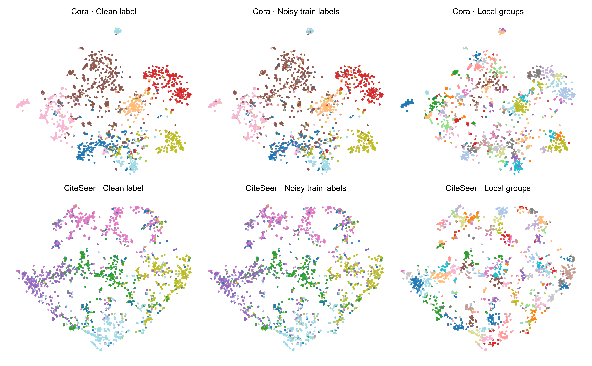
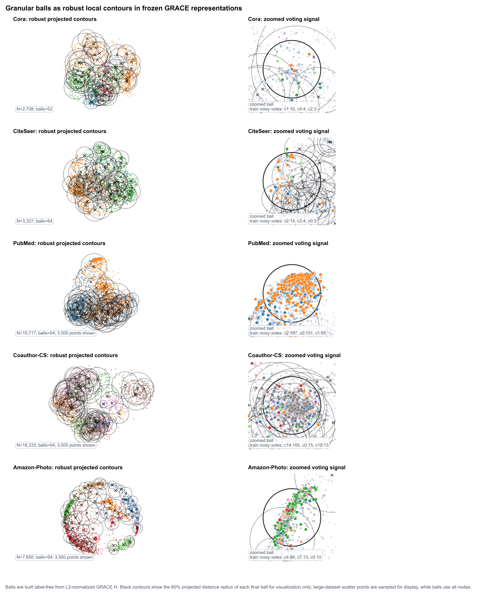
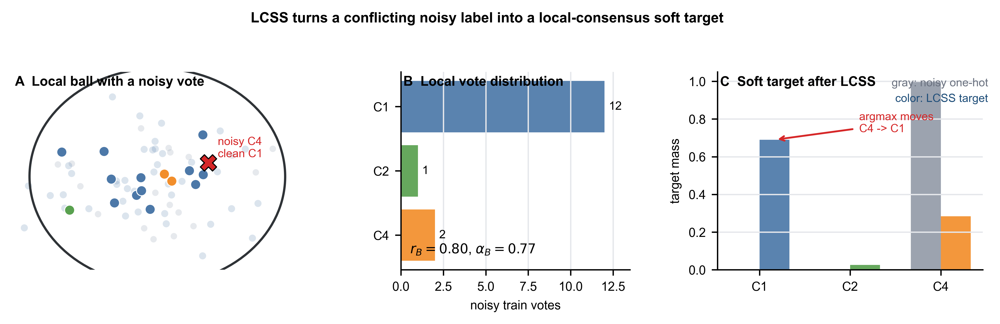
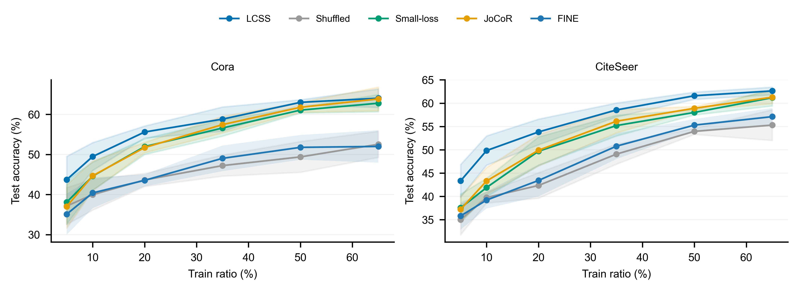
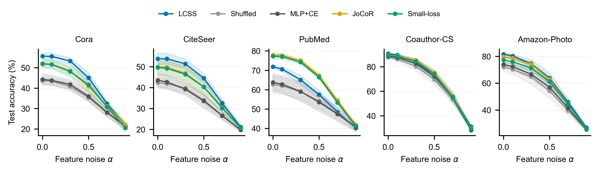

# 基于冻结对比表征局部共识软监督的标签噪声鲁棒无图推理节点分类

**Local-Consensus Soft Supervision on Frozen Contrastive Representations for Label-Noise-Robust Node Classification without Message Passing at Inference**

---

## Highlights

- 提出局部共识软监督方法 LCSS，在冻结图对比表征上以粒球式递归划分构造局部分组，将含噪训练标签转化为半硬软监督，最终训练仅依赖节点特征的轻量 MLP 分类器。
- 在 5 个核心数据集与 5 种噪声设置下，与 11 个同骨干的标签噪声学习策略相比，LCSS 在 4 个数据集的全部设置以及第 5 个数据集的 4/5 设置中取得最高精度。
- 随机化分组对照表明性能增益来自真实局部结构：打乱分组后 25 个核心实验设置的精度全部下降；PubMed 与 Amazon-Computers 作为边界数据集另行报告。
- 共识 teacher 蒸馏扩展使仅特征输入的学生网络在三个数据集上超过同协议 GCN 的绝对精度，弥合了无图推理的精度差距。
- 通过分组形式替代性、共识票数、学生容量与表征空间选择四组机制实验，系统刻画了方法的适用域与边界。

---

## 摘要

在许多图学习应用中，训练阶段可以访问完整的图结构，而部署阶段由于隐私合规、推理延迟或图数据与在线服务分离等原因，模型往往只能获得目标节点自身的特征；与此同时，训练标签常来自人工标注、众包或自动规则，标注错误难以避免。现有的图标签噪声方法在去噪与推理两个环节都依赖邻接矩阵，无法在上述无图推理场景下部署；而以 GNN-to-MLP 蒸馏为代表的无图推理方法以干净标签为前提，其鲁棒性研究集中于特征噪声、特征缺失与标签稀缺，训练标签噪声在这一文献方向中尚未被系统研究。针对这一空白，本文提出局部共识软监督方法 LCSS（Local-Consensus Soft Supervision）：首先以图对比学习在完整图上无监督地预训练节点表征并冻结；随后在冻结表征空间中以粒球式递归二分构造局部分组，各数据集共用同一套固定构造参数；每个分组内由含噪训练标签投票生成半硬软标签，错误标签在局部多数的稀释下得到修正；最后仅以节点特征训练两层 MLP，推理阶段不接触图结构与表征编码器。目标构造不使用任何干净标签，也不依赖模型自身预测，整个流程非迭代、单遍完成。在涵盖小型引文图、大规模多类引文图、合著图与共购图的 5 个核心数据集、5 种噪声设置上，与 11 个移植到同一 MLP 骨干的标签噪声学习策略对比，LCSS 在 Cora、CiteSeer、CoraFull 与 Amazon-Photo 的全部设置中精度最高，在 Coauthor-CS 的 4/5 设置中最高。将局部分组随机打乱后，25 个核心设置的增益全部消失，证明增益来自真实的局部结构；在 CiteSeerFull 与 Coauthor-Physics 两个额外数据集的标准 uniform 0.4 协议上，LCSS 与最强同骨干策略持平，同时相对随机化分组分别提高 13.14 与 4.21 个百分点。PubMed、Amazon-Computers 及其余候选数据集作为边界保留在适用域分析中。本文另给出一条可选的共识 teacher 蒸馏扩展，使仅特征输入的学生网络在多个数据集上达到 GNN-to-MLP 蒸馏方法的同一精度区间。消融实验同时表明：分组形式可由同一表征空间中的 kNN 或 kmeans 共识替代，方法的贡献在于"冻结对比表征、局部共识软监督与无图推理"三者的组合而非分组算法本身。

**关键词**：标签噪声；节点分类；无图推理；图对比学习；粒球计算；知识蒸馏

---

## 1 引言

图神经网络通过消息传递聚合邻域信息，已成为图节点分类的主流方法 [1,2]。然而在工业部署中，消息传递要求推理端取回目标节点的多跳邻居：在电商与社交平台的实时服务中，边表示用户交互、交易或社交关系，向推理端暴露这些边会触发隐私与合规问题；在延迟敏感的在线场景中，邻居抓取的开销随网络层数呈指数增长 [3]；此外，图结构本身也可能滞后于业务数据的更新。这些约束催生了"训练期利用图、推理期只用节点特征"的无图推理（graph-free inference）研究方向：GLNN [3] 以 GNN 为教师蒸馏纯 MLP 学生，其后的工作沿蒸馏信号设计 [6,7]、结构编码 [5] 与工程扩展 [29,30] 等方向持续推进，使 MLP 学生在干净标签下逼近甚至超过 GNN 教师的精度。

与此并行，真实图数据的训练标签往往并不干净。节点类别可能来自众包标注、启发式规则或自动抽取流程，近年也越来越多地由大模型批量生成，标注错误率不可忽视；而深度模型对错误标签的记忆效应 [8] 会直接损害泛化。图上标签噪声学习因此成为活跃方向：NRGNN [9] 通过边预测连接含噪节点与无标签节点，RTGNN [10] 采用双网络相互校验，DND-NET [11] 结合传播特征与邻居不确定性加权伪标签，RNCGLN [12] 则将图对比与标签自纠正联合训练。这些方法的共同点是去噪机制与推理过程都离不开邻接矩阵。

问题出现在两条研究线的交汇处。图标签噪声方法无法在无图推理约束下部署；而无图推理文献虽然常规性地讨论"鲁棒性"，但我们对该方向 13 篇代表工作的逐篇核验显示，其鲁棒性实验集中于测试特征的高斯扰动（NOSMOG [5]、PGKD [28]、VQGraph [6] 采用同一扰动协议）、特征缺失与标签稀缺（AdaGMLP [29]），或教师预测对特征扰动的稳定性（KRD [7]）；训练标签噪声从未被作为中心问题、按标签噪声学习的标准协议（多种噪声类型与噪声率、与标签噪声学习策略族的系统对比）加以研究。GSDN [14] 曾附带报告单一非对称噪声下与 GNN 系方法的对比曲线，但未与任何标签噪声学习策略比较。也就是说，"如何在无图推理约束下从含噪标签中训练一个可用的分类器"这一具有直接部署意义的问题，在两条文献线之间处于空置状态。

本文从一个通道层面的观察切入。结构信息注入 MLP 已有三条被充分探索的路径：输入侧，将传播特征或位置嵌入拼入模型输入（DND-NET [11]、NOSMOG [5]）；表征侧，令 MLP 编码器与图编码器对齐（SimMLP [15]）；预测侧，以教师蒸馏或自蒸馏传递软预测（GLNN [3]、GSDN [14]）。三条路径都把结构用于增强模型，而监督信号本身仍是可能含噪的原始标签、或由这些标签训练出的教师预测。本文选择第四条路径——监督侧：把结构转化为监督信号自身的去噪机制。具体而言，冻结的对比表征在几何上定义了局部邻域，邻域内含噪标签的集体投票构成软监督目标，错误标签在局部多数的稀释下得到修正。这一设计带来两个直接的性质：其一，目标构造只依赖表征几何与标签投票，不含模型自身预测，因而不存在自训练类方法"模型错误进入目标、目标又强化错误"的自增强回路；其二，表征由无监督对比学习获得，标签噪声无法污染分组几何。

在方法实现上，LCSS 由四个步骤组成：以 GRACE [16] 在完整图上无监督预训练节点表征并冻结；在行归一化的表征空间上以粒球计算 [34] 的递归二分方式构造大小自适应的局部分组，全部数据集共用同一套固定构造参数；每个分组内统计含噪训练标签的分布与多数类，以半硬混合（β=0.5）与置信度加权生成软标签；最后仅以原始节点特征训练两层 MLP。整个流程非迭代、单遍完成，学生网络约九万参数，推理与图规模无关。

本文的主要工作与贡献如下。（1）在问题层面，将训练标签噪声作为中心问题引入无图推理节点分类，并提出经由监督侧通道利用图结构的局部共识软监督方法；据我们所知，这是该设定下首个与标签噪声学习策略族进行系统对比的研究。（2）在实验层面，在 5 个核心数据集、5 种噪声设置上与 11 个移植到同一 MLP 骨干的标签噪声学习策略（涵盖 2018 至 2025 年的样本选择、鲁棒损失、正则化与混合策略）进行受控比较，LCSS 在四个数据集的全部设置与第五个数据集的多数设置中取得最高精度；随机化分组对照证明增益来自真实局部结构。另在 CiteSeerFull 与 Coauthor-Physics 上进行同协议广度检验，结果显示局部结构增益可扩展到更完整的引文图和 34k 节点合著图，但其分类精度与最强鲁棒策略相当而非稳定领先。（3）在扩展层面，将共识软标签迁移至教师侧构成蒸馏扩展，使仅特征输入的学生在 Cora、CiteSeer、Coauthor-CS 与 Amazon-Photo 上保持与强 GNN-to-MLP 蒸馏方法相当或更高的精度；CoraFull 的补充结果显示，复杂蒸馏架构与共识 teacher 在该大规模多类图上处于同一精度区间。（4）在分析层面，通过分组形式替代性、共识票数、学生容量与表征空间选择四组机制实验刻画方法的适用域：分组形式可由同空间 kNN/kmeans 共识替代，起作用的核心变量是共识单元内的有效票数；PubMed、Amazon-Computers 与新增筛选数据集共同说明，真实局部结构存在并不保证其增益超过强样本选择或鲁棒损失；只有冻结的无监督对比表征能够支撑有效的局部共识。

需要说明本文的比较范围。主实验比较的是 train-target 类抗噪策略，即所有方法仅使用含噪训练标签构造监督；利用无标签节点的蒸馏属于另一条资源轴，在第 6 节单独对照并展示两者的结合方式。本文协议为 transductive；子图上重训对比编码器的 inductive 扩展在实验中未能保持分组质量，作为局限在第 7 节讨论。

---

## 2 相关工作

### 2.1 通用标签噪声学习

面向含噪标签的深度学习已形成若干成熟的策略族。样本选择类方法基于"干净样本先被拟合"的记忆效应，以小损失准则筛选可信样本，代表性工作包括 Co-teaching [17]、JoCoR [18] 以及作为其共同基础的 small-loss 准则；鲁棒损失类方法设计对错误标签不敏感的目标函数，如对称交叉熵 SCE [19]、早期学习正则 ELR [20] 与主动负损失 ANL [21]；正则化类方法直接约束模型输出，LogitClip [22] 通过裁剪 logit 范数为交叉熵设置上界；混合类方法将噪声划分与半监督学习结合（DivideMix [23]），或引入特征谱过滤（FINE [24]）、置信度跟踪（CT [25]）。这些方法不依赖图结构，本文将其中 11 个的核心机制移植到统一的 X-only MLP 骨干作为主实验对照。值得注意的是，第 5.3 节的容量分析表明样本选择族的优势与学生模型的容量密切相关，这一交互在以往固定骨干的比较中较少被讨论。

### 2.2 图上标签噪声学习

将标签噪声学习引入图节点分类的工作大多以 GNN 为骨干。NRGNN [9] 通过边预测器将含噪标签节点与无标签节点连接以扩充可靠监督；RTGNN [10] 以双网络互校与自适应过滤抑制噪声传播；DND-NET [11] 将 PPR 传播特征输入简单分类器，并以邻居不确定性加权可靠伪标签；RNCGLN [12] 用图对比损失与自注意力联合建模，以预测置信度自纠正标签。这一族方法的去噪信号来自图邻域，推理也需要邻接矩阵，与本文的部署设定不同：DND-NET 虽然以"简单模型"为特点，但其分类器输入是多步传播特征，推理仍需图。本文在第 6 节（表 5）与附录 C 中报告了其中若干方法在相同协议下的参考数字，并标注部署设定差异；这些数字不参与配对比较。

### 2.3 GNN-to-MLP 蒸馏与无图推理节点分类

GLNN [3] 确立了以 GNN 教师蒸馏纯 MLP 学生的范式，此后该方向沿三条线索发展。第一是丰富蒸馏信号：FF-G2M [26] 将教师知识分解为低频与高频成分分别传递；VQGraph [6] 以向量量化学习局部结构码本再蒸馏软码分配；PGKD [28] 通过类原型对齐传递类间结构。第二是提升蒸馏可靠性：KRD [7] 以特征扰动下的熵不变性量化教师知识点的可靠度，上采样可靠监督。第三是工程扩展：AdaGMLP [29] 以 AdaBoost 式集成应对标签稀缺与测试特征缺失，ProGMLP [30] 提供精度—代价可调的渐进推理，SALE-MLP [31] 学习结构感知的潜在嵌入。理论方面，Wu 等 [32] 从神经正切核角度证明软标签蒸馏使 MLP 学生的核与邻接矩阵对齐并偏好低频平滑特征，为"软监督能够向纯特征学生传递结构偏置"提供了依据；本文的共识软标签来自表征局部共识而非 GNN 教师输出，该理论构成类比性支撑。

如引言所述，这一族工作的鲁棒性研究不涉及训练标签噪声。与本文机制最接近的是 PGKD 的类原型：两者都利用表征空间中的聚合统计抵抗离群点，但 PGKD 的原型是按标签分组的全局类均值，标签含噪时类中心被直接污染，而本文的局部共识不依赖标签的正确性。就教师端监督的处理而言，已有工作可以概括为上采样可靠监督（KRD）与下采样不可靠监督（RKD-MLP [33]）两类，本文的共识软标签提供了第三种选择：修复被污染的监督。此外需要指出，NOSMOG [5] 推理需要 DeepWalk 位置嵌入，SA-MLP [27] 推理需要邻接行输入，二者并非严格意义上的仅特征推理；GSDN [14] 以邻域自蒸馏实现无图推理并附带单一非对称噪声评测，但其标签层自蒸馏会将含噪训练标签扩散给邻居监督，第 5.2 节的实验证实了该机制在高噪声下的退化。

### 2.4 粒球计算

粒球计算以自适应多粒度划分为核心思想 [34]，在分类、聚类与标签噪声过滤中形成了系列工作：GBkNN [34] 以最近粒球代替 k 个最近样本，实现近线性复杂度且无需选择 k；MgCNL [35] 与 MgBIF [36] 在故障诊断场景中以多粒度球分离含噪样本；相关工作还包括面向不平衡与过采样的粒球方法 [37]。已发表的成功应用多为端到端训练，球结构参与表征塑造。本文的用法与之不同：在冻结表征上做一次性离线聚合，球结构不参与梯度回传。消融实验（第 5.3 节）表明，在这一角色下球式聚合与同表征空间的 kNN、kmeans 共识精度相当，方法的贡献在于问题设定与配方组合而非新的球生成算法；球式实现的工程优点是构造过程近线性、无需邻域尺度扫描，这与粒球计算的效率动机一致 [34]。

---

## 3 方法

### 3.1 问题设定

给定图 G=(V, E)，节点特征矩阵 X∈R^{N×d}，其中 N 为节点数、d 为特征维数。训练子集 V_L 的标签以噪声率 ρ 被污染，记含噪标签为 Ỹ_L；污染过程服从 uniform、pair 或 instance-dependent 三种噪声模型之一。验证与测试标签保持干净，仅用于模型选择与评测。学习目标是训练分类器 f_θ，使其在干净测试集上的精度最大化，同时满足部署约束：推理时 f_θ 只接受节点自身特征 x_v 作为输入，不使用邻接矩阵，也不使用任何由图派生的嵌入。训练阶段允许访问完整图，这是无图推理文献的标准资源约定 [3,6,14]。

### 3.2 LCSS 方法

LCSS 包含四个步骤，整体流程见算法 1。

**步骤一：冻结对比表征。** 采用 GRACE [16] 在 (X, A) 上无监督预训练：通过边丢弃与特征掩码构造两个增广视图，以 InfoNCE 目标最大化同一节点跨视图表征的一致性，得到节点表征 H∈R^{N×256} 后冻结。预训练使用完整图的邻接与全部节点特征，但不接触任何标签，因此标签噪声无法影响表征几何；无图约束仅施加于推理端。选择无监督对比目标并非出于便利：第 5.4 节的实验表明，将含噪监督信号以任何形式混入表征学习——多任务联合训练、噪声标签微调、或改用训练后网络的隐层——都会破坏表征的局部可聚类性，使后续分组从数十个塌缩为单个；监督表征的线性可分性与局部可聚类性是两种不同的性质，而 GRACE 的对齐—均匀性平衡恰好保持了后者。

**步骤二：局部共识分组。** 对行 L2 归一化后的表征 Ḣ 执行递归二分：将全体节点视为初始粒球，每次选取平均中心距离最大的候选球，以 2-means 尝试划分；若划分使加权平均中心距离的改善超过阈值 δ 且两个子球的规模均不小于下限 n_min，则接受划分，否则该球停止分裂。过程持续至没有可分裂的球或球数达到上限 B_max。全部数据集共用同一套固定参数（B_max=64，n_min=32，δ=0.05），未针对任何数据集调整。由于分裂由数据几何自行终止，实际产生的分组数在 22 至 133 之间随数据集变化，规模上限在多数数据集上并未触发。该构造源自粒球计算的递归划分思想 [34]，单步 2-means 收敛迅速，整体复杂度接近线性。我们不主张这一分组形式不可替代——第 5.3 节的消融显示 kNN 与 kmeans 共识可以达到相当的精度——其工程价值在于无需按数据集扫描邻域尺度参数。

**步骤三：半硬共识软标签。** 对每个分组 B_j，统计其中训练节点的含噪标签分布 p_j 与多数类 m_j，构造组级目标

　　q_j = (1−β)·p_j + β·onehot(m_j)，　β = 0.5。

每个训练节点 v 的最终软标签由原始含噪标签与组级目标按置信度混合：

　　ỹ_v = (1−α_j)·onehot(Ỹ_v) + α_j·q_j，

其中融合权重由组内投票裕度经随机基线修正给出：α_j = max(0, (r_j − 1/C)/(1 − 1/C))，r_j 为组内多数类票占比，C 为类别数。组内多数越显著，共识目标的权重越大；当投票不优于随机（r_j ≤ 1/C）或组内训练节点不足时，软标签退回原始含噪 one-hot，不做修正。这一构造背后的直觉是：由于分组建立在与标签无关的表征几何上，错误标签在其所在分组内通常处于少数地位，集体投票能够稀释个体错误。β=0.5 的半硬化在保留分布信息与强化多数信号之间折中，是初始探索后冻结的保守默认值——它是唯一在全部试点设置中不劣于纯软目标（β=0）的取值，其有效性随后在两个新增数据集与 pair、instance 噪声上得到样本外确认（选择过程的完整审计见附录 D.2）。需要强调，目标构造全程只使用训练子集的含噪标签，不接触验证与测试标签，也不使用模型预测——后者使 LCSS 与自训练类方法在机制上分离：不存在模型错误进入目标再强化自身的回路。

**步骤四：仅特征学生。** 以软交叉熵在 {(x_v, ỹ_v)} 上训练两层 MLP（隐层宽度 64，约 9 万参数）。推理即普通前向传播，不涉及邻接、表征编码器或分组结构。

### 3.3 复杂度分析

分组构造为递归 2-means，时间复杂度约 O(N·d·log B_max)，接近线性 [34]；软标签构造为 O(N·C)。学生网络单节点推理开销为 O(d·F + F·C)（F 为隐层宽度），与图规模和边数无关。作为对照，作为精确基线的 kNN 目标构造需要训练节点间的两两近邻搜索，朴素实现为 O(|V_L|²·d)，且需要选择邻域尺度 k。GRACE 预训练是一次性成本：同一表征在全部噪声类型与噪声率之间复用，因为表征学习不接触标签、对噪声的构造性免疫。

### 3.4 扩展：共识 teacher 蒸馏

仅使用训练节点监督的 LCSS 受监督覆盖的限制：20% 的训练节点无法为其余 80% 的节点提供直接监督，绝对精度与 GCN 存在差距。当部署需要更高绝对精度且训练期预算允许时，可将同款共识软标签用于训练一个以 [X‖H] 为输入的 GCN 教师，再将教师对全部节点的软预测蒸馏给同一个仅特征学生。该扩展保持推理端不变，第 6 节的实验表明它能使学生超过同协议 GCN 的绝对精度。

**算法 1** LCSS：粒球式局部共识软标签生成与 MLP 训练

```
输入: 图 G=(V,E,X)；含噪训练标签 Ỹ_L；训练掩码 M_train；类别数 C；
      构造参数 B_max, n_min, δ；混合系数 β
输出: 仅特征分类器 f_θ；软标签矩阵 Ỹ

 1: 以 GRACE 在 G 上无监督预训练，得到冻结表征 H；行 L2 归一化得 Ḣ
 2: 初始化粒球集合 𝓑 ← {全体节点}
 3: while |𝓑| < B_max 且存在可分裂球 do
 4:     取平均中心距离最大的球 GB_i；若 |GB_i| < 2·n_min 则标记不可分裂并 continue
 5:     以 2-means 将 GB_i 划分为 GB_i1, GB_i2
 6:     if min(|GB_i1|,|GB_i2|) ≥ n_min 且加权平均中心距离改善 > δ then
 7:         𝓑 ← 𝓑 ∪ {GB_i1, GB_i2} \ {GB_i}
 8:     else 标记 GB_i 不可分裂
 9: end while
10: 初始化 Ỹ_v ← onehot(Ỹ_v^noisy)（全部训练节点）
11: for GB_j ∈ 𝓑 do
12:     T_j ← GB_j ∩ M_train；若 |T_j| 过小则跳过（保留原始标签）
13:     p_j ← T_j 内含噪标签分布；m_j ← argmax p_j；r_j ← max p_j
14:     α_j ← max(0, (r_j − 1/C)/(1 − 1/C))
15:     q_j ← (1−β)·p_j + β·onehot(m_j)
16:     for v ∈ T_j: Ỹ_v ← (1−α_j)·onehot(Ỹ_v^noisy) + α_j·q_j
17: end for
18: 以软交叉熵在 {(X_v, Ỹ_v)} 上训练两层 MLP f_θ
19: return f_θ, Ỹ
```

第 1—9 行只使用表征几何，不接触标签；第 10—17 行只使用训练节点的含噪标签；第 18 行训练的学生在推理时只接收原始特征 X。

---

## 4 实验设置

**数据集。** 核心实验覆盖三类图共 5 个数据集：引文网络 Cora（2708 节点，7 类）、CiteSeer（3327 节点，6 类）与 CoraFull（19793 节点，70 类）[38]，合著网络 Coauthor-CS（18333 节点，15 类）[39]，以及共购网络 Amazon-Photo（7650 节点，8 类）[39]。所有数据集按 20%/10%/70% 划分训练、验证与测试集。为检查数据集广度，我们另在 CiteSeerFull（4230 节点，6 类）与 Coauthor-Physics（34493 节点，5 类）上完成 uniform 0.4 下的 13 方法、5 种子对照；二者用于标准设置广度检验，不计入 5 数据集×5 噪声设置的核心全谱 claim。PubMed（19717 节点，3 类）与 Amazon-Computers（13752 节点，10 类）保留为既有适用域边界数据集：前者揭示弱 MLP 学生下样本选择策略的容量优势，后者显示真实局部分组有效但会被强 baseline 吸收。

**噪声协议。** 噪声仅注入训练标签：uniform 噪声以概率 ρ∈{0.2, 0.4, 0.6} 将标签均匀翻转至其余类别；pair 噪声（ρ=0.4）将标签翻转至预定的相邻类别；instance-dependent 噪声（ρ=0.4）依据样本特征决定翻转概率。验证与测试标签保持干净，验证集用于所有方法的模型选择，这一协议与 NoisyGL 基准 [13] 一致。

**对比方法。** 全部方法共用同一个两层 MLP 骨干（隐层 64、dropout 0.5、学习率与权重衰减一致），唯一差异为抗噪策略：交叉熵基线 CE、Co-teaching [17]、small-loss、SCE [19]、ELR [20]、JoCoR [18]、DivideMix-lite [23]、FINE [24]、LogitClip [22]、ANL [21] 与 CT [25]。其中 DivideMix-lite、FINE、CT、LogitClip 与 ANL 为核心机制的移植实现（表中标注 adapted）：这些方法原生于图像分类，我们保留其抗噪机制、去除依赖图像增广的组件，使其可在节点特征上运行。这类适配的公平性在于机制层面的受控比较——所有方法面对相同的骨干、划分、噪声与随机种子——而非对原论文官方实现的复现声明。此外设置随机化对照（shuffled）：保持 LCSS 全流程不变，仅将分组归属随机打乱，用于检验增益是否来自真实的局部结构。

**报告口径。** 全部结果为 5 个随机种子的均值与标准差；配对比较附逐种子方向计数与配对 t 检验（n=5，附录 B 同时给出 Wilcoxon 符号秩检验，其在五个配对样本下的 p 值下限为 0.0625）；差异小于一倍标准差的结果表述为相当。实验在单卡 AMD RX 7700 XT（ROCm）上完成。

---

## 5 实验结果与分析

### 5.1 与标签噪声学习策略的比较

表 1 给出 uniform 0.4 下的代表性结果，五个数据集、五种噪声设置与全部 13 个方法的完整结果见附录 A（表 A.1–A.5）。

**表 1** uniform 0.4 噪声下的测试精度（%，5 种子均值±标准差）。完整结果见附录 A。

| 数据集 | 最强对照方法 | LCSS | 随机化分组对照 |
|---|---:|---:|---:|
| Cora | Small-loss 51.95±1.97 | **55.59±1.50** | 43.63±1.62 |
| CiteSeer | JoCoR 49.91±3.37 | **53.83±2.75** | 42.35±2.74 |
| CoraFull | JoCoR 35.70±0.32 | **37.33±0.81** | 32.27±0.81 |
| Coauthor-CS | JoCoR 89.38±0.61 | **90.62±0.57** | 87.60±1.03 |
| Amazon-Photo | JoCoR 79.57±0.53 | **81.64±0.93** | 72.06±2.97 |

从完整结果看，LCSS 在 Cora、CiteSeer、CoraFull 与 Amazon-Photo 的全部 20 个数据集×噪声组合中均达到最高或并列最高精度；其中 CoraFull 在 uniform 0.4、uniform 0.6、pair 0.4 与 instance 0.4 下分别领先最强对照 1.63、2.70、2.96 与 1.91 个百分点，uniform 0.2 下仅领先 0.17 个百分点，属于边际正向。在 Coauthor-CS 上，LCSS 在 4/5 设置最高，唯一例外 uniform 0.2 与最强对照相差 0.25 个百分点、小于一倍标准差，属于相当。PubMed 与 Amazon-Computers 不进入核心主表，而作为适用域边界保留：PubMed 上样本选择族在弱 MLP 学生下占优；Amazon-Computers 上真实分组稳定优于随机分组，但被 JoCoR 等强 baseline 吸收。5.3 节将说明，PubMed 边界并非任意失败，而是学生容量与策略族的交互现象。

随机化分组对照提供了增益来源的最直接证据。保持全流程不变、仅打乱分组归属后，核心主表的 25 个数据集×噪声组合均出现下降；CoraFull 五个设置的真实分组优势为 2.67 至 5.97 个百分点。值得注意的是，即便在不进入核心主表的 PubMed 与 Amazon-Computers 上，真实分组相对随机分组也保持稳定优势。这说明软标签的增益来自表征空间中真实的局部结构，而非软化目标带来的一般性正则效应。

从噪声类型看，LCSS 的优势在结构化噪声下更为明显：pair 0.4 与 instance 0.4 下相对最强对照的领先幅度普遍大于 uniform 同噪声率的情形（如 CoraFull 上 pair 0.4 领先 2.96 个百分点、instance 0.4 领先 1.91 个百分点；Amazon-Photo 上 pair 0.4 领先 3.6 个百分点、instance 0.4 领先 4.8 个百分点）。一个合理的解释是，样本选择依赖的损失分离信号在结构化噪声下更加模糊——错误标签集中于相似类别，损失分布的双峰性减弱——而几何共识不依赖损失信号，受噪声结构的影响较小。

**表 2** 新增数据集广度检验（uniform 0.4，测试精度 %，5 种子均值±标准差）。最强对照从 11 个同骨干标签噪声策略中按均值选取；该表用于检验可迁移性，不扩大核心全谱胜出 claim。

| 数据集 | LCSS | 最强对照 | 随机化分组 | LCSS−最强对照 | LCSS−随机化分组 |
|---|---:|---:|---:|---:|---:|
| CiteSeerFull | 59.40±1.73 | JoCoR 59.48±1.60 | 46.25±3.18 | −0.08 | +13.14 |
| Coauthor-Physics | **93.11±0.25** | JoCoR 93.09±0.28 | 88.90±2.05 | +0.02 | +4.21 |

两个新增数据集给出了比单纯“再加一列”更有信息量的结果。CiteSeerFull 上 LCSS 与 JoCoR 的均值差仅 0.08 个百分点，Coauthor-Physics 上 LCSS 数值第一但只领先 0.02 个百分点，二者都应解释为相当而非稳定超越；与此同时，真实分组相对 shuffled 在 10/10 paired seeds 上均为正，说明局部结构贡献可以扩展到更完整的引文图与 34k 节点合著图。进一步的噪声率筛选揭示了边界：CiteSeerFull 在 uniform 0.2 下领先最强对照 2.28 个百分点，但在 uniform 0.6 下落后 JoCoR 4.71 个百分点；Coauthor-Physics 在 uniform 0.2/0.6 下分别落后最强对照 0.69/2.29 个百分点。因此两者进入广度与适用域表，而不加入“5 个核心数据集×5 种噪声设置”的全谱胜出统计。Cora_ML 与 Attributed-Wiki 的完整 uniform 0.4 筛选结果保留在附录 A：前者与最强对照持平但跨种子不稳定，后者落后 LogitClip 2.41 个百分点。

### 5.2 与无图推理方法族的比较

主实验回答"相同监督资源下哪种抗噪策略更好"；表 3 回答另一个问题："与无图推理方法族相比，LCSS 处于什么位置"。我们将 Graph-MLP [4] 与 GSDN [14] 移植到相同噪声协议（保留原文默认超参，标注 adapted），并进一步补入三类更强的 GNN-to-MLP 蒸馏基线：FF-G2M [26] 的低/高频蒸馏、KRD [7] 的可靠教师知识采样，以及 VQGraph [6] 的结构 tokenizer/codebook 蒸馏。后三者均为 adapted core implementation：训练和评测完全遵循本文的 train-only label noise、percent split 与 X-only 推理协议，但不声称逐行复现官方代码。

**表 3** 无图推理方法族比较（uniform 0.4，测试精度 %，5 种子均值±标准差；全部方法推理仅使用节点特征）。FF-G2M、KRD 与 VQGraph 为同协议 adapted core implementation，不声称官方 tuned 复现。完整表与 uniform 0.6 结果见附录 I。

| 方法 | 训练资源 | Cora | CiteSeer | CoraFull | Coauthor-CS | Amazon-Photo |
|---|---|---:|---:|---:|---:|---:|
| MLP+CE | 含噪标签 | 44.24±2.62 | 43.50±3.02 | 31.98±0.98 | 88.42±0.62 | 73.90±1.80 |
| Graph-MLP (adapted) | +全图边集对比 | 63.23±3.07 | 57.23±1.85 | 37.05±0.91 | 88.95±0.43 | 77.05±1.24 |
| GSDN (adapted) | +邻域自蒸馏 | 55.97±4.29 | 50.36±3.39 | 35.80±0.66 | 86.55±0.78 | 73.31±2.00 |
| LCSS | +图（经冻结表征） | 55.59±1.50 | 53.83±2.75 | 37.33±0.81 | 90.62±0.57 | 81.64±0.93 |
| GLNN 式蒸馏 | +GNN 教师+无标签节点 | 77.95±2.62 | 66.09±1.38 | **58.74±0.82** | 93.20±0.09 | 89.86±0.77 |
| FF-G2M (adapted) | +GNN 教师+频域蒸馏 | 78.73±2.62 | 66.17±1.30 | 58.54±1.00 | 93.12±0.24 | 90.01±1.14 |
| KRD (adapted) | +GNN 教师+可靠知识采样 | 71.77±2.20 | 64.96±1.03 | 47.12±0.95 | 91.39±0.49 | 85.17±0.94 |
| VQGraph (adapted) | +GNN 教师+结构码本蒸馏 | 78.89±2.34 | 65.64±1.72 | 58.52±0.77 | 93.25±0.09 | **90.54±0.85** |
| LCSS 蒸馏扩展（球式共识教师） | +球式去噪共识教师+无标签节点 | **80.60±0.69** | **69.40±1.08** | 58.22±0.69 | **93.75±0.22** | 90.49±1.05 |

注：CoraFull 的 train-only、Graph-MLP/GSDN 与蒸馏家族结果均为本轮新增的同协议 5 种子结果；所有方法使用 percent 0.2/0.1/0.7 划分，且 uniform 0.4 噪声仅注入训练节点。

四个观察值得展开。第一，Graph-MLP 在 Cora 与 CiteSeer 上高于仅用训练标签的 LCSS。这源于资源差异而非机制优劣：Graph-MLP 的邻域对比损失利用了全部节点与全部边，相当于在训练中注入了整图的结构正则，而 LCSS 的监督只来自 20% 训练节点的含噪标签；在同质性强的小型引文图上，这种全图正则的收益尤其明显。第二，资源天平在 CoraFull、Coauthor-CS 与 Amazon-Photo 上反转或持平：CoraFull 上 LCSS 与 Graph-MLP 基本相当（37.33 对 37.05），Coauthor-CS 与 Amazon-Photo 上分别领先 1.7 与 4.6 个百分点。第三，FF-G2M、KRD 与 VQGraph 的加入显著抬高了无图推理家族的强度：三者在五个数据集上均明显高于 Graph-MLP/GSDN，也远高于 train-only LCSS，说明 clean-label GNN-to-MLP 蒸馏技术在含噪协议下仍能传递强结构知识。第四，当训练资源对齐到"图加无标签节点"的级别时，LCSS 蒸馏扩展在 Cora、CiteSeer 与 Coauthor-CS 上达到最高，在 Amazon-Photo 上与 VQGraph 相当（90.49 对 90.54），在 CoraFull 上与 GLNN/FF-G2M/VQGraph 处于同一精度区间但略低（58.22 对 58.74/58.54/58.52）。这说明本文贡献与蒸馏架构改进并不冲突：关键差异在于 teacher 目标是否经过标签去噪；先进蒸馏方法传递的是由含噪监督训练出的教师知识，而 LCSS 蒸馏先用冻结表征空间中的局部共识修复监督，再将去噪后的软目标交给 X-only 学生。kNN 共识教师作为同一表征空间中的替代实现，在已完成教师消融的三个数据集上略高 0.39/0.17/0.22 个百分点，本文将其放入消融而非主方法行，以保持 LCSS 的球式实现口径。

### 5.3 消融与机制分析

**分组形式的可替代性与共识票数。** 将球式分组换成同一表征空间中的 kNN（k=20）或 kmeans（簇数与分组数匹配），学生精度相当，kNN 在 uniform 0.4 下甚至略高 0.3 至 2.6 个百分点。进一步的实验定位了起作用的核心变量：每个共识单元内的有效票数。默认构造下每组平均含约 10 个训练节点；将最小组规模从 32 提高到 64 使每组票数升至约 24 后，球式分组与最优 kNN 的差距基本闭合（CiteSeer 从落后 2.58 收窄到 0.77 个百分点，PubMed 持平），且值得注意的是，更大的分组虽然标签纯度更低（0.477 对 0.505），精度反而更高——约 20 票的可靠多数比 10 票的高纯度更有价值。这一票数机制与 kNN 侧的观察相互印证：kNN 的最优 k 在四个测试数据集上均为 20，k=5 时因票数不足而全面弱于球式分组（Cora 53.93 对 55.59），干净验证集扫描几乎无损地找到最优 k。基于这些结果，我们不将"无需选择 k"作为精度优势，而将其定位为工程便利：球式构造以近线性代价、在不做任何邻域尺度扫描的前提下达到各数据集最优 kNN 一个百分点以内的精度（CiteSeer 除外），构造参数在合理范围内表现为约正负一个百分点的平台，仅分裂阈值过大（δ=0.1）会导致分组塌缩（附录 D.1）。

**三种表征空间的对照。** 同一套 β=0.5 共识公式作用于三种空间的结果差异显著：在原始特征空间上，递归二分退化为单一分组，方法失效；在原图邻接空间上，以含噪标签沿边两步传播的分布作为组级目标，被表征空间共识稳定压制 6.9 至 8.3 个百分点（三个数据集全部 5/5 种子）——原图传播直接扩散噪声标签，与 GSDN 的机制缺陷同源；只有冻结对比表征空间支撑了有效的共识。作为补充，用含噪监督训练的普通 GCN 隐层替代 GRACE 构造分组：结构信号存在（6/6 设置优于随机分组），但仅 1/6 设置以超过 0.5 个百分点的幅度优于 GRACE，不足以替代无监督对比表征。

**学生容量与 PubMed 边界的重新定性。** 将全部方法的学生换成线性分类器后出现了一个信息量很大的反转。LCSS 的线性版本在五个数据集上均值优于线性 CE 与线性随机分组对照（PubMed 上相对线性 CE 为弱正，+0.68 个百分点、4/5 种子，其余数据集差距明确），说明共识监督的增益不依赖 MLP 的非线性容量；而样本选择族在线性学生下大幅退化——PubMed 上线性 Small-loss 为 69.60（其 MLP 版本为 81.88），线性 DivideMix-lite 为 66.32（MLP 版本 78.28）——LCSS 线性版本在 PubMed 全部五个设置反超最强线性选择方法 7.4 至 14.3 个百分点。机制解释是：样本选择依赖"干净样本先被拟合"产生的损失分离信号，而该信号本身是模型记忆噪声的副产品；线性学生几乎不记忆噪声，信号随之消失，选择既无必要也无依据。共识监督不使用损失信号，因而与容量无关。据此，PubMed 边界应理解为容量与策略族的交互现象：弱 MLP 下选择族占优（边界表如实保留该结果），线性学生下关系反转。两点限定需要说明：线性选择族为本文的移植实现，其退化幅度可能部分源于移植；低噪声下线性 CE 本身已相当强。

**表征直接分类的上界。** 在冻结表征 H 上直接训练分类头远强于一切仅特征方法：线性头达到 78.61/68.87/83.87（Cora/CiteSeer/PubMed，uniform 0.4），MLP 头达到 73.09/68.69/84.05——超过 LCSS 12 至 23 个百分点。这条路线的代价是推理必须携带 GRACE 编码器并访问图，与本文的部署约束不符；而第 6 节的蒸馏扩展使仅特征学生达到甚至略超这一上界（80.60 对 78.61 等），表明无图部署不必付出精度代价。一个相关的现象是，将 H 直接拼接进弱 MLP 的输入（[X‖H]+CE）在小图上反而崩溃（Cora 48.54，低于 LCSS 约 7 个百分点）：表征的价值需要经由监督侧转化或配合鲁棒策略，含噪监督下的裸拼接会被噪声记忆吞噬——这本身构成监督侧通道的又一论据。

**低标签率。** 训练标签比例从 65% 降至 5% 的六点曲线（附录 H）显示，LCSS 相对最强选择方法的优势从 0.2 至 1.4 个百分点总体扩大到 5.6 至 6.7 个百分点：标签越稀缺，单个错误标签的破坏力越大，局部共识的修复价值越高。

**干净标签下的表现。** 在已测的旧五数据集上，零噪声下 LCSS 相对 CE 的差异为：Cora +0.44、CiteSeer +2.33、PubMed +0.02、Coauthor-CS −0.88、Amazon-Photo −1.20 个百分点。在特征强可分且标签完全干净的条件下，半硬共识可能带来约一个百分点的代价，本方法面向标签含噪的场景。CoraFull 的零噪声补点尚未进入本版主文。

**测试特征噪声。** 按无图推理文献的标准协议对测试特征施加高斯扰动（附录 E），LCSS 的相对优势在 Cora、CiteSeer 与 Amazon-Photo 上保持到最高扰动水平，但其绝对退化在小图上比 CE 更陡（Cora 全程降幅 34.0 对 22.8 个百分点）：共识目标加深了模型对特征所承载结构的依赖，这是机制的自然代价。LCSS 不是特征噪声的防御机制，对特征质量的依赖是所有仅特征方法的共同边界。

### 5.4 为什么必须是冻结的无监督对比表征

四组独立实验对这一设计选择给出一致的回答。将含噪交叉熵以 0.1 的权重混入 GRACE 预训练，分组从 52 个塌缩为 1 个（真实类纯度从 0.79 降至 0.30，下游精度下降 12.6 个百分点）；以训练后 MLP 的隐层重新构造分组，出现同样的塌缩；部分线性探针精度更高的自监督表征（如 CCA-SSG 与 GraphMAE，其 512 维嵌入几何不适配递归二分）同样塌缩为单组；含噪监督 GCN 的隐层保有部分局部结构但不稳定（见 5.3 节）。这些结果共同说明，线性可分性与局部可聚类性是表征的两种不同性质：监督信号（即使是轻微的）会将同类样本压向类中心方向、抹平类内的局部簇结构，而 GRACE 的 InfoNCE 目标在对齐与均匀性之间的平衡恰好保留了递归二分所需的局部几何。附录 G 的可视化直观展示了这一几何：真实类别在表征空间中呈清晰的簇结构，噪声标签在各簇内是分散的少数派，局部分组与类簇大体对齐——这正是共识投票能够稀释错误标签的几何前提。

---

## 6 扩展：以共识教师蒸馏弥合精度差距

仅用训练节点监督的 LCSS 在绝对精度上与 GCN 存在约 20 个百分点的差距。这是监督覆盖的机制性差距而非可通过标签数量弥合的差距：将训练标签比例提高到 65%，Cora uniform 0.4 下的精度仅从 43.7 升至 64.0，仍低于使用 20% 标签的 GCN 约 14 个百分点——因为随标签同比例增加的还有噪声，而仅特征模型无法获得结构信息。无图推理文献的标准答案是蒸馏 [3]：教师把全部节点（含 80% 无标签节点）的软预测传给学生，结构信息经由预测传递。本文的扩展将共识软标签移至教师侧，全部构件与第 3 节共用、不引入任何新资源。

具体流程分两步。第一步训练教师：教师为两层 GCN，其输入为原始特征与行归一化冻结表征的拼接 x̃_v = [x_v ‖ h̄_v]——此处的 H 即第 3 节用于构造局部分组的同一份冻结表征；训练目标为共识软标签上的软交叉熵，仅在训练节点上计算：

L_T = −(1/|V_L|) Σ_{v∈V_L} ỹ_vᵀ · log softmax(g_φ(x̃_v; A))，

其中 g_φ 为教师网络，ỹ_v 为第 3 节生成的共识软标签；教师以留出的干净验证集精度选择检查点。第二步蒸馏学生：教师对全部 N 个节点（含无标签节点）输出软预测 p_v = softmax(g_φ(x̃_v; A)/τ)，学生以蒸馏损失

L_S = −(1/N) Σ_{v∈V} p_vᵀ · log softmax(f_θ(x_v)/τ)

在全部节点上训练，温度 τ=1，学生结构、早停协议与第 3 节完全一致，推理端不变。需要说明的一处适配是：学生损失不含 GLNN 原版的真标签交叉熵项——在标签噪声下该项会把错误标签直接灌入学生；为保证公平，表中的 GLNN 式基线采用同一适配（该适配对基线有利，帮助其抵挡噪声）。

**表 4** 共识教师蒸馏（测试精度 %，5 种子均值±标准差）。学生均为同一仅特征 MLP，仅教师不同。完整五臂表与增益分解见附录 I。

| 教师 | Cora u0.4 | CiteSeer u0.4 | CoraFull u0.4 | Cora u0.6 | CiteSeer u0.6 | CoraFull u0.6 |
|---|---:|---:|---:|---:|---:|---:|
| GCN(X)+CE（GLNN 式） | 77.95±2.62 | 66.09±1.38 | 58.74±0.82 | 65.50±3.28 | 53.30±4.42 | 51.63±2.02 |
| GCN[X‖H]+CE | 80.23±1.57 | 68.81±1.12 | **59.45±0.63** | 69.44±2.18 | 61.04±3.08 | **52.75±0.88** |
| 随机分组共识教师 | 78.81±1.63 | 68.60±1.14 | 58.98±0.41 | 68.51±1.82 | 61.07±2.76 | 52.20±0.72 |
| kNN 共识教师 | **80.99±1.02** | **69.57±1.46** | 58.95±0.56 | 71.07±2.29 | 61.96±2.98 | 52.73±0.95 |
| 球式共识教师（本文） | 80.60±0.69 | 69.40±1.08 | 58.22±0.69 | **71.27±2.46** | **62.28±2.30** | 51.82±0.86 |

球式共识教师学生在 Cora 与 CiteSeer 上达到 80.60 与 69.40（uniform 0.4），超过同协议 GCN(X) 教师自身的精度；kNN 共识教师作为替代分组实现给出相近且略高的 80.99/69.57。uniform 0.6 下，球式共识教师相对 GLNN 式蒸馏的领先扩大到 5.8 与 9.0 个百分点，说明在这两个小型引文图上，高噪声确实放大了共识去噪 teacher 的价值。CoraFull 给出了不同的边界图景：球式共识教师在 uniform 0.4 与 0.6 下分别为 58.22 与 51.82，低于 GCN[X‖H]+CE、kNN 共识教师和随机分组教师；因此，CoraFull 不能作为"球式 teacher 去噪归因成立"的证据，只能说明蒸馏扩展将仅特征学生带入强 graph-free 蒸馏方法的同一精度区间。

增益的来源可以通过教师臂之间的配对比较分解为三层。第一层，教师输入端的表征拼接通常是主要来源：在 Cora/CiteSeer/CoraFull 上，GCN[X‖H] 教师相对 GCN(X) 教师大多带来正增益，尤其在 CoraFull 上它成为最强教师。第二层，共识去噪目标是否带来额外增益取决于数据集：Cora 与 CiteSeer 上，高噪声下球式共识相对 GCN[X‖H]+CE 进一步提高；CoraFull 上则相反，共识目标低于直接 CE teacher，说明该数据集的蒸馏收益主要来自 H 输入与教师覆盖，而不是球式标签修正。第三层，球式与 kNN 式共识教师在小图上效果相当，CoraFull 上 kNN 明显高于球式，进一步支持 5.3 节的结论：分组形式不是不可替代的贡献，真正关键的是冻结表征空间能否产生合适尺度的局部共识。结构一致性度量（cut value，附录 F）从另一个角度支持这一图景：蒸馏学生的预测—拓扑一致性显著高于仅用训练标签的学生（提升 0.14 至 0.25，全部 5/5 种子），与软标签蒸馏向纯特征学生传递结构偏置的理论刻画 [32] 相符。

**与图领域专用方法的跨部署参照。** 前述比较均在"推理仅特征"的部署约束内进行；表 5 回答一个约束之外的问题：若允许训练与推理都使用图，图领域专用的标签噪声方法能达到什么水平，蒸馏学生在不使用图推理时又处于什么位置。表中的图依赖方法涵盖边扩充（NRGNN [9]）、双网络互校（RTGNN [10]）、课程学习（CLNode）、对比正则（CRGNN）以及近期图标签噪声方法（TFR、ProCon、GD2）等主要机制族；它们的去噪与推理均依赖邻接矩阵，与本文部署约束不同，因此不进入主表的配对比较，仅作同协议参照。对照在 uniform 0.4 代表性设置下进行，全部图依赖行在与主表相同的划分、噪声与种子下运行，并通过噪声范围审计（验证与测试标签零污染，附录 C）。

**表 5** 图领域专用去噪方法参照（uniform 0.4，测试精度 %，5 种子均值±标准差）。图依赖方法推理需要邻接矩阵，与本文部署设定不同，不构成同资源配对比较。CoraFull 行为本轮补跑结果；RTGNN、CLNode、CRGNN 与 RNCGLN 的 CoraFull 同协议结果尚未补齐，保留在附录旧参照中而不进入本表。

| 方法 | 推理需图 | Cora | CiteSeer | CoraFull | Coauthor-CS | Amazon-Photo |
|---|---|---:|---:|---:|---:|---:|
| GCN(X) | 是 | 78.97±1.63 | 64.53±1.54 | 61.28±0.52 | 92.06±0.34 | 90.77±0.43 |
| GCN[X‖H] | 是 | 80.70±1.54 | 67.48±1.39 | 61.42±0.44 | 92.05±0.19 | 91.87±0.64 |
| NRGNN | 是 | 81.76±1.28 | 71.03±1.01 | **62.70±0.63** | 93.56±0.11 | 89.02±1.08 |
| NRGNN[X‖H] | 是 | 81.47±1.28 | 70.74±1.04 | 62.06±0.52 | 93.72±0.18 | 89.53±1.53 |
| TFR-GCN | 是 | 78.75±0.11 | 68.92±1.77 | 42.12±1.14 | 78.36±2.39 | 35.36±9.43 |
| ProCon | 是 | 77.19±2.17 | 61.07±3.32 | 36.42±3.48 | 86.08±6.85 | 20.74±4.82 |
| GD2 | 是 | 76.89±3.51 | 63.07±1.58 | 59.88±0.79 | 91.57±0.18 | 91.04±1.00 |
| **LCSS 蒸馏扩展（学生）** | **否** | 80.60±0.69 | 69.40±1.08 | 58.22±0.69 | **93.75±0.22** | 90.49±1.05 |

注：TFR-GCN、ProCon 与 GD2 为同协议本地 adapted/reimplemented 参考，不声称官方 tuned 复现。所有新补 CoraFull 图依赖行均通过 train-only 噪声审计：验证集与测试集标签零污染，且 `modified_count == modified_train_count`。

三点观察。第一，图完全可用时，NRGNN 在 Cora、CiteSeer 与 CoraFull 上仍是最强参照（81.76/71.03/62.70），仅特征推理的蒸馏学生与其差距分别为 1.2、1.6 与 4.5 个百分点；CoraFull 因类别数高、图结构仍有较强判别价值，成为无图蒸馏扩展的更清晰边界。第二，在 Coauthor-CS 上学生与最强图依赖行相当并略高（93.75 对 NRGNN[X‖H] 的 93.72），在 Amazon-Photo 上低于最强图依赖行 GCN[X‖H] 约 1.4 个百分点。第三，近期图标签噪声方法的迁移强弱具有明显数据集依赖：TFR-GCN 与 ProCon 在 CoraFull 上显著低于基础 GCN，而 GD2 接近 GCN 但仍低于 NRGNN。换言之，图依赖方法在部分数据集上仍能取得最高绝对精度，尤其是 CoraFull；仅特征蒸馏学生的价值不在于所有数据集都超过图模型，而在于在推理端不访问邻接矩阵的约束下保持可竞争精度。

综合来看，这条扩展给出了部署上的完整谱系：当训练预算有限时，LCSS 以单遍流程提供无图推理下有效的抗噪训练；当部署要求 GCN 级绝对精度时，增加一次教师训练与蒸馏即可在保持仅特征推理的前提下弥合精度差距。

---

## 7 结论

本文研究了训练标签含噪、推理无图这一处于两条文献线空隙中的问题，提出局部共识软监督方法 LCSS：冻结的图对比表征定义局部分组，含噪标签的组内投票构成半硬软监督，最终的学生只依赖节点特征。在 5 个核心数据集、5 种噪声设置与 11 个同骨干标签噪声策略的受控比较中，LCSS 在 Cora、CiteSeer、CoraFull 与 Amazon-Photo 的全部设置及 Coauthor-CS 的多数设置中取得最高或并列最高精度；CiteSeerFull 与 Coauthor-Physics 的附加 uniform 0.4 实验进一步表明，真实局部结构增益可以扩展到更完整的引文图和 34k 节点合著图，但对最强鲁棒策略仅达到相当水平。随机化分组对照将增益严格归因于真实局部结构；共识教师蒸馏扩展使仅特征学生达到强 GNN-to-MLP 蒸馏方法的同一精度区间，并在多个数据集上超过同协议 GCN 的绝对精度。机制分析将方法的有效条件刻画为三点：共识单元需要足够的有效票数（约 20 票）、表征必须具备局部可聚类性（当前以冻结无监督对比表征为可靠选择）、共识增益与学生容量无关（区别于容量依赖的样本选择策略）。

本文的局限均有实验依据。其一，训练阶段需要在完整图上完成高质量的对比预训练，在观测子图上重训编码器会破坏分组质量，因此当前协议限于 transductive，inductive 扩展有待表征层面的改进。其二，分组形式可由同空间 kNN 或 kmeans 共识替代，本文的贡献在于问题设定与配方组合，粒球式实现的价值在于近线性构造与免邻域尺度扫描。其三，在损失可分性强的数据（如 PubMed）与弱 MLP 学生的组合下，样本选择策略更优；Amazon-Computers、CiteSeerFull 与 Coauthor-Physics 的结果进一步表明，真实局部分组即使稳定优于随机分组，其分类增益仍可能被 JoCoR 等强 baseline 吸收，且这一边界在 uniform 0.6 下更加明显。其四，完全干净标签下方法可能有约一个百分点的代价。其五，方法不防御测试特征噪声，且共识目标会加深对特征质量的依赖。其六，实验采用合成噪声（instance-dependent 为最接近真实标注错误的代理），图领域目前缺少带真实标注噪声的公开基准。未来工作将围绕 inductive 场景的表征预训练与真实噪声基准的构建展开。

---

## 参考文献

[1] T. N. Kipf, M. Welling, Semi-supervised classification with graph convolutional networks, in: Proc. ICLR, 2017.

[2] P. Velickovic, G. Cucurull, A. Casanova, A. Romero, P. Lio, Y. Bengio, Graph attention networks, in: Proc. ICLR, 2018.

[3] S. Zhang, Y. Liu, Y. Sun, N. Shah, Graph-less neural networks: Teaching old MLPs new tricks via distillation, in: Proc. ICLR, 2022.

[4] Y. Hu, H. You, Z. Wang, Z. Wang, E. Zhou, Y. Gao, Graph-MLP: Node classification without message passing in graph, arXiv preprint arXiv:2106.04051, 2021.

[5] Y. Tian, C. Zhang, Z. Guo, X. Zhang, N. V. Chawla, Learning MLPs on graphs: A unified view of effectiveness, robustness, and efficiency, in: Proc. ICLR, 2023.

[6] L. Yang, et al., VQGraph: Rethinking graph representation space for bridging GNNs and MLPs, in: Proc. ICLR, 2024.

[7] L. Wu, H. Lin, Y. Huang, S. Z. Li, Quantifying the knowledge in GNNs for reliable distillation into MLPs, in: Proc. ICML, 2023.

[8] C. Zhang, S. Bengio, M. Hardt, B. Recht, O. Vinyals, Understanding deep learning (still) requires rethinking generalization, Communications of the ACM 64 (3) (2021) 107–115.

[9] E. Dai, C. Aggarwal, S. Wang, NRGNN: Learning a label noise resistant graph neural network on sparsely and noisily labeled graphs, in: Proc. ACM SIGKDD, 2021.

[10] S. Qian, et al., Robust training of graph neural networks via noise governance, in: Proc. WSDM, 2023.

[11] K. Ding, et al., Divide and denoise: Empowering simple models for robust semi-supervised node classification against label noise, in: Proc. ACM SIGKDD, 2024.

[12] Y. Zhu, L. Feng, Z. Deng, Y. Chen, R. Amor, M. Witbrock, Robust node classification on graph data with graph and label noise, in: Proc. AAAI, 2024.

[13] Z. Wang, et al., NoisyGL: A comprehensive benchmark for graph neural networks under label noise, in: Proc. NeurIPS Datasets and Benchmarks Track, 2024.

[14] L. Wu, J. Xia, H. Lin, Z. Gao, Z. Liu, G. Zhao, S. Z. Li, Teaching yourself: Graph self-distillation on neighborhood for node classification, arXiv preprint arXiv:2210.02097, 2022.

[15] Z. Wang, Z. Zhang, C. Zhang, Y. Ye, Training MLPs on graphs without supervision, in: Proc. WSDM, 2025.

[16] Y. Zhu, Y. Xu, F. Yu, Q. Liu, S. Wu, L. Wang, Deep graph contrastive representation learning, in: ICML Workshop on Graph Representation Learning and Beyond, 2020.

[17] B. Han, Q. Yao, X. Yu, G. Niu, M. Xu, W. Hu, I. W. Tsang, M. Sugiyama, Co-teaching: Robust training of deep neural networks with extremely noisy labels, in: Proc. NeurIPS, 2018.

[18] H. Wei, L. Feng, X. Chen, B. An, Combating noisy labels by agreement: A joint training method with co-regularization, in: Proc. CVPR, 2020.

[19] Y. Wang, X. Ma, Z. Chen, Y. Luo, J. Yi, J. Bailey, Symmetric cross entropy for robust learning with noisy labels, in: Proc. ICCV, 2019.

[20] S. Liu, J. Niles-Weed, N. Razavian, C. Fernandez-Granda, Early-learning regularization prevents memorization of noisy labels, in: Proc. NeurIPS, 2020.

[21] X. Ye, X. Li, S. Dai, T. Liu, Y. Sun, W. Tong, Active negative loss functions for learning with noisy labels, in: Proc. NeurIPS, 2023.

[22] H. Wei, H. Zhuang, R. Xie, L. Feng, G. Niu, B. An, Y. Li, Mitigating memorization of noisy labels by clipping the model prediction, in: Proc. ICML, 2023.

[23] J. Li, R. Socher, S. C. H. Hoi, DivideMix: Learning with noisy labels as semi-supervised learning, in: Proc. ICLR, 2020.

[24] T. Kim, J. Ko, S. Cho, J. Choi, S.-Y. Yun, FINE samples for learning with noisy labels, in: Proc. NeurIPS, 2021.

[25] （CT，置信度跟踪样本选择，AAAI 2025——投稿前补全完整出处）

[26] L. Wu, H. Lin, Y. Huang, T. Fan, S. Z. Li, Extracting low-/high-frequency knowledge from graph neural networks and injecting it into MLPs: An effective GNN-to-MLP distillation framework, in: Proc. AAAI, 2023.

[27] J. Chen, S. Chen, M. Bai, J. Gao, J. Zhang, J. Pu, SA-MLP: Distilling graph knowledge from GNNs into structure-aware MLP, arXiv preprint arXiv:2210.09609, 2022.

[28] （PGKD，原型引导的 GNN-to-MLP 蒸馏，COLING 2025——投稿前补全完整出处）

[29] W. Lu, et al., AdaGMLP: AdaBoosting GNN-to-MLP knowledge distillation, in: Proc. ACM SIGKDD, 2024.

[30] （ProGMLP，渐进式 GNN-to-MLP 蒸馏，AAAI 2026——投稿前补全完整出处）

[31] （SALE-MLP，结构感知潜在嵌入，IJCAI 2025——投稿前补全完整出处）

[32] （Demystifying GNN-to-MLP knowledge distillation，NTK 理论分析，AAAI 2026——投稿前补全完整出处）

[33] Anonymous, RKD-MLP: Reliable knowledge distillation from GNNs to MLPs, OpenReview, 2023.（投稿前核对正式出处）

[34] S. Xia, Y. Liu, X. Ding, G. Wang, H. Yu, Y. Luo, Granular ball computing classifiers for efficient, scalable and robust learning, Information Sciences 483 (2019) 136–152.

[35] （MgCNL，多粒度球噪声标签样本分离，IEEE Trans. Ind. Informat. 2024——投稿前补全完整出处）

[36] （MgBIF，多粒度球内融合，Advanced Engineering Informatics 2024——投稿前补全完整出处）

[37] S. Xia, et al., Granular ball sampling for noisy label classification or imbalanced classification, IEEE Transactions on Neural Networks and Learning Systems, 2021.

[38] P. Sen, G. Namata, M. Bilgic, L. Getoor, B. Galligher, T. Eliassi-Rad, Collective classification in network data, AI Magazine 29 (3) (2008) 93–106.

[39] O. Shchur, M. Mumme, A. Bojchevski, S. Gunnemann, Pitfalls of graph neural network evaluation, arXiv preprint arXiv:1811.05868, 2018.

---

## 附录索引（投稿时编排为 Supplementary Material）

附录完整内容沿用审阅版与资产包 paper_assets_20260706/，全部 23 项数据对拍通过。

- **附录 A** 完整主表：核心 5 数据集（Cora/CiteSeer/CoraFull/Coauthor-CS/Amazon-Photo）× 5 噪声设置 × 13 方法，5 种子均值±标准差，含配对 t 检验显著性标记（表 A.1–A.5）；PubMed 与 Amazon-Computers 作为既有边界数据集单独列入适用域分析；Cora_ML、Attributed-Wiki、CiteSeerFull 与 Coauthor-Physics 的 uniform 0.4 完整 13 方法筛选矩阵及选择流程另列为数据集广度审计表，其中后两者进入正文表 2。
- **附录 B** 配对显著性检验：LCSS 与各对照的逐设置 paired t-test 与 Wilcoxon 符号秩检验 p 值及逐种子方向计数（339 组比较；n=5 下 Wilcoxon p 值下限为 0.0625，显著性判定以 t 检验为准）。
- **附录 C** 图依赖参考方法：正文表 5 的完整版（逐种子数字、可行性记录与协议审计）。全部图依赖行经 2026-07-08/09 干净协议重跑或补齐（`noise_scope=train`，逐行核验验证/测试标签零污染）；旧版 phase24/tfr 数字因早期噪声注入污染验证/测试标签已作废，禁止引用。RNCGLN 的 seed0-only/坍缩记录与 RTGNN/CRGNN 在 Amazon-Photo 上的高方差记录一并保留。
- **附录 D** 构造参数敏感性（27 配置网格：合理范围内为约 ±1 个百分点的平台，δ=0.1 导致分组塌缩为单组；组数上限 32 与 128 在 Cora/CiteSeer 上给出逐种子完全相同的结果，说明分裂由数据几何自行终止）与 β 选择审计（逐设置验证集选择的完整记录，支撑正文的保守默认表述）。
- **附录 E** 测试特征噪声完整曲线（5 方法 × 5 数据集 × 6 个扰动水平，零扰动点逐种子锚定主表数字）。
- **附录 F** Cut value 结构一致性表，附该指标在标签噪声协议下受预测坍缩污染的说明（CE 与随机分组对照的逐种子方差达 0.15–0.28，蒸馏臂仅 0.003–0.01）；正文仅引用蒸馏变体与仅训练标签变体之间的组内差值。
- **附录 G** 表征空间可视化：t-SNE 三着色图（真实类别/噪声标签/分组归属）、粒球覆盖示意图与噪声软修正机制图（图 G.1–G.3，均为机制示意，定量证据以正文消融为准）。
- **附录 H** 低标签率完整曲线（6 个标签比例 × 5 方法）及趋势单调性核验（Cora 严格单调，CiteSeer 存在一个回折点，故正文表述为总体扩大）。
- **附录 I** 正文表 3 与表 4 的完整版本（全部噪声设置、训练资源标注列、教师精度与三层增益分解）。当前 CoraFull 已补齐表 3 的 graph-free family 行，并通过 MLP-22 补齐正文表 4 的五臂教师分解与正文表 5 的主要图依赖参照；RTGNN、CLNode、CRGNN 与 RNCGLN 的 CoraFull 行暂不进入正文表。

---

## 导师审阅附录图精选

> 本节只保留适合导师快速理解机制与实验边界的附录图，不加入长表格。所有图均来自 HTML 审阅版对应的本地资产 `paper_assets_20260706/figures/`。

### 图 S1：表征空间三着色可视化

该图用于直观说明：GRACE 表征空间中真实类别具有局部聚集结构，训练标签噪声主要表现为局部簇内的少数派错误标签，而局部共识分组大体沿表征几何覆盖这些区域。注意该图是机制示意，定量证据仍以正文消融为准。



### 图 S2：GRACE-H 空间中的局部球覆盖

该图用于解释“粒球式分组”在本文中的角色：它不是新的分类器，而是在冻结 GRACE 表征空间上构造局部覆盖单元，再由组内训练标签投票生成软监督。图中的圆圈表示投影空间中的球覆盖，圆心用叉号标出。



### 图 S3：含噪标签到局部共识软标签的修正机制

该图用于说明 LCSS 的监督侧去噪逻辑：单个训练节点的 noisy one-hot 标签不会被直接信任，而是与其所在局部组的标签分布和多数类信号混合，得到半硬软标签。



### 图 S4：低标签率曲线

该图用于展示标签越稀缺时，局部共识软监督的相对价值越明显。正文中只保守表述为“总体扩大”，因为 CiteSeer 存在一个非严格单调的回折点。



### 图 S5：测试特征噪声曲线

该图用于说明方法边界：LCSS 解决的是训练标签噪声，不是测试特征噪声。强特征扰动下，所有仅特征推理方法都会退化；LCSS 在部分数据集上保持相对优势，但绝对下降可能更陡。


