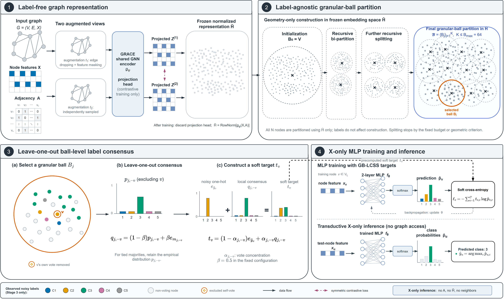
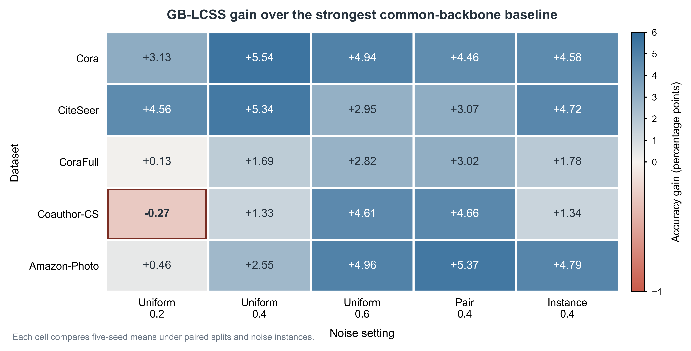
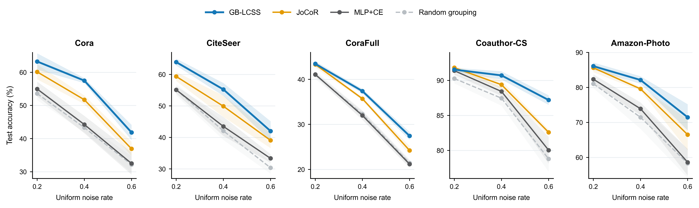
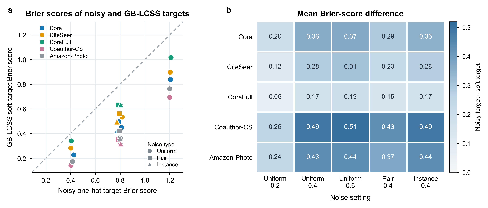
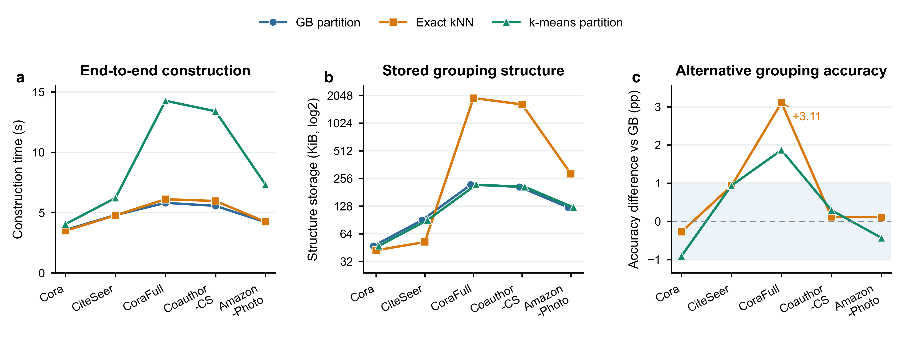

# Granular-Ball Local-Consensus Soft Supervision for Noisy-Label Transductive Node Classification with Graph-Free Inference

---

## Highlights

- Noisy-label transductive node classification with attribute-only (X-only) inference.
- Granular balls turn leave-one-out label consensus of ball peers into soft targets.
- Graphs are used only during training; inference reads node attributes alone.
- Top or tied-top mean accuracy in 24/25 settings against matched-backbone baselines.
- Graph-teacher soft predictions further improve the attribute-only student.

---

## Abstract

Access to the graph during training but only to node attributes at inference is a common deployment scenario arising from missing relations, privacy constraints, and low-latency requirements. When training labels are corrupted by noise, existing graph label-noise methods typically still depend on the graph structure, whereas graph-free inference methods largely assume clean supervision, and their robustness to noisy supervision remains underexplored. This paper proposes Granular-Ball Local-Consensus Soft Supervision (GB-LCSS). The method constructs granular balls in a frozen, unsupervised graph-contrastive representation space, generates soft supervision from the label consensus of the other training nodes within each ball, and trains an MLP that takes only node attributes as input. On five datasets evaluated over the full noise spectrum, GB-LCSS attains the highest or tied-highest mean accuracy in 24 of 25 evaluation settings among noise-robust methods with a matched MLP backbone, and consistently outperforms three structure-assisted soft-supervision baselines. A graph-teacher extension further trains the student on the teacher's soft predictions over all nodes, improving accuracy while preserving attribute-only inference. These results indicate that GB-LCSS provides a local-consensus-based supervision construction for noisy-label transductive node classification with graph-free inference.

**Keywords**: label noise, node classification, graph-free inference, graph contrastive learning, granular-ball computing, knowledge distillation

---

## 1 Introduction

Graph neural networks (GNNs) aggregate neighborhood information through message passing and have become the dominant approach to node classification [1,2]. In deployment, however, the full set of edges is not always available, and online message passing incurs neighbor-fetching and multi-hop propagation overhead [3]. Graph-free inference allows the graph to be exploited during training while the student model uses only node attributes at inference time [3,14]. GLNN [3] and its successors show that knowledge distillation, structural encoding, and structure-aware training enable a multilayer perceptron (MLP) to approach GNN-level accuracy in this setting [5--7,29,30]. This paper studies transductive X-only node classification on a fixed graph: test nodes are visible in the training-time graph, and the deployed classifier reads only node attributes, without access to the adjacency structure, graph-encoder outputs, or any other graph-derived representations.

When training labels are corrupted, this deployment setting faces a new difficulty. Manual annotation, automatic collection, and multi-source data integration can all introduce erroneous node labels, and deep models progressively fit such erroneous supervision during training [8]. Graph label-noise methods such as NRGNN, RTGNN, DND-NET, and RNCGLN improve robustness through graph propagation, dual-network co-checking, or pseudo-labeling [9--12], but their denoising procedures or final inference typically still require adjacency information. Existing GNN-to-MLP and X-only node classification work, in turn, mostly assumes clean training labels and focuses on structural knowledge transfer, feature perturbation, missing features, or label scarcity [3,5--7,14,15]. How to exploit the training-time graph against label noise while obtaining a classifier that relies only on node attributes at inference therefore remains largely unexplored.

Existing graph-free inference methods transfer structural knowledge to the MLP mainly at the input, representation, or prediction level [3,5--7,14,15], while the supervision signal still comes from the raw training labels or from a teacher trained on them. Under noisy training labels, erroneous supervision can propagate to the student through structure-aware training or knowledge distillation. Transferring structural knowledge alone may thus preserve the erroneous supervision, and the supervision signal delivered to the X-only classifier itself needs to be improved. This paper extracts label consensus from the local geometry of an unsupervised graph-contrastive representation and constructs soft supervision from it, reducing the model's reliance on any individual noisy label.

We propose the Granular-Ball Local-Consensus Soft Supervision (GB-LCSS) framework. GB-LCSS constructs label-agnostic granular balls [34] in a frozen, unsupervised graph-contrastive representation space and uses each ball as a local semantic unit to aggregate the noisy labels of the training nodes it contains. For every training node, the method removes the node itself from the local vote and generates a soft target from the label distribution and vote concentration of the remaining nodes. The precomputed soft targets are used to train an X-only MLP, and the trained classifier receives only node attributes.

We evaluate GB-LCSS on five datasets with full-noise-spectrum coverage. The method outperforms noise-robust baselines with a matched MLP backbone in most settings and consistently surpasses PosteL, ALS, and SALS under a unified protocol. The base GB-LCSS trains the MLP directly on local-consensus targets. An extension route additionally trains a graph teacher and distills the teacher's soft predictions over all nodes into the attribute-only student to further improve its accuracy.

The main contributions of this paper are as follows:

1. We propose the GB-LCSS framework for noisy training labels and transductive X-only inference, converting training-time graph information into soft supervision for an attribute-only MLP.
2. We perform label-agnostic granular-ball partitioning in a frozen graph-contrastive representation space and exploit the label distributions of same-ball peers through leave-one-out local consensus. After training, the classifier reads only node attributes.
3. On five datasets with full-noise-spectrum coverage, GB-LCSS attains the highest or tied-highest mean accuracy in 24 of 25 matched-backbone comparison settings and consistently outperforms PosteL, ALS, and SALS. Random-grouping, target-quality, and grouping-substitution experiments analyze the roles of local membership, the soft targets, and the grouping interface, respectively, and a graph-teacher extension examines the effect of all-node soft predictions on student accuracy.

---

## 2 Related work

### 2.1 Learning with noisy labels

General noisy-label learning mitigates erroneous supervision mainly through sample selection, robust losses, label correction, and semi-supervised training. Co-teaching lets two networks select small-loss samples for each other, and JoCoR augments joint sample selection with an agreement constraint between the two networks [17,18]. SCE combines cross entropy with reverse cross entropy, ELR suppresses late-stage memorization of noisy labels, and ANL and LogitClip improve loss robustness through negative-learning objectives and logit-norm constraints, respectively [19--22]. DivideMix partitions samples into labeled and unlabeled subsets for semi-supervised training, FINE identifies reliable samples from class-wise principal directions of the features, and CT estimates label reliability from confidence trajectories during training [23--25]. These methods target label noise on independent samples and serve as the matched-MLP-backbone references in our experiments.

### 2.2 Label noise on graphs

Label-noise learning on graphs must simultaneously handle label sparsity, node dependence, and the propagation of erroneous supervision along the graph structure. UnionNET aggregates the labels of structurally close nodes to estimate node class distributions, and performs sample reweighting and label correction accordingly [46]. NRGNN expands reliable supervision through edge prediction and pseudo-label mining, and RTGNN governs noise with dual networks, self-reinforced label correction, and consistency constraints [9,10]. DND-NET decouples high-order graph propagation from a simple classifier and combines neighbor uncertainty to generate robust pseudo labels; its classifier still reads graph-propagated features [11]. RNCGLN couples graph contrastive learning with label self-correction, addressing both label and structure perturbations [12].

Recent methods further exploit topological sample selection, structure reconstruction, and multi-view consistency. TSS brings graph topology into small-loss sample selection, TFR filters pseudo labels through topological feature reconstruction, and ProCon identifies noise and updates class prototypes based on the label consistency of structurally close peers [40,41,47]. GD² detects noise from the prediction discrepancy between a node's ego view and its structural view, and GNN-CFGD combines training memorization, graph connectivity, and confidence to partition reliable nodes [42,44]. Prototype-Guided Supervision aggregates noisy labels into class prototypes and extends prototype-based supervision [63]. These methods repair noisy supervision on graphs at the levels of node filtering, structure reconstruction, and class prototypes.

Other studies start from teacher distillation, topology adjustment, and robust aggregation. BO-NNC and SAMTD combine multiple graph teachers via bi-level optimization and consistency-based weighting, respectively [45,58]. GTA adjusts trustworthy and untrustworthy edges, while MILAB and HALF improve aggregation robustness from the perspectives of the information bottleneck and local homophily [50,51,59]. These methods identify noise or propagate supervision directly on the graph, and their training and inference resources differ from those of an attribute-only classifier.

### 2.3 GNN-to-MLP distillation and graph-free inference

Graph-free inference research exploits the graph during training while avoiding message passing at deployment. Early work includes Graph-MLP, which trains an MLP with a neighborhood contrastive constraint, and GSDN, which performs neighborhood self-distillation at the prediction level [4,14]. GSDN also examined asymmetric label noise, but its primary goal remains neighborhood self-distillation rather than a systematic study of noisy supervision construction. SimMLP aligns MLP representations with graph-contextual representations in a self-supervised manner, and ES-MLP adapts to homophilic and heterophilic graphs through an edge-splitting mechanism [15,33]. NOSMOG additionally injects positional and structural features into the MLP [5]. Inference-time resources differ across methods: NOSMOG relies on pre-generated DeepWalk positional embeddings, and the main structural branch of SA-MLP takes adjacency-matrix rows as input, with an online variant that estimates latent structure separately [27]. Our experiments adopt the X-only inference condition, where the classifier receives only node attributes at test time.

Another line distills GNN knowledge into MLPs. GLNN transfers the predictions of a GNN teacher to a student that uses only node attributes, establishing the basic GNN-to-MLP paradigm [3]. Follow-up methods extend the distilled content and the training procedure. FF-G2M decomposes low- and high-frequency knowledge, VQGraph expresses local structure through a structure tokenizer and a discrete codebook, PGKD transfers class prototypes, and TINED combines teacher parameter injection with Dirichlet-energy distillation [6,26,28,43]. KRD selects reliable teacher knowledge points according to their entropy stability under feature perturbations [7]. AdaGMLP, ProGMLP, and SALE-MLP study adaptive distillation under label scarcity, accuracy--cost trade-offs, and structure-aware latent embeddings, respectively [29--31]. Yu et al. [32] further explain, from a neural-tangent-kernel perspective, how GNN soft labels transfer a low-frequency graph bias to MLPs.

Beyond distillation, training-time graph information can also be used to reshape the soft labels directly. PosteL generates smoothed labels from model posteriors, ALS adaptively adjusts the smoothing strength, and SALS further incorporates neighborhood structure [60--62]. These works show that graph knowledge can be delivered either through teacher predictions or directly through the supervision targets.

The base GB-LCSS follows the latter route: it extracts leave-one-out local consensus from label-agnostic granular balls in a frozen graph representation and trains an X-only classifier on the resulting targets. The distillation extension trains a graph teacher with the same targets and then transfers all-node predictions to the student.

### 2.4 Granular-ball computing and noisy-label learning

Granular-ball computing replaces fine-grained samples with a smaller number of hyper-ball information granules, balancing computational efficiency and noise robustness through multi-granularity representations [34]. In classification, GBkNN performs nearest-neighbor classification on the ball set according to query-to-ball distances, and granular-ball sampling selects representative samples using ball purity and boundary structure [34,37]. VPGB jointly performs attribute reduction and classification on noisy data from a coarse-grained perspective [52]. MgCNL filters reliable samples according to ball-level label confidence, and MgBIF aggregates within-ball labels into pseudo labels before sample selection [35,36]. GEAF further adopts an adaptive granular-ellipsoid partition that does not rely on label purity, identifying and correcting erroneous labels within local granules [53]. These methods mainly use granular structures for classification, sample filtering, label correction, or reliable-training-set construction.

Granular balls have also been applied to graph learning. Supervised granular-ball graph coarsening and GBGC both compress the training graph with balls as super-nodes: the former splits by label purity, and the latter adaptively forms the coarsened result from the graph's multi-granularity structure [54,55]. MGGR recursively decomposes intra-graph subregions with granular balls and completes graph-level classification with a hierarchical encoder [56]. These methods show that granular balls can carry graph structure, but their goals are mainly graph coarsening, training acceleration, or graph-level representation, and the final models still depend on the graph.

Combining granular balls with deep models further extends their noise-robust role. GBRAIN dynamically constructs granular balls in text classification and forms coarse-grained training representations from ball centers and ball-level labels, reducing the influence of erroneous labels [57]. G-GBC extracts features with a CNN, adaptively generates granular balls with Gaussian mixture models and Mahalanobis distances, and lets ball purity and weights participate in noise-robust training [48]. BNO-GB adopts unsupervised, label-agnostic granular-ball clustering and distinguishes clean samples, in-distribution noise, and out-of-distribution noise with ball-level and sample-level indicators before optimizing open-intent representations [49]. GB-LCSS constructs label-agnostic granular balls in a frozen, unsupervised graph representation and generates soft targets from the leave-one-out label consensus of the training nodes within each ball.

---

## 3 Method

### 3.1 Problem setup and notation

Consider a transductive attributed graph $G=(\mathcal V,\mathcal E,X)$, where $\mathcal V=\{v_1,\ldots,v_N\}$ is the node set, $\mathcal E$ is the edge set, $A\in\{0,1\}^{N\times N}$ is the adjacency matrix, and $X=[x_1,\ldots,x_N]^\top\in\mathbb R^{N\times d}$ is the node-attribute matrix. Nodes belong to $C$ classes. The training-node set is denoted $\mathcal V_L$, and the observed labels $\tilde y_v\in\{1,\ldots,C\}$ may be corrupted by unknown noise. GB-LCSS does not require prior knowledge of the noise type, the noise rate, or the label transition matrix.

The training stage may use the full $X$ and $A$ to learn structural representations and construct supervision targets. After training, only the classifier $f_\theta$ is retained. For a node $v$ to be predicted, the model outputs

$$
p_\theta(\cdot\mid x_v)=\operatorname{softmax}\!\left(f_\theta(x_v)\right),
\tag{1}
$$

This paper considers transductive attribute-only inference on the same fixed graph: test nodes are visible in the training-time graph, and at inference the classifier receives only node attributes, without access to $A$, neighboring nodes, the frozen representation, or the graph encoder.

For later use, let $\mathcal B=\{B_j\}_{j=1}^{K}$ denote the granular-ball partition covering all nodes, and let $T_j=B_j\cap\mathcal V_L$ denote the training nodes inside ball $B_j$. For $v\in T_j$, the subscript $-v$ indicates that node $v$'s own label is removed when constructing the local consensus; all remaining symbols are defined at first use.

### 3.2 Overview of GB-LCSS

GB-LCSS constructs soft supervision from the graph during training, and the trained classifier uses only node attributes. As shown in Fig. 1, GRACE first learns label-agnostic node representations on the full graph. Mutually exclusive granular balls are then obtained in the frozen representation space through recursive 2-means partitioning. Once the balls are fixed, a leave-one-out local-consensus target is constructed for each training node from the observed labels of the other training nodes in the same ball. Finally, an MLP is trained with node attributes $X$ as input and these soft targets as supervision. The inference stage no longer uses the graph structure or the frozen representation.



**Fig. 1** Overview of GB-LCSS. Stage 1 learns a label-agnostic frozen representation, and Stage 2 constructs granular balls in this representation space. Stage 3 illustrates the construction of the leave-one-out local-consensus target using one ball as an example. Stage 4 trains the X-only MLP with the soft targets. Hollow nodes do not vote. Overlapping outlines in the figure are two-dimensional projections of high-dimensional balls; every node belongs to exactly one ball. The graph structure and the frozen representation are used only during training, and the classifier receives only node attributes at inference.

### 3.3 Label-agnostic granular-ball construction in the frozen representation space

#### 3.3.1 Frozen graph-contrastive representation

We adopt GRACE [16] to generate the ball-construction space. GRACE creates two stochastic graph views through edge dropping and feature masking and optimizes a node-level contrastive objective that pulls together the two views of the same node. Pre-training reads only $X$ and $A$ and never uses node labels. After convergence, the encoder output

$$
H=g_\psi(X,A)\in\mathbb R^{N\times d_h},
\tag{2}
$$

is taken, the parameters $\psi$ are frozen, and $H$ is stored in node order. Before ball construction, each node representation is L2-normalized:

$$
\bar h_v=\frac{h_v}{\max(\lVert h_v\rVert_2,\varepsilon)}.
\tag{3}
$$

Let $\bar H=[\bar h_1,\ldots,\bar h_N]^\top$ denote the normalized representation matrix. Ball membership is subsequently determined solely by the geometry of the frozen representation, and labels enter only after the partition is complete, when the local consensus is constructed. We use the ability to form a non-degenerate multi-ball structure under the fixed construction rule as the criterion for representation selection. The representation-source comparison and pre-training-seed diagnostics in Appendix D.3 show that GRACE forms non-degenerate balls on all three diagnostic datasets and maintains stable downstream gains across pre-training seeds.

#### 3.3.2 Recursive bi-partition

The ball set is initialized as $\mathcal B=\{\mathcal V\}$. For any ball $B\subseteq\mathcal V$, define its center and mean center distance as

$$
\mu_B=\frac{1}{|B|}\sum_{v\in B}\bar h_v,
\qquad
D(B)=\frac{1}{|B|}\sum_{v\in B}\lVert \bar h_v-\mu_B\rVert_2.
\tag{4}
$$

$D(B)$ measures how dispersed the nodes of a ball are around its center; smaller values indicate a tighter region in the representation space. Each splitting round first collects the candidate balls satisfying $|B|\ge 2n_{\min}$ and then attempts 2-means splits in descending order of $D(B)$, so that the limited splitting budget is spent preferentially on geometrically looser regions. Suppose a candidate ball $B$ is split into $B^{(1)}$ and $B^{(2)}$; the size-weighted mean dispersion after the split is

$$
D_{\mathrm{split}}(B)=
\frac{|B^{(1)}|D(B^{(1)})+|B^{(2)}|D(B^{(2)})}{|B|}.
\tag{5}
$$

A split is accepted only if both child balls contain at least $n_{\min}$ nodes and

$$
D_{\mathrm{split}}(B)\le (1-\delta)D(B),
\tag{6}
$$

in which case the first valid split encountered in that round is applied. Eq. (6) requires the weighted dispersion to decrease by at least a fraction $\delta$, and the child-size constraint prevents overly small regions. After each accepted split, the candidate set and its ordering are recomputed. The recursion stops when a round yields no valid split or when the number of balls reaches the budget $B_{\max}$. The final partition consists of at most $B_{\max}$ mutually exclusive balls that cover all nodes, with every node belonging to exactly one ball. The experimental parameter values are given in Section 4.3.

Granular balls provide GB-LCSS with a fixed-budget, mutually exclusive, and traceable regional interface. Nodes in the same ball share region-level label statistics: the leave-one-out distribution of any training node can be obtained from the ball-level class histogram by subtracting the node's own vote, without maintaining separate local statistics per node. Because each node belongs to exactly one ball, every soft target can be traced back through its region, its leave-one-out vote counts, and its consensus weight. kNN, in contrast, forms overlapping and potentially asymmetric neighborhoods centered at each training node and must aggregate neighbor labels node by node. Granular balls thus organize a large number of node-level neighborhoods into at most $B_{\max}$ shared consensus units. Section 5.3.2 compares the classification results of three grouping implementations, and Section 5.5 further reports their construction time and storage overhead.

### 3.4 Granular-ball local-consensus soft supervision

#### 3.4.1 Leave-one-out consensus targets

For ball $B_j$, let $T_j=B_j\cap\mathcal V_L$ denote its training nodes. To prevent a node's observed label from serving simultaneously as the label to be corrected and as local evidence, GB-LCSS defines, for every $v\in T_j$, the leave-one-out voting set

$$
T_{j,-v}=T_j\setminus\{v\}.
\tag{7}
$$

When $|T_{j,-v}|\ge s_{\min}$, an empirical distribution is constructed from the noisy labels of the other same-ball training nodes:

$$
p_{j,-v,c}=
\frac{1}{|T_{j,-v}|}
\sum_{u\in T_{j,-v}}\mathbb I(\tilde y_u=c),
\qquad c=1,\ldots,C.
\tag{8}
$$

Let

$$
M_{j,-v}=\{c:p_{j,-v,c}=r_{j,-v}\},
\qquad
r_{j,-v}=\max_c p_{j,-v,c}.
\tag{9}
$$

$M_{j,-v}$ is the set of classes receiving the maximum number of leave-one-out votes, with ties determined directly on integer vote counts. If the majority class is unique, it is denoted $m_{j,-v}$ and mixed with the empirical distribution as a one-hot vector; if a tie occurs, only the empirical distribution is retained:

$$
q_{j,-v}=
\begin{cases}
(1-\beta)p_{j,-v}+\beta e_{m_{j,-v}}, & |M_{j,-v}|=1,\\
p_{j,-v}, & |M_{j,-v}|>1,
\end{cases}
\tag{10}
$$

where $e_c$ is the one-hot vector of class $c$ and $\beta$ controls the mixture between the empirical distribution and the majority class. Under ties, no unique majority class is designated by class index, which keeps the target permutation-equivariant under class relabeling. Because a different node is removed each time, $p_{j,-v}$ and $q_{j,-v}$ may differ across nodes within the same ball.

#### 3.4.2 Normalized consensus weight and node-level targets

We linearly normalize the maximum vote share against the uniform class probability $1/C$ as a lower bound:

$$
\alpha_{j,-v}=
\max\left(
0,
\frac{r_{j,-v}-1/C}{1-1/C}
\right).
\tag{11}
$$

$\alpha_{j,-v}$ measures how concentrated the leave-one-out label distribution is relative to the uniform distribution, whereas the minimum-vote threshold $s_{\min}$ specifies the sample support required to activate the local target; the two quantities separately describe distribution concentration and effective vote count. For $v\in T_j$, the final training target is

$$
t_v=(1-\alpha_{j,-v})e_{\tilde y_v}+\alpha_{j,-v}q_{j,-v}.
\tag{12}
$$

When the leave-one-out vote is close to uniform, $\alpha_{j,-v}$ is small and the target largely retains the node's observed label; as the label distribution becomes more concentrated, supervision shifts toward the local consensus $q_{j,-v}$. If the remaining vote count after removing the node falls below $s_{\min}$, the original label is kept. This continuous interpolation avoids hard replacement of a node's label by the ball-level majority class.

Appendix E gives the conditions under which the true within-ball majority class remains dominant under symmetric noise, together with an upper bound on the probability of majority-class error at finite vote counts.

Ball membership is generated without reading labels; Eqs. (7)–(12) use only the observed labels of training nodes to construct supervision targets, and validation and test labels never enter target construction or the training loss.

#### 3.4.3 Attribute-only student training

The student $f_\theta$ is a two-layer MLP whose computation order is a linear layer, ReLU, BatchNorm, dropout, and an output linear layer. The hidden width is $F=64$ and the dropout rate is 0.5. The student probabilities are given by Eq. (1), and the soft cross entropy

$$
\mathcal L_{\mathrm{LCSS}}
=
-\frac{1}{|\mathcal V_L|}
\sum_{v\in\mathcal V_L}
\sum_{c=1}^{C}
t_{vc}\log p_\theta(c\mid x_v)
\tag{13}
$$

is minimized over the training nodes. After training, only $f_\theta$ is retained, and prediction uses node attributes alone.

**Algorithm 1** Recursive granular-ball partitioning in the frozen representation space

```text
Input:  normalized frozen representation H̄, node set V, parameters B_max, n_min, δ
Output: mutually exclusive ball set 𝓑

 1: 𝓑 ← {V}
 2: while |𝓑| < B_max do
 3:     𝓑_cand ← {B∈𝓑 : |B|≥2n_min}, sorted by D(B) in descending order
 4:     accepted ← false
 5:     for B∈𝓑_cand do
 6:         split B into B^(1), B^(2) with 2-means
 7:         if min(|B^(1)|,|B^(2)|)≥n_min
 8:            and D_split(B)≤(1−δ)D(B) then
 9:             𝓑 ← (𝓑\{B})∪{B^(1),B^(2)}
10:             accepted ← true
11:             break
12:         end if
13:     end for
14:     if accepted=false then break
15: end while
16: return 𝓑
```

**Algorithm 2** Leave-one-out granular-ball soft-target construction

```text
Input:  ball set 𝓑, noisy labels {ỹ_v | v∈V_L}, number of classes C, parameters s_min, β
Output: soft targets for training nodes {t_v | v∈V_L}

 1: initialize t_v ← e_{ỹ_v} for all v∈V_L
 2: for B_j∈𝓑 do
 3:     T_j ← B_j∩V_L
 4:     n_j ← Σ_{u∈T_j} e_{ỹ_u}
 5:     for v∈T_j do
 6:         n_(j,−v) ← n_j−e_{ỹ_v}
 7:         if Σ_c n_(j,−v,c)<s_min then continue
 8:         p_(j,−v) ← n_(j,−v)/(Σ_c n_(j,−v,c))
 9:         r_(j,−v) ← max_c p_(j,−v,c)
10:         M_(j,−v) ← {c:p_(j,−v,c)=r_(j,−v)}
11:         if |M_(j,−v)|=1 then
12:             q_(j,−v) ← (1−β)p_(j,−v)+βe_m,  m∈M_(j,−v)
13:         else q_(j,−v) ← p_(j,−v)
14:         α_(j,−v) ← max(0,(r_(j,−v)−1/C)/(1−1/C))
15:         t_v ← (1−α_(j,−v))e_{ỹ_v}+α_(j,−v)q_(j,−v)
16:     end for
17: end for
18: return {t_v | v∈V_L}
```

### 3.5 Consensus-teacher distillation extension

Consensus-teacher distillation enlarges the set of nodes through which structural knowledge reaches the student. The extension first trains a graph-structured teacher with the granular-ball consensus and then lets the X-only student fit the teacher's node-wise soft predictions over all nodes. Whereas the soft targets of the base GB-LCSS act only on training nodes, the distillation extension exploits the teacher's prediction distribution over the entire graph.

The teacher directly adopts the GB-LCSS targets defined in Section 3.4. For a training node $v\in T_j$, the node's own observed label is first excluded, and $p_{j,-v}$, $q_{j,-v}$, and $\alpha_{j,-v}$ are computed via Eqs. (8)–(11). The teacher target is

$$
t_v^{T}=t_v
=(1-\alpha_{j,-v})e_{\tilde y_v}
+\alpha_{j,-v}q_{j,-v}.
\tag{14}
$$

Eq. (14) coincides with the leave-one-out consensus target of the base GB-LCSS, with $\beta=0.5$. In the extension, this target is used to train a graph-structured teacher. The teacher $g_\phi$ is a two-layer GCN that takes the raw node attributes $X$ and the adjacency matrix $A$ as input:

$$
Z^T=g_\phi(X,A).
\tag{15}
$$

The frozen representation $\bar H$ is used only to determine the balls and their consensus targets; it is not an input feature of the teacher. The teacher minimizes, over training nodes only,

$$
\mathcal L_T
=
-\frac{1}{|\mathcal V_L|}
\sum_{v\in\mathcal V_L}
\sum_{c=1}^{C}
t_{vc}^{T}
\log
\operatorname{softmax}\left(Z_v^T\right)_c.
\tag{16}
$$

After the teacher checkpoint is selected, $g_\phi$ is frozen, and the graph-structural information absorbed during training is converted into temperature-softened predictions over all nodes:

$$
\pi_v=
\operatorname{softmax}
\left(
\frac{Z_v^T}{\tau}
\right).
\tag{17}
$$

The X-only student then fits these predictions over all $N$ nodes:

$$
\mathcal L_{\mathrm{KD}}
=
-\frac{\tau^2}{N}
\sum_{v\in\mathcal V}
\sum_{c=1}^{C}
\pi_{vc}
\log
\operatorname{softmax}
\left(
\frac{f_\theta(x_v)}{\tau}
\right)_c.
\tag{18}
$$

The base method uses local-consensus targets on $\mathcal V_L$ only, whereas Eq. (18) fits the teacher's soft predictions over all nodes. The current configuration sets $\tau=1$, and the student loss consists solely of the cross entropy against the teacher's soft predictions. After training, only the student MLP is retained; the teacher, the adjacency matrix, and the frozen representation play no role at inference.

### 3.6 Computational complexity and inference resources

Compared with directly training an MLP, the additional computation of GB-LCSS is concentrated before student training and consists of one GRACE pre-training run and one granular-ball construction. The GRACE training cost is denoted $T_{\mathrm{GRACE}}$; the resulting representation can be reused across the noise settings and downstream seeds of the same dataset and requires $O(Nd_h)$ storage.

On the frozen representation, running 2-means for $I$ iterations on a node subset $S$ costs $O(I|S|d_h)$. Candidate balls within one round are disjoint, so their total node count does not exceed $N$. The entire construction accepts at most $B_{\max}-1$ splits; a conservative upper bound on the time of candidate scanning and 2-means calls is therefore

$$
O(IB_{\max}Nd_h).
\tag{19}
$$

Since $B_{\max}$ is fixed to a constant in this paper, the ball-construction cost is approximately linear in the number of nodes $N$ and the representation dimension $d_h$. The dominant storage during construction comes from the frozen representation; node memberships, ball centers, and class histograms require an additional $O(N+B_{\max}(d_h+C))$ space. Subtracting the current node's vote from the ball-level histogram yields the leave-one-out statistics, so generating all training targets takes $O(|\mathcal V_L|C)$ time. The current implementation stores the targets as an $N\times C$ matrix, corresponding to $O(NC)$ space.

Once the soft targets are generated, student training is identical to that of an ordinary two-layer MLP. The current implementation uses full-batch training: each epoch computes MLP outputs for all $N$ nodes and evaluates the loss on the training-node mask. With $T_S$ training epochs, the training complexity is $O(T_SN(dF+FC))$. After training, single-node inference costs

$$
O(dF+FC),
\tag{20}
$$

and deployment stores only the student parameters of size $O(dF+FC)$, using neither the adjacency matrix, the frozen representation, the ball partition, nor any neighbor index; the inference cost therefore does not grow with the number of edges $|\mathcal E|$. The distillation extension adds the training cost of a two-layer GCN teacher, which is likewise discarded after training. Section 5.5 reports GRACE pre-training time and peak GPU memory, together with the construction time and storage overhead of the three grouping interfaces.

---

## 4 Experimental setup

### 4.1 Datasets and evaluation scope

Cora, CiteSeer, CoraFull, Coauthor-CS, and Amazon-Photo are used for full-noise-spectrum evaluation, covering uniform 0.2/0.4/0.6, pair 0.4, and instance-dependent 0.4. In addition, six supplementary datasets are evaluated for breadth under uniform 0.4, among which CiteSeerFull is further extended to the full noise spectrum; the corresponding results are given in Appendix I.

Cora and CiteSeer come from the classical citation-network benchmark [38], and the remaining datasets use the public versions commonly adopted in graph-learning evaluation [39]. Table 1 summarizes the statistics of the five full-spectrum datasets. Edge homophily is defined as the fraction of undirected edges whose endpoints share the same class; it is used only to describe the graphs.

**Table 1** Dataset statistics. Edge counts are undirected, and training-node counts follow the 20% split.

| Dataset | Nodes | Undirected edges | Features | Classes | Training nodes | Edge homophily |
|---|---:|---:|---:|---:|---:|---:|
| Cora | 2,708 | 5,278 | 1,433 | 7 | 541 | 0.810 |
| CiteSeer | 3,327 | 4,552 | 3,703 | 6 | 665 | 0.736 |
| CoraFull | 19,793 | 63,421 | 8,710 | 70 | 3,958 | 0.567 |
| Coauthor-CS | 18,333 | 81,894 | 6,805 | 15 | 3,666 | 0.808 |
| Amazon-Photo | 7,650 | 119,081 | 745 | 8 | 1,530 | 0.827 |

### 4.2 Data splits and label noise

We adopt transductive node classification on a fixed graph. The training stage may read the node attributes and adjacency of the full graph, and the attributes and topology of test nodes participate in GRACE pre-training and ball partitioning as unlabeled context. Since data splits can markedly affect graph-learning results [39], all methods share the same percent split, with 20%, 10%, and 70% of nodes for training, validation, and testing, respectively. Under the default protocol, only training labels are corrupted; clean validation labels are used for checkpoint selection, and test labels are used solely for final evaluation.

Uniform noise satisfies $P_{ii}=1-\rho$ and $P_{ij}=\rho/(C-1)$, with $\rho\in\{0.2,0.4,0.6\}$. Pair noise uses $\rho=0.4$ and flips class $i$ to $((i-2)\bmod C)+1$ with probability $\rho$, keeping the original class with probability $1-\rho$. Instance-dependent noise likewise uses an average flip rate of 0.4 and assigns non-true-class probabilities via class-conditional random mappings of the node attributes. The noise-generation forms follow NoisyGL [13], and all methods share the splits and training-noise instances under the same dataset and seed.

### 4.3 Compared methods and resource tiers

The compared methods fall into two training-resource tiers. The first tier matches the MLP classifier's depth, width, noisy-training-label budget, and inference input, and includes MLP+CE, Small-loss, Co-teaching, JoCoR, SCE, ELR, LogitClip, and GB-LCSS. GB-LCSS uses the same single-network classifier but additionally exploits the full graph and the frozen GRACE representation during training; Co-teaching and JoCoR retain their original dual-network structure. The second tier exploits graph information during training while still reading only node attributes at inference, and includes PosteL, ALS, SALS [60--62], Graph-MLP [4], and GSDN [14]. PosteL retains its posterior target construction with iterative pseudo-labeling disabled; the other methods retain the core objectives of their public versions, and all use our data splits, noise instances, and X-only student. Implementation identities, protocol adaptations, and method-specific parameters are detailed in Appendix H.

The graph-teacher distillation extension compares, in the main text, GLNN-style response distillation, FF-G2M, KRD, VQGraph, and the ball-consensus teacher [3,6,7,26]. FF-G2M is re-implemented on the common student backbone with its low- and high-frequency distillation objectives retained. KRD and VQGraph retain their reliable-knowledge selection and soft-codebook distillation mechanisms, respectively, adapted to our unified noise protocol. All routes retrain the teacher and student per seed, and the final student reads only node attributes.

All first-tier methods use the same two-layer MLP backbone with hidden width 64 and dropout 0.5; dual-network methods use two independently initialized copies of the same backbone. Models are trained with Adam, learning rate 0.01, weight decay $5\times10^{-4}$, and at most 200 epochs. Small-loss, Co-teaching, and JoCoR set their forget-rate schedules from the known synthetic noise rate; the other first-tier methods do not use this information.

GB-LCSS uses $B_{\max}=64$, $n_{\min}=32$, $\delta=0.05$, $s_{\min}=2$, and $\beta=0.5$ in all experiments. The 2-means step uses Euclidean distance and k-means++ initialization. GRACE uses dataset-level configurations that never read labels, and the encoder is frozen after pre-training. Complete parameters and configuration sources are given in Appendix H.

### 4.4 Statistical analysis

We report the mean and sample standard deviation of test accuracy over five paired seeds. The main experiment of each dataset fixes one pre-trained representation $H$, while the five paired seeds vary the data split, noise instance, and downstream initialization; diagnostics across GRACE pre-training seeds are given in Appendix D.3. For each dataset, noise setting, and seed, we apply two-sided one-sample $t$-tests to the paired accuracy differences, with 95% confidence intervals based on the $t$ distribution with four degrees of freedom. Holm corrections are applied separately within the three 25-item comparison families of GB-LCSS versus random grouping, MLP+CE, and JoCoR. These tests assess the stability of paired gains under the current protocol; full paired results are in Appendix B.

---

## 5 Experimental results and analysis

### 5.1 Noise-robust methods with a matched MLP backbone

**Table 2** Test accuracy under uniform 0.4 for noise-robust methods with a matched X-only MLP configuration.

Values are test accuracy (%, mean±std over five paired seeds); boldface marks the highest mean in each column. All classifiers use the same MLP depth and width and share the noisy-training-label budget and inference input. Dual-network methods retain their original training structure, and GB-LCSS additionally uses the full graph and the frozen GRACE representation during training.

| Method | Cora | CiteSeer | CoraFull | Coauthor-CS | Amazon-Photo |
|---|---:|---:|---:|---:|---:|
| MLP+CE | 44.24±2.62 | 43.50±3.02 | 31.98±0.98 | 88.42±0.62 | 73.90±1.80 |
| Small-loss | 51.95±1.97 | 49.70±3.07 | 33.04±0.50 | 89.06±0.88 | 77.25±1.62 |
| Co-teaching | 46.83±1.78 | 46.24±2.89 | 34.39±0.24 | 88.80±0.97 | 78.21±1.00 |
| JoCoR | 51.72±1.30 | 49.91±3.37 | 35.70±0.32 | 89.38±0.61 | 79.57±0.53 |
| SCE | 43.60±1.86 | 42.09±3.47 | 29.29±0.45 | 88.37±0.53 | 76.08±3.11 |
| ELR | 44.28±1.38 | 43.17±3.95 | 32.14±0.67 | 88.29±0.73 | 73.93±2.12 |
| LogitClip | 47.50±1.50 | 46.57±3.52 | 34.69±1.17 | 88.40±0.21 | 74.98±2.38 |
| GB-LCSS | **57.49±0.76** | **55.24±2.04** | **37.39±0.51** | **90.71±0.59** | **82.12±1.08** |

GB-LCSS attains the highest mean accuracy on all five datasets, with gains of 1.33 to 5.54 percentage points over the strongest baseline per dataset. The improvements are largest on Cora, CiteSeer, and Amazon-Photo. On Coauthor-CS, MLP+CE already reaches 88.42%, and the gain of GB-LCSS is correspondingly smaller.

The full noise spectrum exhibits the same trend. GB-LCSS improves over MLP+CE and JoCoR by 7.74 and 3.46 percentage points on average, with positive settings in 25/25 and 24/25 cases, respectively. Among the seven matched-backbone baselines, GB-LCSS attains the highest or tied-highest mean in 24/25 settings; the only exception is Coauthor-CS under uniform 0.2, where it trails JoCoR by 0.27 percentage points. Fig. 2 summarizes the per-setting gains over the strongest matched-backbone baseline; complete results and paired statistics are in Appendices A and B.



**Fig. 2** Accuracy gains of GB-LCSS over the strongest matched-backbone baseline. Each cell is the five-seed mean accuracy of GB-LCSS minus the highest mean accuracy among the seven matched-backbone noise-robust baselines for that dataset and noise setting, in percentage points. Blue indicates GB-LCSS is better, red indicates the baseline is better. Coauthor-CS under uniform 0.2 is the only negative cell.

Fig. 3 further shows absolute accuracy as the uniform noise rate varies. Except for Coauthor-CS under uniform 0.2, GB-LCSS exceeds the three plotted references in the remaining 14 dataset–noise-rate combinations. As the noise rate rises from 0.2 to 0.6, all methods degrade, but GB-LCSS retains the advantage of true grouping over random grouping on all five datasets.



**Fig. 3** Test accuracy under different uniform label-noise rates. Curves show five-paired-seed means and shading shows sample standard deviations; the vertical range is set per dataset. All methods share data splits and training-label noise instances, and random grouping preserves the ball-size distribution while shuffling node memberships.

On the six supplementary datasets, GB-LCSS exceeds the strongest matched-backbone baseline on three datasets and outperforms size-matched random grouping on all six; complete results are in Appendix I.

### 5.2 Structure-assisted X-only methods

**Table 3** Test accuracy of structure-assisted X-only methods under uniform 0.4.

Uniform 0.4, test accuracy (%, mean±std over five seeds). All methods may use graph information during training and read only node attributes at inference. Boldface marks the highest mean in each column.

| Method | Training-time graph usage | Cora | CiteSeer | CoraFull | Coauthor-CS | Amazon-Photo |
|---|---|---:|---:|---:|---:|---:|
| PosteL | structure-assisted soft labels | 47.09±1.81 | 45.84±2.48 | 36.51±1.01 | 84.74±1.51 | 80.59±0.94 |
| ALS | neighborhood label smoothing | 45.20±1.24 | 43.77±2.76 | 31.91±1.05 | 88.55±0.86 | 73.41±2.75 |
| SALS | structure-aware label smoothing | 48.27±2.50 | 47.20±1.69 | 37.06±0.78 | 88.85±0.82 | 77.86±0.79 |
| Graph-MLP | multi-hop structural supervision | **63.23±3.07** | **57.23±1.85** | 37.05±0.91 | 88.95±0.43 | 77.05±1.24 |
| GSDN | neighborhood self-distillation | 55.97±4.29 | 50.36±3.39 | 35.80±0.66 | 86.55±0.78 | 73.31±2.00 |
| GB-LCSS | leave-one-out ball consensus in frozen graph representation | 57.49±0.76 | 55.24±2.04 | **37.39±0.51** | **90.71±0.59** | **82.12±1.08** |

Across the complete 25 settings, GB-LCSS improves over PosteL, ALS, and SALS by 5.69, 7.71, and 4.69 percentage points on average, with positive settings in 24/25, 25/25, and 24/25 cases, respectively. Protocol adaptations for each method are described in Section 4.3 and Appendix H, and full noise-spectrum results are in Appendix G.

Graph-MLP and GB-LCSS exhibit different dataset preferences. Graph-MLP is higher by 5.74 and 1.99 percentage points on Cora and CiteSeer, whereas GB-LCSS leads by 0.34, 1.76, and 5.07 percentage points on CoraFull, Coauthor-CS, and Amazon-Photo. The relative merits of multi-hop structural supervision and frozen-representation local consensus vary across datasets.

### 5.3 Ablation and mechanism analysis

#### 5.3.1 Effect of the local-consensus target

Size-matched random grouping preserves the ball count, ball-size distribution, target formulas, and student training, and only shuffles node-to-region memberships; it applies the same leave-one-out target rule as the main method and is referred to as "random grouping" hereafter. GB-LCSS outperforms this control in all 25 dataset–noise settings of the full spectrum, with an average gain of 8.69 percentage points. The actual memberships in the frozen representation are therefore an effective information source for local-consensus soft supervision.

Leave-one-out voting reduces the influence of a node's own noisy label on its local target. Compared with the self-vote-inclusive ablation, GB-LCSS achieves cross-setting average gains between 0.08 and 1.03 percentage points on the five datasets. Under uniform 0.4, GB-LCSS also outperforms uniform label smoothing and training-prior smoothing on all five datasets. Complete results are in Appendix D.

To directly assess how well the soft targets agree with clean supervision, Fig. 4 computes the multi-class Brier score post hoc against the clean training labels. For any target matrix $Y^{\mathrm{tar}}$, we use

$$
\operatorname{BS}(Y^{\mathrm{tar}})=\frac{1}{|\mathcal V_L|}\sum_{v\in\mathcal V_L}\sum_{c=1}^{C}\left(Y^{\mathrm{tar}}_{vc}-\mathbf 1[y_v=c]\right)^2,
$$

where $y_v$ is the clean label of training node $v$ and $Y^{\mathrm{tar}}$ is either the original noisy one-hot target or the GB-LCSS soft target. The five-seed means of all 25 dataset–noise settings lie below the identity line: the GB-LCSS soft targets attain lower mean squared probability error than the original noisy one-hot targets. The per-setting reduction in mean Brier score ranges from 0.06 to 0.51, with the largest improvements on Coauthor-CS and Amazon-Photo.



**Fig. 4** Post-hoc quality diagnosis of GB-LCSS soft targets. **(a)** The horizontal axis is the multi-class Brier score of the original noisy one-hot targets and the vertical axis is that of the GB-LCSS soft targets. Each point is the five-seed mean of one dataset–noise setting; colors distinguish datasets, and circles, squares, and triangles denote uniform, pair, and instance noise. The dashed line marks equality. **(b)** Each cell is the five-seed mean of the original-target Brier score minus the soft-target Brier score; positive values indicate lower squared probability error for the soft targets.

#### 5.3.2 Role of the granular-ball partition

The kNN and k-means groupings use the same leave-one-out targets as the main method. kNN matches the neighborhood size to the per-seed average number of within-ball training votes and excludes the query node itself; k-means matches the number of clusters to the per-seed ball count, likewise removing the current node from the cluster-level target. On the five full-spectrum datasets, granular balls differ from the better of the two alternatives by $+0.27$, $-0.94$, $-3.11$, $-0.29$, and $-0.11$ percentage points. Except on CoraFull, the three grouping implementations lie within one percentage point of one another. The local-consensus target can therefore be realized by different grouping schemes; the granular ball serves in this paper as the fixed-budget regional organization interface, while the specific grouping choice mainly affects local resolution.

### 5.4 Control with clean training labels

To separate label-noise robustness from a generic regularization effect, we further examine the clean-label condition, setting $\rho=0$ with all other splits and training settings unchanged. Relative to MLP+CE, the accuracy differences of GB-LCSS on Cora, CiteSeer, CoraFull, Coauthor-CS, and Amazon-Photo are $-0.24$, $+2.00$, $-0.38$, $-0.87$, and $-1.75$ percentage points. Except on CiteSeer, GB-LCSS does not improve clean-label accuracy.

This control indicates that the benefit of GB-LCSS over MLP+CE arises mainly when training labels are corrupted; under clean supervision, local consensus shows no consistent additional gain.

### 5.5 Construction and preprocessing overhead

All times and memory figures were measured on the same workstation with an AMD Radeon RX 7700 XT, running Python 3.12.10 and PyTorch 2.9.1+rocm7.2.1. GB-LCSS and MLP+CE share the same student and therefore have identical parameter counts, inference inputs, and forward complexity; the additional overhead comes from GRACE representation learning and ball construction before training. In the seed-0 records, the one-time GRACE pre-training times for Cora, CiteSeer, and CoraFull are 0.07, 0.13, and 74.48 minutes, with peak GPU memory of 0.40, 0.67, and 12.73 GiB. The same frozen representation is reused across all noise settings and downstream seeds of a dataset.

Complementing the classification results of Section 5.3.2, Fig. 5 compares the grouping overhead of granular balls, exact kNN, and k-means. The end-to-end construction time of granular balls is lower on three of the five datasets. On CoraFull, Coauthor-CS, and Amazon-Photo, the storage of the mutually exclusive regions is also smaller than that of node-wise exact-kNN neighborhoods. Granular balls provide a fixed-budget shared regional representation whose accuracy and overhead profiles vary with data scale and local geometry.



**Fig. 5** Implementation profiles of three local-consensus grouping interfaces. **(a)** End-to-end construction time of the grouping structure and target statistics. **(b)** Size of the grouping structure stored for subsequent target construction. **(c)** Test-accuracy differences of exact kNN and k-means relative to granular balls; positive values indicate the alternative grouping is higher, and the blue band marks $\pm1$ percentage point. Time and storage are seed-0 implementation measurements; accuracy is the five-seed mean under uniform 0.4. kNN is the exact implementation excluding the query node itself.

---

## 6 Graph-teacher distillation extension

### 6.1 From training-node targets to all-node distillation

The base GB-LCSS trains the MLP directly on the local-consensus targets of training nodes. The distillation extension additionally trains a graph teacher and lets the student fit the teacher's soft predictions over all nodes. The two routes use different training resources, but in both cases the trained student receives only node attributes.

The extension experiments cover Cora, CiteSeer, CoraFull, Coauthor-CS, and Amazon-Photo under uniform 0.4 and uniform 0.6, comparing how different teacher supervision and knowledge-transfer schemes affect the X-only student.

### 6.2 Comparing graph-knowledge transfer routes

Beyond basic GLNN-style response distillation, we include three representative GNN-to-MLP routes. FF-G2M separately transfers low-frequency neighborhood knowledge and high-frequency edge-difference knowledge, KRD selects reliable knowledge according to the teacher's stability under feature perturbations, and VQGraph represents local structure with a soft codebook [6,7,26]. The ball-consensus teacher trains a GCN(X) teacher with the GB-LCSS targets of Eq. (14). All routes share data splits and noise instances, and each seed independently trains the teacher and the same two-layer X-only student.

**Table 4** Base GB-LCSS versus five graph-knowledge transfer routes.

Values are test accuracy (%, five-seed mean±std); boldface marks the highest mean in each column. All distillation routes use the same two-layer student, which reads only node attributes at inference. FF-G2M is a common-student-backbone re-implementation retaining the paper's core objectives; KRD and VQGraph are mechanism-level adaptations. The ball-consensus teacher is trained on $X$ and the adjacency matrix, with the frozen $H$ used only to construct the ball targets of Eq. (14).

**(a) Uniform 0.4**

| Training route | Cora | CiteSeer | CoraFull | Coauthor-CS | Amazon-Photo |
|---|---:|---:|---:|---:|---:|
| Base GB-LCSS (no distillation) | 57.49±0.76 | 55.24±2.04 | 37.39±0.51 | 90.71±0.59 | 82.12±1.08 |
| GCN(X)+CE teacher (GLNN-style) | 77.95±2.62 | 66.09±1.38 | **58.74±0.82** | 93.20±0.09 | 89.86±0.77 |
| FF-G2M | 77.65±2.97 | 65.80±0.49 | 56.58±0.93 | 91.58±0.24 | 84.82±0.84 |
| KRD | 71.77±2.20 | 64.96±1.03 | 47.12±0.95 | 91.39±0.49 | 85.17±0.94 |
| VQGraph | 78.89±2.34 | 65.64±1.72 | 58.52±0.77 | 93.25±0.09 | **90.54±0.85** |
| Ball-consensus teacher | **81.35±1.05** | **69.27±1.57** | 57.29±0.24 | **93.83±0.21** | 90.40±0.77 |

**(b) Uniform 0.6**

| Training route | Cora | CiteSeer | CoraFull | Coauthor-CS | Amazon-Photo |
|---|---:|---:|---:|---:|---:|
| Base GB-LCSS (no distillation) | 41.86±2.30 | 42.02±3.14 | 27.43±0.89 | 87.19±0.69 | 71.45±3.75 |
| GCN(X)+CE teacher (GLNN-style) | 65.50±3.28 | 53.30±4.42 | 51.63±2.02 | 91.13±0.58 | 84.80±1.48 |
| FF-G2M | 63.63±2.16 | 52.32±4.20 | 45.78±2.90 | 86.50±1.01 | 73.08±2.82 |
| KRD | 61.28±1.17 | 54.17±3.14 | 41.61±2.43 | 89.80±0.29 | 80.30±0.51 |
| VQGraph | 65.75±2.72 | 53.34±4.47 | 52.01±0.65 | 90.71±1.24 | 84.77±2.19 |
| Ball-consensus teacher | **71.34±3.91** | **58.93±4.62** | **52.32±1.26** | **92.40±0.65** | **86.81±1.94** |

The ball-consensus teacher exceeds the base GB-LCSS on all five datasets under both noise rates, with gains of 3.12–23.86 percentage points under uniform 0.4 and 5.21–29.48 percentage points under uniform 0.6.

Among the three general GNN-to-MLP methods, VQGraph is the strongest overall. The ball-consensus teacher attains the highest mean in eight of the ten dataset–noise combinations and exceeds the GCN(X)+CE teacher in nine. Under uniform 0.6, it surpasses the best of the three general routes on all five datasets. The two exceptions are CoraFull and Amazon-Photo under uniform 0.4, where the highest means are obtained by GCN(X)+CE and VQGraph, with the ball-consensus teacher trailing by 1.45 and 0.14 percentage points, respectively. All routes discard the graph teacher after training, and the student infers from node attributes alone.

---

## 7 Conclusion

This paper studies transductive node classification with noisy training labels, where the graph is accessible during training but only node attributes are available at inference. GB-LCSS constructs label-agnostic granular balls in a frozen graph-contrastive representation and generates soft supervision for an X-only MLP through leave-one-out local consensus. On five datasets with full-noise-spectrum coverage, GB-LCSS outperforms noise-robust methods with a matched MLP backbone in most noise settings and consistently surpasses PosteL, ALS, and SALS under a unified protocol.

Granular balls organize node-level neighborhoods into at most 64 mutually exclusive regions, enabling ball-level statistics to be reused and every soft target to be traced back to its region and leave-one-out label distribution. Random-grouping experiments verify the role of genuine local memberships, while the kNN and k-means substitutions show that local consensus does not hinge on any particular grouping algorithm; the granular ball serves in GB-LCSS as a fixed-budget, mutually exclusive, and traceable regional implementation. As a secondary extension, the ball-consensus teacher trains the student on all-node soft predictions and improves the accuracy of the base GB-LCSS in all ten settings of Table 4.

The current evidence is limited to synthetic label noise, clean validation labels, and transductive evaluation on a fixed graph, and the local targets rely on a graph representation frozen after pre-training. Real annotation noise, inductive generalization to unseen nodes, and model selection without clean validation labels remain open. Future work may introduce vote-count-aware consensus weights and explore ball-level statistics for streaming updates and federated transmission.

---

## 8 Data and code availability

All graph datasets used in this paper are public benchmarks. The supplementary material archives complete configurations, per-seed results, split and noise-instance hashes, statistical scripts, the frozen $H$, and its SHA256 checksums. For Cora, CiteSeer, and CoraFull, model checkpoints of three pre-training seeds, $H$, loss records, and cost inventories are archived, allowing the corresponding representations to be re-extracted and verified. For Coauthor-CS and Amazon-Photo, $H$ is archived for downstream reproduction, while the encoder checkpoints were not retained. The reproducibility inventory specifies the reproducible scope per dataset. Anonymized code, configurations, per-seed results, and the reproducibility inventory are provided with the submission's supplementary material. <!-- TODO before submission: replace this sentence with the actual anonymous repository URL. -->

---

## References

[1] T. N. Kipf, M. Welling, Semi-supervised classification with graph convolutional networks, in: Proc. ICLR, 2017.

[2] P. Velickovic, G. Cucurull, A. Casanova, A. Romero, P. Lio, Y. Bengio, Graph attention networks, in: Proc. ICLR, 2018.

[3] S. Zhang, Y. Liu, Y. Sun, N. Shah, Graph-less neural networks: Teaching old MLPs new tricks via distillation, in: Proc. ICLR, 2022.

[4] Y. Hu, H. You, Z. Wang, Z. Wang, E. Zhou, Y. Gao, Graph-MLP: Node classification without message passing in graph, arXiv preprint arXiv:2106.04051, 2021.

[5] Y. Tian, C. Zhang, Z. Guo, X. Zhang, N. V. Chawla, Learning MLPs on graphs: A unified view of effectiveness, robustness, and efficiency, in: Proc. ICLR, 2023.

[6] L. Yang, Y. Tian, M. Xu, Z. Liu, S. Hong, W. Qu, W. Zhang, B. Cui, M. Zhang, J. Leskovec, VQGraph: Rethinking graph representation space for bridging GNNs and MLPs, in: Proc. ICLR, 2024.

[7] L. Wu, H. Lin, Y. Huang, S. Z. Li, Quantifying the knowledge in GNNs for reliable distillation into MLPs, in: Proc. ICML, 2023.

[8] C. Zhang, S. Bengio, M. Hardt, B. Recht, O. Vinyals, Understanding deep learning (still) requires rethinking generalization, Communications of the ACM 64 (3) (2021) 107–115.

[9] E. Dai, C. Aggarwal, S. Wang, NRGNN: Learning a label noise resistant graph neural network on sparsely and noisily labeled graphs, in: Proc. ACM SIGKDD, 2021.

[10] S. Qian, H. Ying, R. Hu, J. Zhou, J. Chen, D. Z. Chen, J. Wu, Robust training of graph neural networks via noise governance, in: Proc. WSDM, 2023, pp. 607--615. https://doi.org/10.1145/3539597.3570369.

[11] K. Ding, X. Ma, Y. Liu, S. Pan, Divide and denoise: Empowering simple models for robust semi-supervised node classification against label noise, in: Proc. ACM SIGKDD, 2024, pp. 574--584.

[12] Y. Zhu, L. Feng, Z. Deng, Y. Chen, R. Amor, M. Witbrock, Robust node classification on graph data with graph and label noise, in: Proc. AAAI, 2024.

[13] Z. Wang, D. Sun, S. Zhou, H. Wang, J. Fan, L. Huang, J. Bu, NoisyGL: A comprehensive benchmark for graph neural networks under label noise, Advances in Neural Information Processing Systems 37 (2024) 38142--38170.

[14] L. Wu, J. Xia, H. Lin, Z. Gao, Z. Liu, G. Zhao, S. Z. Li, Teaching yourself: Graph self-distillation on neighborhood for node classification, arXiv preprint arXiv:2210.02097, 2022.

[15] Z. Wang, Z. Zhang, C. Zhang, Y. Ye, Training MLPs on graphs without supervision, in: Proc. WSDM, 2025.

[16] Y. Zhu, Y. Xu, F. Yu, Q. Liu, S. Wu, L. Wang, Deep graph contrastive representation learning, in: ICML Workshop on Graph Representation Learning and Beyond, 2020.

[17] B. Han, Q. Yao, X. Yu, G. Niu, M. Xu, W. Hu, I. W. Tsang, M. Sugiyama, Co-teaching: Robust training of deep neural networks with extremely noisy labels, in: Proc. NeurIPS, 2018.

[18] H. Wei, L. Feng, X. Chen, B. An, Combating noisy labels by agreement: A joint training method with co-regularization, in: Proc. CVPR, 2020.

[19] Y. Wang, X. Ma, Z. Chen, Y. Luo, J. Yi, J. Bailey, Symmetric cross entropy for robust learning with noisy labels, in: Proc. ICCV, 2019.

[20] S. Liu, J. Niles-Weed, N. Razavian, C. Fernandez-Granda, Early-learning regularization prevents memorization of noisy labels, in: Proc. NeurIPS, 2020.

[21] X. Ye, X. Li, S. Dai, T. Liu, Y. Sun, W. Tong, Active negative loss functions for learning with noisy labels, in: Proc. NeurIPS, 2023.

[22] H. Wei, H. Zhuang, R. Xie, L. Feng, G. Niu, B. An, Y. Li, Mitigating memorization of noisy labels by clipping the model prediction, in: Proc. ICML, 2023.

[23] J. Li, R. Socher, S. C. H. Hoi, DivideMix: Learning with noisy labels as semi-supervised learning, in: Proc. ICLR, 2020.

[24] T. Kim, J. Ko, S. Cho, J. Choi, S.-Y. Yun, FINE samples for learning with noisy labels, in: Proc. NeurIPS, 2021.

[25] W. Pan, W. Wei, F. Zhu, Y. Deng, Enhanced sample selection with confidence tracking: Identifying correctly labeled yet hard-to-learn samples in noisy data, in: Proc. AAAI, 39 (19) (2025) 19795–19803. https://doi.org/10.1609/aaai.v39i19.34180.

[26] L. Wu, H. Lin, Y. Huang, T. Fan, S. Z. Li, Extracting low-/high-frequency knowledge from graph neural networks and injecting it into MLPs: An effective GNN-to-MLP distillation framework, in: Proc. AAAI, 2023.

[27] J. Chen, M. Bai, S. Chen, J. Gao, J. Zhang, J. Pu, SA-MLP: Distilling graph knowledge from GNNs into structure-aware MLP, Transactions on Machine Learning Research (2024).

[28] T. Wu, Z. Zhao, J. Wang, X. Bai, L. Wang, N. Wong, Y. Yang, Edge-free but structure-aware: Prototype-guided knowledge distillation from GNNs to MLPs, in: Proc. COLING, 2025, pp. 5656–5667.

[29] W. Lu, Z. Guan, W. Zhao, Y. Yang, AdaGMLP: AdaBoosting GNN-to-MLP knowledge distillation, in: Proc. ACM SIGKDD, 2024, pp. 2060--2071. https://doi.org/10.1145/3637528.3671699.

[30] W. Lu, Z. Guan, W. Zhao, Y. Yang, Y. Sun, Z. Liang, Y. Zhan, D. Tao, ProGMLP: A progressive framework for GNN-to-MLP knowledge distillation with efficient trade-offs, in: Proc. AAAI, 40 (29) (2026) 24088–24096. https://doi.org/10.1609/aaai.v40i29.39587.

[31] H. Pal, S. Malik, R. Patel, A. Malhotra, SALE-MLP: Structure aware latent embeddings for GNN to graph-free MLP distillation, in: Proc. IJCAI, 2025, pp. 6003–6011. https://doi.org/10.24963/ijcai.2025/668.

[32] Z. Yu, M. Lin, W. Li, Z. Yin, S. Xiao, S. Lu, Demystifying GNN-to-MLP knowledge transfer: Theoretical grounding and dual-stream distillation method, in: Proc. AAAI, 40 (33) (2026) 28005–28013. https://doi.org/10.1609/aaai.v40i33.40025.

[33] M. Kohn, M. Hoffmann, A. Scherp, Edge-splitting MLP: Node classification on homophilic and heterophilic graphs without message passing, in: Proc. Third Learning on Graphs Conference, PMLR 269 (2025) 11:1--11:21. https://proceedings.mlr.press/v269/kohn25a.html.

[34] S. Xia, Y. Liu, X. Ding, G. Wang, H. Yu, Y. Luo, Granular ball computing classifiers for efficient, scalable and robust learning, Information Sciences 483 (2019) 136–152.

[35] F. Dunkin, X. Li, H. Li, G. Wu, C. Hu, S. S. Ge, MgCNL: A sample separation approach via multi-granularity balls for fault diagnosis with the interference of noisy labels, IEEE Transactions on Automation Science and Engineering 22 (2025) 7748–7761. https://doi.org/10.1109/TASE.2024.3469000.

[36] F. Dunkin, X. Li, C. Hu, G. Wu, H. Li, X. Lu, Z. Zhang, Like draws to like: A multi-granularity ball-intra fusion approach for fault diagnosis models to resists misleading by noisy labels, Advanced Engineering Informatics 60 (2024) 102425. https://doi.org/10.1016/j.aei.2024.102425.

[37] S. Xia, S. Zheng, G. Wang, X. Gao, B. Wang, Granular ball sampling for noisy label classification or imbalanced classification, IEEE Transactions on Neural Networks and Learning Systems 34 (4) (2023) 2144–2155. https://doi.org/10.1109/TNNLS.2021.3105984.

[38] P. Sen, G. Namata, M. Bilgic, L. Getoor, B. Galligher, T. Eliassi-Rad, Collective classification in network data, AI Magazine 29 (3) (2008) 93–106.

[39] O. Shchur, M. Mumme, A. Bojchevski, S. Gunnemann, Pitfalls of graph neural network evaluation, in: Relational Representation Learning Workshop, NeurIPS, 2018. https://www.cs.cit.tum.de/daml/gnn-benchmark/.

[40] Z. Wang, Y. Bei, S. Zhou, Z. Zhou, J. Fan, H. Xue, H. Wang, J. Bu, Learning from graph: Mitigating label noise on graph through topological feature reconstruction, in: Proc. CIKM, 2025, pp. 3261–3270. https://doi.org/10.1145/3746252.3761185.

[41] K. Li, J. Sun, J. Lou, Z. Feng, H. Zhou, C. Wu, G. Xue, W. Zhao, J. Li, Leveraging peer-informed label consistency for robust graph neural networks with noisy labels, in: Proc. IJCAI, 2025, pp. 5598–5606. https://doi.org/10.24963/ijcai.2025/623.

[42] K. Li, J. Lou, J. Sun, H. Zeng, W. Li, C. Wu, Y. Luo, W. Zhao, S. Du, J. Li, GD²: Robust graph learning under label noise via dual-view prediction discrepancy, Advances in Neural Information Processing Systems 38 (2025).

[43] Z. Zhou, Z. Ding, J. Shi, L. Qing, S. Shen, TINED: GNNs-to-MLPs by teacher injection and Dirichlet energy distillation, in: Proc. ICML, PMLR 267 (2025) 78616--78632. https://proceedings.mlr.press/v267/zhou25a.html.

[44] S. Li, B. Zhang, J. Song, G. Ruan, C. Wang, J. Xie, Graph neural networks with coarse- and fine-grained division for mitigating label noise and sparsity, Neural Networks 187 (2025) 107338. https://doi.org/10.1016/j.neunet.2025.107338.

[45] B. Hu, G. Wen, Y. Huang, Y. Liu, X. Zhu, Structure-aware multi-teacher distillation for noise node classification, Information Processing & Management 63 (7) (2026) 104877. https://www.sciencedirect.com/science/article/pii/S0306457326002682.

[46] Y. Li, J. Yin, L. Chen, Unified robust training for graph neural networks against label noise, in: Proc. PAKDD, Lecture Notes in Computer Science 12712 (2021) 528--540. https://doi.org/10.1007/978-3-030-75762-5_42.

[47] Y. Wu, J. Yao, X. Xia, J. Yu, R. Wang, B. Han, T. Liu, Mitigating label noise on graphs via topological sample selection, in: Proc. ICML, PMLR 235 (2024) 53944--53972. https://proceedings.mlr.press/v235/wu24ae.html.

[48] J. Yang, Q. Liu, X. Cao, F. Li, X. Yang, G-GBC: A Gaussian mixture-based granular ball computing method for robust CNN classification under noisy labels, Knowledge-Based Systems 341 (2026) 115754. https://doi.org/10.1016/j.knosys.2026.115754.

[49] Y. Li, X. Ouyang, J. Zhang, C. Pan, L. Ren, X. Yang, Beneficial noise learning for open intent classification via granular-ball representation, Pattern Recognition 177 (2026) 113283. https://doi.org/10.1016/j.patcog.2026.113283.

[50] Z. Liu, H. Yu, X. Luo, Mitigating label noise in graph learning with information bottleneck-guided aggregation and adversarial consistency, Pattern Recognition 180 (2026) 114271. https://doi.org/10.1016/j.patcog.2026.114271.

[51] S. Li, B. Zhang, M. Cao, J. Song, X. Cheng, C. Wang, HALF: A homophily-aware loss fusion for robust learning under label noise in heterophilic graphs, Information Sciences 754 (2026) 123714. https://doi.org/10.1016/j.ins.2026.123714.

[52] X. Peng, P. Wang, S. Xia, C. Wang, W. Chen, VPGB: A granular-ball based model for attribute reduction and classification with label noise, Information Sciences 611 (2022) 504--521. https://doi.org/10.1016/j.ins.2022.08.066.

[53] J. Zhang, X. Sun, B. Huang, T. Wang, H. Li, X. Jia, GEAF: A label noise filtering method based on adaptive partitioning of granular ellipsoids, Information Sciences 742 (2026) 123324. https://doi.org/10.1016/j.ins.2026.123324.

[54] S. Xia, X. Ma, Z. Liu, C. Liu, S. Zhao, G. Wang, Graph coarsening via supervised granular-ball for scalable graph neural network training, in: Proc. AAAI, 39 (12) (2025) 12872--12880. https://doi.org/10.1609/aaai.v39i12.33404.

[55] S. Xia, G. Wang, G. Xu, S. Zhao, G. Wang, GBGC: Efficient and adaptive graph coarsening via granular-ball computing, in: Proc. IJCAI, 2025, pp. 3489--3497. https://doi.org/10.24963/ijcai.2025/388.

[56] J. Ni, S. Xia, Y. Guan, G. Xu, L. Chen, Y. Liu, Y. Wang, Multi-granularity graph refinement via granular ball for graph classification, Neurocomputing 686 (2026) 133713. https://doi.org/10.1016/j.neucom.2026.133713.

[57] Z. Wang, T. Zhang, S. Xia, L. Lin, G. Wang, GBRAIN: Combating textual label noise by granular-ball based robust training, in: Proc. ACM ICMR, 2024, pp. 357--365. https://doi.org/10.1145/3652583.3658084.

[58] Y. Liu, Z. Wu, Z. Lu, C. Nie, G. Wen, Y. Zhu, X. Zhu, Noisy node classification by bi-level optimization based multi-teacher distillation, in: Proc. AAAI, 39 (18) (2025) 19033--19040. https://doi.org/10.1609/aaai.v39i18.34095.

[59] M. Zhou, X. Han, W. Wei, G. Yan, Graph topology adaptive judgment against node label noise, Knowledge-Based Systems 328 (2025) 114162. https://doi.org/10.1016/j.knosys.2025.114162.

[60] J. Heo, M. Park, D. Kim, Posterior label smoothing for node classification, in: Proc. AAAI, 40 (26) (2026) 21708--21716. https://doi.org/10.1609/aaai.v40i26.39321.

[61] K. Zhou, S.-H. Choi, Z. Liu, N. Liu, F. Yang, R. Chen, L. Li, X. Hu, Adaptive label smoothing to regularize large-scale graph training, in: Proc. 2023 SIAM International Conference on Data Mining, 2023, pp. 55--63. https://doi.org/10.1137/1.9781611977653.ch7.

[62] Y. Wang, Y. Cai, Y. Liang, W. Wang, H. Ding, M. Chen, J. Tang, B. Hooi, Structure-aware label smoothing for graph neural networks, arXiv preprint arXiv:2112.00499 (2021). https://arxiv.org/abs/2112.00499.

[63] Q. Li, X. Li, D. Li, J. Wang, Prototype-guided supervision for graph learning with noisy and sparse labels, in: Proc. AAAI, 40 (27) (2026) 23105--23113. https://doi.org/10.1609/aaai.v40i27.39477.

---

# Supplementary Material

---

## Appendix A Full noise spectrum of the main compared methods

### A.1 Cora

**Table A.1** Full noise spectrum of the main compared methods on Cora. Values are test accuracy (%, five-seed mean±std).

| Method | Uniform 0.2 | Uniform 0.4 | Uniform 0.6 | Pair 0.4 | Instance 0.4 |
|---|---:|---:|---:|---:|---:|
| MLP+CE | 54.96±2.22 | 44.24±2.62 | 32.51±3.38 | 42.83±2.19 | 45.33±2.22 |
| Small-loss | 59.84±1.29 | 51.95±1.97 | 36.72±1.09 | 46.99±2.77 | 51.82±0.94 |
| Co-teaching | 58.62±1.97 | 46.83±1.78 | 33.29±3.48 | 44.26±2.30 | 47.35±2.24 |
| JoCoR | 60.12±2.25 | 51.72±1.30 | 36.92±2.14 | 45.91±2.38 | 52.26±1.01 |
| SCE | 53.57±2.17 | 43.60±1.86 | 32.66±3.78 | 41.40±2.04 | 43.29±4.35 |
| ELR | 52.95±2.38 | 44.28±1.38 | 32.82±3.51 | 41.83±1.75 | 45.93±2.26 |
| LogitClip | 58.63±1.35 | 47.50±1.50 | 34.44±2.67 | 44.90±1.21 | 48.09±1.73 |
| Random grouping (size-matched) | 53.57±1.99 | 43.31±1.40 | 32.18±2.54 | 39.28±1.34 | 43.34±1.70 |
| GB-LCSS | 63.25±2.46 | 57.49±0.76 | 41.86±2.30 | 51.45±2.80 | 56.84±1.67 |

### A.2 CiteSeer

**Table A.2** Full noise spectrum of the main compared methods on CiteSeer. Values are test accuracy (%, five-seed mean±std).

| Method | Uniform 0.2 | Uniform 0.4 | Uniform 0.6 | Pair 0.4 | Instance 0.4 |
|---|---:|---:|---:|---:|---:|
| MLP+CE | 55.10±1.17 | 43.50±3.02 | 33.35±1.36 | 45.15±1.67 | 44.33±2.04 |
| Small-loss | 59.26±1.94 | 49.70±3.07 | 37.73±2.86 | 48.16±2.56 | 50.75±3.33 |
| Co-teaching | 57.05±0.82 | 46.24±2.89 | 34.19±2.92 | 46.25±2.29 | 46.81±1.68 |
| JoCoR | 59.36±1.43 | 49.91±3.37 | 39.07±2.47 | 48.63±2.35 | 50.86±2.45 |
| SCE | 52.12±3.28 | 42.09±3.47 | 30.59±2.83 | 42.22±1.56 | 40.92±4.23 |
| ELR | 53.62±1.48 | 43.17±3.95 | 30.80±2.70 | 42.69±2.43 | 41.94±3.27 |
| LogitClip | 58.75±1.44 | 46.57±3.52 | 34.47±1.69 | 45.78±1.06 | 47.41±2.64 |
| Random grouping (size-matched) | 55.13±1.85 | 42.08±2.88 | 30.36±1.88 | 43.92±1.67 | 43.07±2.00 |
| GB-LCSS | 63.92±1.12 | 55.24±2.04 | 42.02±3.14 | 51.70±2.14 | 55.58±2.54 |

### A.3 CoraFull

**Table A.3** Full noise spectrum of the main compared methods on CoraFull. Values are test accuracy (%, five-seed mean±std).

| Method | Uniform 0.2 | Uniform 0.4 | Uniform 0.6 | Pair 0.4 | Instance 0.4 |
|---|---:|---:|---:|---:|---:|
| MLP+CE | 41.11±0.46 | 31.98±0.98 | 21.16±0.81 | 28.14±1.17 | 31.33±0.85 |
| Small-loss | 41.58±0.94 | 33.04±0.50 | 21.51±0.98 | 30.15±1.11 | 32.90±0.87 |
| Co-teaching | 41.70±1.05 | 34.39±0.24 | 22.84±1.38 | 30.28±0.52 | 33.39±0.90 |
| JoCoR | 43.33±0.70 | 35.70±0.32 | 24.20±0.98 | 31.45±0.80 | 35.17±0.51 |
| SCE | 37.93±0.72 | 29.29±0.45 | 17.79±1.33 | 26.98±0.51 | 29.68±1.06 |
| ELR | 41.08±0.53 | 32.14±0.67 | 21.32±0.98 | 28.91±1.44 | 31.52±0.83 |
| LogitClip | 41.24±0.78 | 34.69±1.17 | 24.62±0.72 | 31.23±1.84 | 34.19±0.17 |
| Random grouping (size-matched) | 41.02±0.92 | 32.30±0.85 | 21.41±0.84 | 28.49±0.78 | 31.43±0.79 |
| GB-LCSS | 43.46±0.57 | 37.39±0.51 | 27.43±0.89 | 34.46±1.23 | 36.95±0.53 |

### A.4 Coauthor-CS

**Table A.4** Full noise spectrum of the main compared methods on Coauthor-CS. Values are test accuracy (%, five-seed mean±std).

| Method | Uniform 0.2 | Uniform 0.4 | Uniform 0.6 | Pair 0.4 | Instance 0.4 |
|---|---:|---:|---:|---:|---:|
| MLP+CE | 91.38±0.54 | 88.42±0.62 | 80.03±1.91 | 75.91±1.34 | 87.44±1.15 |
| Small-loss | 91.50±0.49 | 89.06±0.88 | 81.65±0.91 | 80.13±1.50 | 88.97±1.02 |
| Co-teaching | 91.70±0.29 | 88.80±0.97 | 81.88±0.72 | 79.06±1.30 | 88.95±0.97 |
| JoCoR | 91.81±0.25 | 89.38±0.61 | 82.58±0.41 | 81.02±1.62 | 89.17±0.85 |
| SCE | 90.63±0.47 | 88.37±0.53 | 79.43±1.45 | 79.77±2.51 | 87.99±0.56 |
| ELR | 91.21±0.60 | 88.29±0.73 | 80.54±1.28 | 78.03±1.48 | 87.78±0.94 |
| LogitClip | 91.32±0.43 | 88.40±0.21 | 79.96±1.64 | 81.57±0.53 | 88.60±0.75 |
| Random grouping (size-matched) | 90.26±0.70 | 87.46±1.07 | 78.78±1.82 | 75.99±0.60 | 86.87±1.56 |
| GB-LCSS | 91.54±0.26 | 90.71±0.59 | 87.19±0.69 | 86.24±1.18 | 90.51±0.43 |

### A.5 Amazon-Photo

**Table A.5** Full noise spectrum of the main compared methods on Amazon-Photo. Values are test accuracy (%, five-seed mean±std).

| Method | Uniform 0.2 | Uniform 0.4 | Uniform 0.6 | Pair 0.4 | Instance 0.4 |
|---|---:|---:|---:|---:|---:|
| MLP+CE | 82.34±1.39 | 73.90±1.80 | 58.60±3.77 | 62.61±4.31 | 69.13±3.00 |
| Small-loss | 84.96±0.58 | 77.25±1.62 | 61.40±3.72 | 66.70±5.73 | 73.00±1.25 |
| Co-teaching | 85.21±0.51 | 78.21±1.00 | 63.29±5.00 | 67.24±6.97 | 73.59±1.19 |
| JoCoR | 85.60±1.26 | 79.57±0.53 | 66.48±4.43 | 66.94±6.36 | 74.80±1.79 |
| SCE | 84.74±0.94 | 76.08±3.11 | 57.82±4.07 | 66.51±6.96 | 73.08±2.54 |
| ELR | 82.31±1.98 | 73.93±2.12 | 59.32±4.53 | 66.07±5.25 | 69.41±2.70 |
| LogitClip | 83.78±1.02 | 74.98±2.38 | 62.42±4.37 | 68.52±4.20 | 72.90±1.05 |
| Random grouping (size-matched) | 81.03±1.23 | 71.45±3.29 | 58.30±4.17 | 62.56±4.24 | 67.56±2.89 |
| GB-LCSS | 86.07±1.05 | 82.12±1.08 | 71.45±3.75 | 73.89±3.73 | 79.59±0.88 |

---

## Appendix B Paired statistics

Mean differences and 95% confidence intervals are in percentage points. Each cell uses the five same-seed paired differences in a two-sided one-sample $t$-test, with confidence intervals based on the $t$ distribution with four degrees of freedom. Holm corrections are applied separately within the three 25-item comparison families.

**Table B.1** Per-setting paired statistics of GB-LCSS versus random grouping, MLP+CE, and JoCoR.

| Dataset | Noise | Comparison | Mean diff. | 95% CI | Positive seeds | Holm p |
|---|---:|---:|---:|---:|---:|---:|
| Cora | Uniform 0.2 | GB-LCSS − Random grouping | +9.68 | [+7.16, +12.20] | 5/5 | 0.005674 |
| Cora | Uniform 0.2 | GB-LCSS − MLP+CE | +8.30 | [+5.59, +11.00] | 5/5 | 0.01143 |
| Cora | Uniform 0.2 | GB-LCSS − JoCoR | +3.13 | [+0.55, +5.72] | 5/5 | 0.1122 |
| Cora | Uniform 0.4 | GB-LCSS − Random grouping | +14.17 | [+12.71, +15.63] | 5/5 | 0.0002813 |
| Cora | Uniform 0.4 | GB-LCSS − MLP+CE | +13.25 | [+10.81, +15.68] | 5/5 | 0.002252 |
| Cora | Uniform 0.4 | GB-LCSS − JoCoR | +5.77 | [+3.60, +7.95] | 5/5 | 0.03085 |
| Cora | Uniform 0.6 | GB-LCSS − Random grouping | +9.68 | [+6.39, +12.96] | 5/5 | 0.00973 |
| Cora | Uniform 0.6 | GB-LCSS − MLP+CE | +9.35 | [+4.54, +14.16] | 5/5 | 0.01143 |
| Cora | Uniform 0.6 | GB-LCSS − JoCoR | +4.94 | [+1.79, +8.09] | 5/5 | 0.08171 |
| Cora | Pair 0.4 | GB-LCSS − Random grouping | +12.17 | [+7.23, +17.11] | 5/5 | 0.01189 |
| Cora | Pair 0.4 | GB-LCSS − MLP+CE | +8.62 | [+5.74, +11.50] | 5/5 | 0.01143 |
| Cora | Pair 0.4 | GB-LCSS − JoCoR | +5.54 | [+2.90, +8.18] | 5/5 | 0.06022 |
| Cora | Instance 0.4 | GB-LCSS − Random grouping | +13.51 | [+12.08, +14.94] | 5/5 | 0.0003041 |
| Cora | Instance 0.4 | GB-LCSS − MLP+CE | +11.51 | [+9.50, +13.53] | 5/5 | 0.001937 |
| Cora | Instance 0.4 | GB-LCSS − JoCoR | +4.58 | [+2.27, +6.89] | 5/5 | 0.06231 |
| CiteSeer | Uniform 0.2 | GB-LCSS − Random grouping | +8.79 | [+6.87, +10.71] | 5/5 | 0.003559 |
| CiteSeer | Uniform 0.2 | GB-LCSS − MLP+CE | +8.81 | [+7.00, +10.63] | 5/5 | 0.003176 |
| CiteSeer | Uniform 0.2 | GB-LCSS − JoCoR | +4.56 | [+2.87, +6.26] | 5/5 | 0.03085 |
| CiteSeer | Uniform 0.4 | GB-LCSS − Random grouping | +13.16 | [+11.26, +15.06] | 5/5 | 0.0009797 |
| CiteSeer | Uniform 0.4 | GB-LCSS − MLP+CE | +11.74 | [+9.99, +13.50] | 5/5 | 0.001139 |
| CiteSeer | Uniform 0.4 | GB-LCSS − JoCoR | +5.34 | [+2.51, +8.16] | 5/5 | 0.06231 |
| CiteSeer | Uniform 0.6 | GB-LCSS − Random grouping | +11.66 | [+9.60, +13.72] | 5/5 | 0.001813 |
| CiteSeer | Uniform 0.6 | GB-LCSS − MLP+CE | +8.67 | [+4.92, +12.42] | 5/5 | 0.01143 |
| CiteSeer | Uniform 0.6 | GB-LCSS − JoCoR | +2.95 | [+1.09, +4.81] | 5/5 | 0.08171 |
| CiteSeer | Pair 0.4 | GB-LCSS − Random grouping | +7.78 | [+5.04, +10.53] | 5/5 | 0.009835 |
| CiteSeer | Pair 0.4 | GB-LCSS − MLP+CE | +6.55 | [+3.98, +9.13] | 5/5 | 0.01143 |
| CiteSeer | Pair 0.4 | GB-LCSS − JoCoR | +3.07 | [+2.06, +4.07] | 5/5 | 0.02034 |
| CiteSeer | Instance 0.4 | GB-LCSS − Random grouping | +12.51 | [+9.97, +15.05] | 5/5 | 0.002993 |
| CiteSeer | Instance 0.4 | GB-LCSS − MLP+CE | +11.25 | [+8.48, +14.01] | 5/5 | 0.005604 |
| CiteSeer | Instance 0.4 | GB-LCSS − JoCoR | +4.72 | [+3.63, +5.80] | 5/5 | 0.006514 |
| CoraFull | Uniform 0.2 | GB-LCSS − Random grouping | +2.44 | [+1.48, +3.40] | 5/5 | 0.01189 |
| CoraFull | Uniform 0.2 | GB-LCSS − MLP+CE | +2.35 | [+1.46, +3.25] | 5/5 | 0.01143 |
| CoraFull | Uniform 0.2 | GB-LCSS − JoCoR | +0.13 | [-0.86, +1.12] | 3/5 | 0.8524 |
| CoraFull | Uniform 0.4 | GB-LCSS − Random grouping | +5.09 | [+4.32, +5.87] | 5/5 | 0.001117 |
| CoraFull | Uniform 0.4 | GB-LCSS − MLP+CE | +5.41 | [+4.51, +6.32] | 5/5 | 0.001673 |
| CoraFull | Uniform 0.4 | GB-LCSS − JoCoR | +1.69 | [+0.86, +2.52] | 5/5 | 0.06231 |
| CoraFull | Uniform 0.6 | GB-LCSS − Random grouping | +6.02 | [+5.16, +6.89] | 5/5 | 0.0009797 |
| CoraFull | Uniform 0.6 | GB-LCSS − MLP+CE | +6.27 | [+5.52, +7.03] | 5/5 | 0.000529 |
| CoraFull | Uniform 0.6 | GB-LCSS − JoCoR | +3.23 | [+1.89, +4.57] | 5/5 | 0.0417 |
| CoraFull | Pair 0.4 | GB-LCSS − Random grouping | +5.98 | [+4.75, +7.20] | 5/5 | 0.002993 |
| CoraFull | Pair 0.4 | GB-LCSS − MLP+CE | +6.32 | [+4.66, +7.98] | 5/5 | 0.006809 |
| CoraFull | Pair 0.4 | GB-LCSS − JoCoR | +3.02 | [+2.10, +3.93] | 5/5 | 0.01662 |
| CoraFull | Instance 0.4 | GB-LCSS − Random grouping | +5.52 | [+4.23, +6.80] | 5/5 | 0.004259 |
| CoraFull | Instance 0.4 | GB-LCSS − MLP+CE | +5.62 | [+4.37, +6.86] | 5/5 | 0.003933 |
| CoraFull | Instance 0.4 | GB-LCSS − JoCoR | +1.78 | [+1.22, +2.34] | 5/5 | 0.01796 |
| Coauthor-CS | Uniform 0.2 | GB-LCSS − Random grouping | +1.28 | [+0.70, +1.85] | 5/5 | 0.01189 |
| Coauthor-CS | Uniform 0.2 | GB-LCSS − MLP+CE | +0.16 | [-0.33, +0.65] | 3/5 | 0.4182 |
| Coauthor-CS | Uniform 0.2 | GB-LCSS − JoCoR | -0.27 | [-0.41, -0.13] | 0/5 | 0.06231 |
| Coauthor-CS | Uniform 0.4 | GB-LCSS − Random grouping | +3.25 | [+1.96, +4.55] | 5/5 | 0.01189 |
| Coauthor-CS | Uniform 0.4 | GB-LCSS − MLP+CE | +2.29 | [+1.66, +2.93] | 5/5 | 0.007858 |
| Coauthor-CS | Uniform 0.4 | GB-LCSS − JoCoR | +1.33 | [+1.07, +1.59] | 5/5 | 0.003739 |
| Coauthor-CS | Uniform 0.6 | GB-LCSS − Random grouping | +8.41 | [+5.72, +11.10] | 5/5 | 0.008729 |
| Coauthor-CS | Uniform 0.6 | GB-LCSS − MLP+CE | +7.16 | [+4.58, +9.75] | 5/5 | 0.01143 |
| Coauthor-CS | Uniform 0.6 | GB-LCSS − JoCoR | +4.61 | [+3.37, +5.85] | 5/5 | 0.01137 |
| Coauthor-CS | Pair 0.4 | GB-LCSS − Random grouping | +10.25 | [+8.67, +11.83] | 5/5 | 0.001121 |
| Coauthor-CS | Pair 0.4 | GB-LCSS − MLP+CE | +10.32 | [+8.97, +11.67] | 5/5 | 0.0007012 |
| Coauthor-CS | Pair 0.4 | GB-LCSS − JoCoR | +5.22 | [+3.82, +6.62] | 5/5 | 0.01137 |
| Coauthor-CS | Instance 0.4 | GB-LCSS − Random grouping | +3.65 | [+2.12, +5.17] | 5/5 | 0.01189 |
| Coauthor-CS | Instance 0.4 | GB-LCSS − MLP+CE | +3.07 | [+2.15, +4.00] | 5/5 | 0.009357 |
| Coauthor-CS | Instance 0.4 | GB-LCSS − JoCoR | +1.34 | [+0.76, +1.92] | 5/5 | 0.04476 |
| Amazon-Photo | Uniform 0.2 | GB-LCSS − Random grouping | +5.03 | [+3.82, +6.25] | 5/5 | 0.004573 |
| Amazon-Photo | Uniform 0.2 | GB-LCSS − MLP+CE | +3.72 | [+2.63, +4.81] | 5/5 | 0.008928 |
| Amazon-Photo | Uniform 0.2 | GB-LCSS − JoCoR | +0.46 | [-0.99, +1.92] | 3/5 | 0.8524 |
| Amazon-Photo | Uniform 0.4 | GB-LCSS − Random grouping | +10.66 | [+6.55, +14.78] | 5/5 | 0.01189 |
| Amazon-Photo | Uniform 0.4 | GB-LCSS − MLP+CE | +8.22 | [+5.17, +11.26] | 5/5 | 0.01143 |
| Amazon-Photo | Uniform 0.4 | GB-LCSS − JoCoR | +2.55 | [+1.02, +4.07] | 5/5 | 0.07844 |
| Amazon-Photo | Uniform 0.6 | GB-LCSS − Random grouping | +13.15 | [+9.63, +16.67] | 5/5 | 0.005843 |
| Amazon-Photo | Uniform 0.6 | GB-LCSS − MLP+CE | +12.85 | [+8.39, +17.31] | 5/5 | 0.01143 |
| Amazon-Photo | Uniform 0.6 | GB-LCSS − JoCoR | +4.96 | [+0.60, +9.32] | 5/5 | 0.1122 |
| Amazon-Photo | Pair 0.4 | GB-LCSS − Random grouping | +11.32 | [+8.02, +14.63] | 5/5 | 0.007517 |
| Amazon-Photo | Pair 0.4 | GB-LCSS − MLP+CE | +11.28 | [+9.10, +13.46] | 5/5 | 0.00259 |
| Amazon-Photo | Pair 0.4 | GB-LCSS − JoCoR | +6.95 | [+1.90, +12.00] | 5/5 | 0.09355 |
| Amazon-Photo | Instance 0.4 | GB-LCSS − Random grouping | +12.03 | [+8.45, +15.61] | 5/5 | 0.007517 |
| Amazon-Photo | Instance 0.4 | GB-LCSS − MLP+CE | +10.46 | [+6.95, +13.98] | 5/5 | 0.01143 |
| Amazon-Photo | Instance 0.4 | GB-LCSS − JoCoR | +4.79 | [+2.43, +7.15] | 5/5 | 0.06231 |

## Appendix C Sensitivity to validation-label noise

This experiment examines, under uniform 0.4, how contaminating the validation labels affects model selection. The noisy-validation protocol keeps the original training-noise instances unchanged and injects noise into validation nodes independently, using the same uniform transition mechanism and noise rate with seed $seed+1{,}000{,}003$. Test labels remain untouched. GB-LCSS and random grouping both use the leave-one-out consensus targets defined in the main text, and the GSDN row uses the protocol-adapted implementation.

**Table C.1** Test accuracy (%, five-seed mean±std) under clean-validation and noisy-validation protocols.

| Validation protocol | Dataset | Method | Test accuracy |
|---|---:|---:|---:|
| Clean validation | CiteSeer | GB-LCSS | 55.24±2.04 |
| Clean validation | CiteSeer | Random grouping | 42.08±2.88 |
| Clean validation | CiteSeer | GSDN (protocol-adapted) | 50.36±3.39 |
| Clean validation | CiteSeer | MLP+CE | 43.50±3.02 |
| Clean validation | CiteSeer | JoCoR | 49.91±3.37 |
| Clean validation | CiteSeer | PosteL (protocol-adapted) | 45.84±2.48 |
| Clean validation | Cora | GB-LCSS | 57.49±0.76 |
| Clean validation | Cora | Random grouping | 43.31±1.40 |
| Clean validation | Cora | GSDN (protocol-adapted) | 55.97±4.29 |
| Clean validation | Cora | MLP+CE | 44.24±2.62 |
| Clean validation | Cora | JoCoR | 51.72±1.30 |
| Clean validation | Cora | PosteL (protocol-adapted) | 47.09±1.81 |
| Clean validation | CoraFull | GB-LCSS | 37.39±0.51 |
| Clean validation | CoraFull | Random grouping | 32.30±0.85 |
| Clean validation | CoraFull | GSDN (protocol-adapted) | 35.80±0.66 |
| Clean validation | CoraFull | MLP+CE | 31.98±0.98 |
| Clean validation | CoraFull | JoCoR | 35.70±0.32 |
| Clean validation | CoraFull | PosteL (protocol-adapted) | 36.51±1.01 |
| Noisy validation | CiteSeer | GB-LCSS | 54.99±2.18 |
| Noisy validation | CiteSeer | Random grouping | 42.65±2.49 |
| Noisy validation | CiteSeer | GSDN (protocol-adapted) | 50.60±1.84 |
| Noisy validation | CiteSeer | MLP+CE | 43.06±2.96 |
| Noisy validation | CiteSeer | JoCoR | 50.67±1.07 |
| Noisy validation | CiteSeer | PosteL (protocol-adapted) | 46.27±1.76 |
| Noisy validation | Cora | GB-LCSS | 56.81±1.55 |
| Noisy validation | Cora | Random grouping | 43.12±2.07 |
| Noisy validation | Cora | GSDN (protocol-adapted) | 54.81±4.70 |
| Noisy validation | Cora | MLP+CE | 43.30±3.65 |
| Noisy validation | Cora | JoCoR | 50.77±1.98 |
| Noisy validation | Cora | PosteL (protocol-adapted) | 46.81±1.94 |
| Noisy validation | CoraFull | GB-LCSS | 36.90±0.81 |
| Noisy validation | CoraFull | Random grouping | 32.03±0.77 |
| Noisy validation | CoraFull | GSDN (protocol-adapted) | 36.13±0.69 |
| Noisy validation | CoraFull | MLP+CE | 31.99±0.85 |
| Noisy validation | CoraFull | JoCoR | 35.57±1.04 |
| Noisy validation | CoraFull | PosteL (protocol-adapted) | 35.74±1.14 |

Under noisy validation labels, GB-LCSS leads random grouping by 13.69, 12.35, and 4.87 percentage points on Cora, CiteSeer, and CoraFull, and leads MLP+CE by 13.51, 11.93, and 4.91 percentage points. The rank correlation (Kendall $\tau$) of the six methods between the two validation protocols is 1.000 on Cora and 0.867 on both CiteSeer and CoraFull, indicating that the relative ordering of the main methods changes little.

---

## Appendix D Supplementary mechanism and extension experiments

### D.1 Leave-one-out voting and explicit smoothing

**Table D.1** Leave-one-out voting versus explicit label-smoothing ablations under uniform 0.4 (test accuracy %, five-seed mean±std).

| Dataset | With self-vote | GB-LCSS | Random grouping | Uniform smoothing | Prior smoothing | LOO gain |
|---|---:|---:|---:|---:|---:|---:|
| Cora | 56.28±1.54 | 57.49±0.76 | 43.31±1.40 | 44.69±2.90 | 44.89±2.38 | +1.21 |
| CiteSeer | 53.52±2.71 | 55.24±2.04 | 42.08±2.88 | 43.69±3.31 | 43.43±2.99 | +1.72 |
| CoraFull | 37.30±0.57 | 37.39±0.51 | 32.30±0.85 | 32.59±1.12 | 32.63±0.84 | +0.09 |
| Coauthor-CS | 90.62±0.47 | 90.71±0.59 | 87.46±1.07 | 88.25±0.80 | 88.04±0.73 | +0.09 |
| Amazon-Photo | 81.33±0.70 | 82.12±1.08 | 71.45±3.29 | 74.18±1.72 | 74.72±1.44 | +0.79 |

The self-vote-inclusive ablation uses the same tie-handling rule as the main method; the only difference is that the current node's label remains in the local statistics. Over the full noise spectrum, the minimum per-setting difference of the leave-one-out target relative to this ablation is $-0.49$ percentage points. Uniform and prior smoothing modify only the target construction and do not use ball memberships.

When the majority class is unique, the target mixes the ball distribution with the majority one-hot; under ties, the target retains the empirical distribution. Among 125 seed runs, 123 contain effective ties, with 911 tied balls detected in total, involving 12,788/259,000 nodes (4.94%). This treatment keeps the targets permutation-equivariant under class relabeling.

### D.2 Grouping substitution

Table D.2 reports grouping substitution under leave-one-out consensus targets. kNN excludes the query node itself and matches the per-seed average number of within-ball training votes; k-means matches the per-seed ball count.

**Table D.2** Granular-ball, kNN, and k-means grouping substitution under uniform 0.4 (test accuracy %, five-seed mean±std).

| Dataset | Granular ball | kNN | kNN−ball | k-means | k-means−ball |
|---|---:|---:|---:|---:|---:|
| Cora | 57.49±0.76 | 57.21±1.19 | −0.27 | 56.58±1.23 | −0.91 |
| CiteSeer | 55.24±2.04 | 56.17±3.24 | +0.94 | 56.18±1.78 | +0.94 |
| CoraFull | 37.39±0.51 | 40.50±0.51 | +3.11 | 39.26±0.48 | +1.87 |
| Coauthor-CS | 90.71±0.59 | 90.83±0.57 | +0.12 | 91.01±0.64 | +0.29 |
| Amazon-Photo | 82.12±1.08 | 82.23±1.20 | +0.11 | 81.68±0.66 | −0.44 |

### D.3 Representation-source comparison

Table D.3 changes only the label-agnostic representation used for ball construction, keeping the leave-one-out consensus rule of the main text on the target side. Raw $X$ and $A^2X$ form only a single ball at seed 0 and are recorded as collapsed under the fixed geometric criterion. GRACE $H$ reports five-seed means and sample standard deviations.

**Table D.3** Classification accuracy and ball counts under different label-agnostic representation sources.

| Dataset | GRACE $H$ | Raw $X$ | $A^2X$ | Raw $X$ balls | $A^2X$ balls |
|---|---:|---:|---:|---:|---:|
| Cora | 57.49±0.76 | 42.69 ($n=1$) | 42.69 ($n=1$) | 1 | 1 |
| CiteSeer | 55.24±2.04 | 43.08 ($n=1$) | 43.08 ($n=1$) | 1 | 1 |
| CoraFull | 37.39±0.51 | 31.87 ($n=1$) | 31.87 ($n=1$) | 1 | 1 |

On these three datasets and under the fixed construction rule, raw attributes and their adjacency-propagated variants fail to form a usable multi-ball structure, whereas the GRACE representation yields a non-degenerate multi-ball partition. A further diagnostic with three GRACE seeds and three downstream seeds shows cross-pre-training-seed standard deviations of 0.13, 0.45, and 0.60 percentage points on Cora, CiteSeer, and CoraFull, with the gain of GB-LCSS over MLP+CE positive under all pre-training seeds. The mean adjusted Rand index between partitions from different pre-training seeds is 0.300, ranging from 0.247 to 0.365.

---

## Appendix E Local ranking preservation under symmetric noise

**Proposition 1 (expected ranking preservation).** Let the true class distribution within a ball be $\pi$, and let labels be flipped independently by $C$-class symmetric noise at rate $\rho$. The observed class probability is

$$
\tilde{\pi}_c
=(1-\rho)\pi_c+
\frac{\rho}{C-1}(1-\pi_c).
\tag{21}
$$

For any two classes $a,b$,

$$
\tilde{\pi}_a-\tilde{\pi}_b
=
\left(1-\frac{C\rho}{C-1}\right)
(\pi_a-\pi_b).
\tag{22}
$$

Hence the expected class ranking is preserved whenever $\rho<(C-1)/C$. If the true majority class $a$ has minimum margin

$$
\Delta_{\min}=\min_{b\ne a}(\pi_a-\pi_b)>0,
$$

and writing $\gamma=1-C\rho/(C-1)>0$, applying Hoeffding's inequality with a union bound over $n$ independent training votes in the ball yields the empirical-majority error probability

$$
\Pr(\hat a\ne a)
\le
(C-1)\exp\left(
-\frac{n\gamma^2\Delta_{\min}^2}{2}
\right).
\tag{23}
$$

This proposition characterizes the relationship among vote count, class margin, and symmetric noise rate under the following conditions: label noise is independent, ball membership is not generated from labels, and the true within-ball distribution has a positive margin. Eq. (22) does not cover pair noise, instance-dependent noise, label correlation across graph nodes, or the semantic purity of the representation.

---

## Appendix F Result provenance and reproducibility information

The main experiments, random grouping, and the matched-MLP-backbone baselines use paired data splits, noise instances, and downstream seeds. PosteL, ALS, and SALS use the same splits and noise instances, and the validation-noise sensitivity experiment uses the leave-one-out consensus targets defined in the main text. The cross-setting mean differences of the three comparisons are:

- GB-LCSS − Random grouping: 8.6879 percentage points.
- GB-LCSS − MLP+CE: 7.7433 percentage points.
- GB-LCSS − JoCoR: 3.4554 percentage points.

The reproducibility materials provide per-seed results for the leave-one-out ablation, grouping substitution, the $\rho=0$ control, explicit smoothing, cross-GRACE-pre-training-seed diagnostics, and the representation-source comparison. GSDN is a protocol-adapted implementation, and the representation-source comparison uses the fixed geometric collapse criterion. Teacher experiments retrain, per seed, the GCN(X)+CE (GLNN-style), FF-G2M, KRD, VQGraph, and ball-consensus-teacher routes. Complete configurations, source-file checksums, per-seed outputs, and consistency-check scripts are provided together.

---

## Appendix G Full noise spectrum of structure-assisted soft-target methods

Table G.1 gives the five-seed means and sample standard deviations of GB-LCSS and the protocol-adapted implementations of PosteL, ALS, and SALS over five full-spectrum datasets and five noise settings. The four methods share data splits, training-label noise instances, and the X-only inference constraint.

**Table G.1** Full noise spectrum of structure-assisted soft-target methods (test accuracy %, five-seed mean±std).

| Dataset | Noise setting | GB-LCSS | PosteL (adapted) | ALS (adapted) | SALS (adapted) |
|---|---|---:|---:|---:|---:|
| Cora | Uniform 0.2 | 63.25±2.46 | 58.36±1.64 | 55.98±1.42 | 58.23±1.67 |
| Cora | Uniform 0.4 | 57.49±0.76 | 47.09±1.81 | 45.20±1.24 | 48.27±2.50 |
| Cora | Uniform 0.6 | 41.86±2.30 | 32.33±2.37 | 32.72±2.54 | 35.34±1.74 |
| Cora | Pair 0.4 | 51.45±2.80 | 44.36±0.65 | 41.63±3.61 | 44.16±1.52 |
| Cora | Instance 0.4 | 56.84±1.67 | 46.62±2.17 | 45.73±1.34 | 48.54±1.17 |
| CiteSeer | Uniform 0.2 | 63.92±1.12 | 58.11±1.11 | 56.58±2.04 | 58.36±1.07 |
| CiteSeer | Uniform 0.4 | 55.24±2.04 | 45.84±2.48 | 43.77±2.76 | 47.20±1.69 |
| CiteSeer | Uniform 0.6 | 42.02±3.14 | 31.88±0.86 | 32.00±1.57 | 35.16±2.58 |
| CiteSeer | Pair 0.4 | 51.70±2.14 | 45.06±1.60 | 45.72±2.41 | 45.63±2.70 |
| CiteSeer | Instance 0.4 | 55.58±2.54 | 46.02±2.54 | 43.75±2.18 | 47.51±2.50 |
| CoraFull | Uniform 0.2 | 43.46±0.57 | 44.54±0.31 | 41.72±0.22 | 44.43±0.75 |
| CoraFull | Uniform 0.4 | 37.39±0.51 | 36.51±1.01 | 31.91±1.05 | 37.06±0.78 |
| CoraFull | Uniform 0.6 | 27.43±0.89 | 23.90±1.16 | 20.64±0.61 | 26.10±1.07 |
| CoraFull | Pair 0.4 | 34.46±1.23 | 32.62±1.71 | 29.83±0.92 | 32.85±1.68 |
| CoraFull | Instance 0.4 | 36.95±0.53 | 35.99±0.51 | 31.15±1.18 | 36.58±0.74 |
| Coauthor-CS | Uniform 0.2 | 91.54±0.26 | 89.01±0.40 | 91.13±0.57 | 91.08±0.49 |
| Coauthor-CS | Uniform 0.4 | 90.71±0.59 | 84.74±1.51 | 88.55±0.86 | 88.85±0.82 |
| Coauthor-CS | Uniform 0.6 | 87.19±0.69 | 74.61±1.95 | 79.36±1.67 | 82.99±0.95 |
| Coauthor-CS | Pair 0.4 | 86.24±1.18 | 78.45±2.28 | 74.99±2.24 | 77.85±1.51 |
| Coauthor-CS | Instance 0.4 | 90.51±0.43 | 85.72±1.35 | 87.53±1.27 | 88.33±0.66 |
| Amazon-Photo | Uniform 0.2 | 86.07±1.05 | 84.37±0.96 | 82.63±1.27 | 84.81±1.20 |
| Amazon-Photo | Uniform 0.4 | 82.12±1.08 | 80.59±0.94 | 73.41±2.75 | 77.86±0.79 |
| Amazon-Photo | Uniform 0.6 | 71.45±3.75 | 64.49±2.99 | 58.14±1.78 | 66.29±3.62 |
| Amazon-Photo | Pair 0.4 | 73.89±3.73 | 67.56±3.57 | 62.82±6.11 | 64.83±3.54 |
| Amazon-Photo | Instance 0.4 | 79.59±0.88 | 77.23±2.77 | 68.81±2.81 | 72.73±1.78 |

## Appendix H Implementation identities and key parameters

Table H.1 summarizes the implementation identities of the structure-assisted and distillation comparison methods. Protocol adaptation unifies the data splits, noise instances, and X-only inference condition while retaining each method's core objective used for comparison.

**Table H.1** Implementation identities of structure-assisted and distillation comparison methods.

| Method | Implementation identity | Core mechanism retained | Protocol adaptation |
|---|---|---|---|
| PosteL | official no-IPL target construction, integrated | posterior-based label smoothing | plugged into our MLP, splits, and noise protocol; iterative pseudo-labeling disabled |
| ALS | mechanism-level adaptation | adaptive label smoothing with pacing and KL constraint | our splits, noise instances, and X-only student |
| SALS | mechanism-level adaptation | neighborhood structure-aware label smoothing | our splits, noise instances, and X-only student |
| Graph-MLP | protocol port | multi-hop adjacency NContrast objective | our noise protocol and matched MLP classifier |
| GSDN | mechanism-level adaptation | feature- and label-level neighborhood self-distillation | our noise protocol and X-only student |
| GCN(X)+CE teacher | GLNN-style project implementation | GCN response distillation | common teacher/student configuration and our noise protocol |
| FF-G2M | common-student-backbone re-implementation | low- and high-frequency knowledge distillation | common GCN teacher, MLP student, and our noise protocol |
| KRD | mechanism-level adaptation | reliability-based knowledge selection under feature perturbation | common teacher/student configuration and our noise protocol |
| VQGraph | mechanism-level adaptation | soft codebook with token, node, and edge distillation | common teacher/student configuration and our noise protocol |

Table H.2 lists the method-specific parameters of the methods entering Tables 2–4, together with their sources or selection rules. Optimizer and MLP parameters not listed follow the shared settings of Section 4.3.

**Table H.2** Method-specific parameters of the main compared methods and their sources.

| Method | Method-specific settings | Source or selection rule |
|---|---|---|
| Small-loss | forget rate equal to the known synthetic noise rate, 10-epoch linear ramp, exponent 1.0 | unified project implementation; forget rate given by the synthetic noise rate |
| Co-teaching | two independent MLPs; forget-rate settings as in Small-loss | NoisyGL configuration port; ramp unified to our noise rates |
| JoCoR | two independent MLPs; forget-rate settings as in Small-loss; consistency weight 0.1 | NoisyGL configuration port; ramp unified to our noise rates |
| SCE | CE weight 0.1, reverse-CE weight 1.0 | NoisyGL configuration port; method weights as in the original |
| ELR | EMA coefficient 0.7, regularization weight 1.0 | implemented per the original objective; fixed before the full grid |
| LogitClip | logit clipping threshold 1.0 | implemented per the original objective; fixed before the full grid |
| PosteL (adapted) | soft-label ratio 0.8, smoothing ratio 0.4, degree cutoff 1, temperature 1.0, no iterative pseudo-labels | official no-IPL target construction with the unified project training setup |
| ALS (adapted) | 2-step propagation, residual 0.5, KL weight $10^{-3}$, exponential pacing, max smoothing weight 0.1 | mechanism adaptation with a project-fixed configuration shared across datasets |
| SALS (adapted) | $\epsilon=0.4$, $\gamma=0.8$; unlabeled neighborhoods fall back to the uniform distribution | mechanism adaptation with a project-fixed configuration shared across datasets |
| Graph-MLP (adapted) | graph batch 512, neighborhood-contrast weight 0.5, temperature 0.5 | protocol port with a project-fixed configuration on the matched MLP backbone |
| GSDN (adapted) | graph batch 512, feature- and label-level loss weights 0.8, negative-constraint weight 0.1, mixup init 0.5 | mechanism adaptation with a project-fixed configuration shared across datasets |
| GB-LCSS | $B_{\max}=64,n_{\min}=32,\delta=0.05,s_{\min}=2,\beta=0.5$; leave-one-out voting; ties keep the empirical distribution; 2-means with Euclidean distance, k-means++ init, and 10 restarts | fixed configuration of the proposed method |
| GCN(X)+CE teacher (GLNN-style) | two-layer width-64 GCN teacher and two-layer width-64 MLP student, both trained for 200 epochs, temperature 1.0 | GLNN-style common reference configuration |
| FF-G2M (common-student re-implementation) | two-layer width-64 GCN teacher; low- and high-frequency distillation weights 0.4; temperature 1.5 | retains the published core objectives, fixed under the common teacher/student configuration |
| KRD (adapted) | 4 feature perturbations, perturbation std 0.01, keep the top 50% most reliable nodes, distillation temperature 1.0 | retains the published core mechanism, fixed under the common teacher/student configuration |
| VQGraph (adapted) | 128 soft codes, codebook temperature 1.0, token/node/edge loss weights $1.0/0.001/0.03$, 4096 edges sampled per round | retains the published core mechanism, fixed under the common teacher/student configuration |
| Ball-consensus teacher | two-layer width-64 GCN(X) teacher, leave-one-out consensus targets of Eq. (14), student temperature 1.0, fits all-node teacher predictions only | our distillation extension, sharing the training budget of the other teachers |

All results in the tables are generated by the project's implementations; no numbers are quoted from the original papers. "Project-fixed" means the parameters were determined before the full comparison grid was run and are held constant across datasets. Protocol-adapted results are not regarded as officially tuned reproductions; the configuration files record the complete per-dataset parameters and implementation identities.

Table H.3 gives the GRACE configurations of the five full-spectrum datasets. The hidden and projection dimensions are denoted $d_h$ and $d_p$; all configurations use a two-layer GCN encoder and weight decay $10^{-5}$.

**Table H.3** GRACE configurations used for the five full-spectrum datasets.

| Dataset | Configuration source | $d_h/d_p$ | Learning rate | Epochs | Edge-drop rates | Feature-mask rates | Temperature |
|---|---|---:|---:|---:|---|---|---:|
| Cora | public GRACE configuration | 128/128 | $5\times10^{-4}$ | 200 | 0.2/0.4 | 0.3/0.4 | 0.4 |
| CiteSeer | public GRACE configuration | 256/256 | $10^{-3}$ | 200 | 0.2/0.0 | 0.3/0.2 | 0.9 |
| CoraFull | fixed transfer of the DBLP configuration | 256/256 | $10^{-3}$ | 1000 | 0.1/0.4 | 0.1/0.0 | 0.7 |
| Coauthor-CS | fixed transfer of the DBLP configuration | 256/256 | $10^{-3}$ | 1000 | 0.1/0.4 | 0.1/0.0 | 0.7 |
| Amazon-Photo | fixed transfer of the PubMed configuration | 256/256 | $10^{-3}$ | 1500 | 0.4/0.1 | 0.0/0.2 | 0.7 |

These pre-training configurations were fixed before the label-noise experiments, and GRACE training reads neither labels nor split masks.

---

## Appendix I Supplementary dataset results

The six supplementary datasets were first evaluated under uniform 0.4. Based on this stage, CiteSeerFull was further extended to the remaining four noise settings. Table I.1 summarizes the statistics of these datasets; data processing and the edge-homophily definition are identical to Table 1.

**Table I.1** Statistics of the six supplementary datasets. Edge counts are undirected, and training-node counts follow the 20% split.

| Dataset | Nodes | Undirected edges | Features | Classes | Training nodes | Edge homophily |
|---|---:|---:|---:|---:|---:|---:|
| PubMed | 19,717 | 44,324 | 500 | 3 | 3,943 | 0.802 |
| Amazon-Computers | 13,752 | 245,861 | 767 | 10 | 2,750 | 0.777 |
| Cora_ML | 2,995 | 8,158 | 2,879 | 7 | 599 | 0.789 |
| Attributed-Wiki | 2,405 | 8,990 | 4,973 | 17 | 481 | 0.669 |
| CiteSeerFull | 4,230 | 5,337 | 602 | 6 | 846 | 0.949 |
| Coauthor-Physics | 34,493 | 247,962 | 8,415 | 5 | 6,898 | 0.931 |

Table I.2 evaluates the six supplementary datasets with the leave-one-out consensus targets defined in the main text, under uniform 0.4, 20% training nodes, and five paired seeds. The reference for each dataset is the highest mean among the seven matched-MLP-backbone methods listed in Table 2.

**Table I.2** Results on the six supplementary datasets under uniform 0.4 (test accuracy %, five-seed mean±std).

| Dataset | GB-LCSS | Strongest baseline | Baseline acc. | GB-LCSS−baseline | Positive seeds | Random grouping (LOO) | GB-LCSS−random |
|---|---:|---|---:|---:|---:|---:|---:|
| PubMed | 72.60±0.66 | JoCoR | 77.84±1.10 | -5.24 | 0/5 | 63.04±4.49 | +9.56 |
| Amazon-Computers | 76.20±0.56 | JoCoR | 76.81±0.85 | -0.60 | 1/5 | 70.49±1.08 | +5.71 |
| Cora_ML | 56.26±2.61 | Small-loss | 55.56±3.42 | +0.70 | 3/5 | 47.81±3.34 | +8.45 |
| Attributed-Wiki | 65.17±1.42 | LogitClip | 67.83±1.51 | -2.66 | 0/5 | 59.83±2.13 | +5.34 |
| CiteSeerFull | 60.94±1.08 | JoCoR | 59.48±1.60 | +1.46 | 4/5 | 46.69±2.74 | +14.25 |
| Coauthor-Physics | 93.13±0.25 | JoCoR | 93.09±0.28 | +0.04 | 3/5 | 88.80±2.12 | +4.33 |

The five-seed means of true granular-ball grouping exceed those of size-matched random grouping on all six datasets, consistent with the interpretation that local memberships aid supervision construction. The gains over the strongest noise-robust baseline vary considerably across datasets, with CiteSeerFull improving by 1.46 percentage points under uniform 0.4. Table I.3 further gives the full noise spectrum of this dataset.

**Table I.3** Full noise spectrum on CiteSeerFull (test accuracy %, five-seed mean±std).

| Noise setting | GB-LCSS | Strongest baseline | Baseline acc. | GB-LCSS−baseline | Positive seeds | Random grouping (LOO) |
|---|---:|---|---:|---:|---:|---:|
| Uniform 0.2 | 70.71±0.65 | Small-loss | 67.47±1.98 | +3.24 | 5/5 | 58.70±1.88 |
| Uniform 0.4 | 60.94±1.08 | JoCoR | 59.48±1.60 | +1.46 | 4/5 | 46.69±2.74 |
| Uniform 0.6 | 42.45±3.08 | JoCoR | 46.65±3.70 | -4.20 | 0/5 | 33.13±3.53 |
| Pair 0.4 | 55.02±4.07 | JoCoR | 51.12±5.88 | +3.89 | 4/5 | 43.86±3.51 |
| Instance 0.4 | 61.49±3.01 | JoCoR | 59.92±4.19 | +1.57 | 3/5 | 47.51±2.21 |

CiteSeerFull matches or exceeds the strongest baseline in four settings but falls 4.20 percentage points below it under uniform 0.6. Its gains at low-to-moderate uniform noise and under pair and instance-dependent noise do not carry over to high-rate uniform noise.
