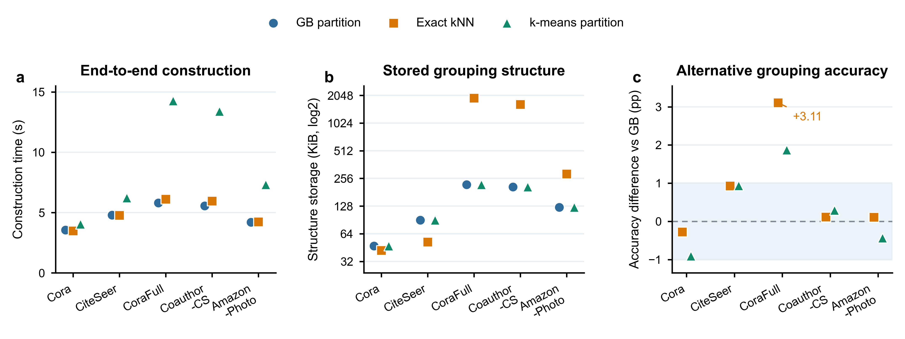

# 粒球局部共识软监督：带噪标签下的转导式无图推理节点分类

**Granular-Ball Local-Consensus Soft Supervision for Noisy-Label Transductive Node Classification with Graph-Free Inference**

---

## Highlights

- 研究带噪训练标签下的转导式 X-only 节点分类。
- 粒球在标签无关的图表征空间中构造。
- 留一局部共识为每个节点生成对应的软监督。
- 训练阶段利用图结构，推理阶段仅使用节点属性。
- 在使用相同部署 MLP 的抗噪基线比较中，GB-LCSS 于 24/25 个设置取得最高或并列最高均值。

---

## 摘要

训练阶段可访问图结构、推理阶段只能使用节点属性，是关系缺失、隐私约束和低时延需求下常见的部署场景。当训练标签受到噪声污染时，现有图标签去噪方法的预测通常仍依赖图结构，而无图推理方法大多以干净训练标签为前提，针对噪声监督的鲁棒性研究仍然有限。本文针对带噪训练标签和 X-only 推理下的转导式节点分类，提出粒球局部共识软监督（Granular-Ball Local-Consensus Soft Supervision，GB-LCSS）。GB-LCSS 将冻结的标签无关图对比表征划分为互斥粒球。对于每个训练节点，算法统计同球内其他训练节点的标签分布，并通过归一化共识权重将该分布与节点自身的观测标签结合，得到节点相关的软目标。这些目标用于训练推理时只接收节点属性的 MLP。在五个数据集和五种噪声设置上，GB-LCSS 与七种使用相同部署 MLP 架构的带噪标签基线比较，在 25 个设置中的 24 个取得最高或并列最高平均精度。图教师扩展通过蒸馏教师对全部节点的软预测提高学生的平均精度，并且不改变学生的 X-only 推理输入。

**关键词**：标签噪声，节点分类，无图推理，图对比学习，粒球计算，知识蒸馏

---

## 1 引言

图神经网络（Graph Neural Network，GNN）通过消息传递将节点属性与关系上下文结合，在节点分类中取得了良好效果 [1,2]。但这种依赖会增加部署难度，因为推理可能需要检索并聚合多跳邻域 [3]。一种常见的无图推理策略是将结构计算移到训练阶段，并部署仅根据节点属性预测的多层感知机（Multilayer Perceptron，MLP）[3,5–7,14,15]。本文研究固定图上的转导式 X-only 节点分类：训练阶段可以使用完整图，部署后的分类器只接收目标节点的属性，不访问邻接关系、邻居节点、图编码器输出或其他图衍生表征。

当训练标签受到污染时，这一部署约束会变得更为棘手。人工标注、自动规则或多源数据都可能引入错误，深度模型还可能在训练后期记忆这些错误监督 [8]。在图上，关系依赖会通过消息传递进一步传播错误标签的影响 [13]。现有图抗噪方法利用拓扑进行标签修正、伪标签构造、样本选择或鲁棒表征学习 [9–12,47]，但其预测过程通常仍依赖图结构。无图方法则侧重将结构知识迁移到 MLP，并且主要在干净标签监督下研究 [3,5–7,14,15]。因此，如何利用训练期图结构改善带噪监督，同时使部署后的分类器仅使用节点属性，仍然没有得到充分解决。

本文的核心思路是在训练阶段利用图结构构造监督，同时保持部署分类器的 X-only 推理。为此，我们将区域构造与标签聚合分开：局部区域的形成不读取标签，观测标签只在划分固定后进入目标构造。GRACE [16] 首先从图中学习不依赖标签的节点表征，随后将该表征空间划分为数量受限且互不重叠的粒球 [34]。对于每个节点，同球其他训练节点的观测标签提供留一局部证据。该证据根据局部一致程度与当前节点的观测标签结合，形成用于训练 X-only MLP 的软目标。

我们在 Cora、CiteSeer、CoraFull、Coauthor-CS 和 Amazon-Photo 上，采用 uniform、pair 和 instance-dependent 标签噪声评估 GB-LCSS。在五种噪声设置中，与七种使用相同部署 MLP 架构的抗噪基线比较，GB-LCSS 在 25 个设置中的 24 个取得最高或并列最高五种子平均精度。作为次要扩展，以相同共识目标训练的图教师为全部节点生成软预测，并在不改变学生推理输入的情况下，使 X-only 学生获得更高的平均精度。

本文的主要贡献如下：

1. 研究带噪标签下的转导式 X-only 节点分类，在训练阶段利用图结构构造监督，而不把图结构作为部署后分类器的输入。
2. 提出 GB-LCSS，在固定球数预算下，将冻结的标签无关图对比表征划分为互斥且划分过程不读取标签的粒球，并通过留一局部共识构造节点相关的软目标。
3. 在五个数据集和五种噪声设置下，系统比较 GB-LCSS 与抗噪方法及结构辅助的 X-only 方法，并通过受控实验分析局部共识监督的作用。进一步将相同的共识目标用于训练图教师，以教师对全部节点的预测为 X-only 学生提供附加监督。

---

## 2 相关工作

### 2.1 带噪标签学习

带噪标签学习通过控制哪些样本值得信任、如何表示监督，或模型以多大强度拟合不确定目标，降低错误标注的影响。样本选择方法利用深度网络先学习干净模式、后记忆噪声的现象。Co-teaching 在两个网络之间交换小损失样本，JoCoR 还约束两个网络的预测一致性 [17,18]。DivideMix 将划分后的干净样本与噪声样本转化为半监督学习问题，FINE 和 CT 则分别根据类别特征方向与置信度轨迹估计样本可靠性 [23–25]。

另一类方法修改训练目标。SCE 结合交叉熵与反向交叉熵，ELR 抑制后期记忆，ANL 和 LogitClip 通过负学习与 logit 范数控制降低模型对错误目标的敏感性 [19–22]。这些方法为一般标签噪声提供了有效的训练策略，但没有显式建模样本之间的图关系。

### 2.2 图上的抗噪学习

图上的带噪标签学习还需要考虑一个额外影响：消息传递可能把错误监督传播到相连节点。一类方法因而将图结构用作估计标签可靠性的证据。UnionNET、NRGNN 和 RTGNN 分别从邻域中提取证据、扩充可靠监督或协调双网络训练 [9,10,46]。TSS、TFR、ProCon、GD² 和 GNN-CFGD 等拓扑选择与分歧方法，则根据重构、一致性、预测分歧或训练历史识别不可靠节点 [40–42,44,47]。

另一类方法利用图结构生成或传播更可靠的监督。DND-NET 根据邻域不确定性构造鲁棒伪标签，RNCGLN 在标签与结构扰动下结合图对比表征学习和标签自修正 [11,12]。Prototype-Guided Supervision 将含噪标签聚合为类别原型；BO-NNC 和 SAMTD 等图教师方法改进监督来源；GTA、MILAB 和 HALF 则调整拓扑或聚合过程，降低不可靠邻域的影响 [45,50,51,58,59,63]。NoisyGL [13] 为这类方法提供了统一基准。

这些方法表明，图结构有助于识别不可靠标签并修正监督，但多数方法的最终预测仍依赖图结构。

### 2.3 无图节点分类与图到 MLP 的知识传递

无图推理将结构计算移出在线预测过程。与本文最相关的方法主要通过三种方式将训练期图信息传递给 MLP，即图衍生目标或表征、图教师蒸馏，以及结构辅助的监督目标。第一条路线使用图衍生目标或表征训练 MLP。Graph-MLP 引入邻域对比目标，GSDN 通过预测层自蒸馏传递邻域信息，SimMLP 则对齐 MLP 与图上下文表征 [4,14,15]。ES-MLP 通过边拆分扩展无消息传递学习，NOSMOG 和 SA-MLP 则保留不同形式的预计算或估计结构信息 [5,27,33]。这些方法采用不同的部署假设，从严格的节点属性输入到附加结构特征不等。

第二条路线通过教师传递图知识。GLNN 建立了 GNN-to-MLP 范式，以 GNN 预测训练 MLP [3]。后续方法扩展了被传递的知识：FF-G2M 分离低频与高频成分，KRD 根据预测稳定性筛选可靠教师知识，VQGraph 用离散编码表示局部结构，PGKD 传递类别原型，TINED 结合教师参数注入与 Dirichlet energy 蒸馏 [6,7,26,28,43]。AdaGMLP、ProGMLP 和 SALE-MLP 进一步研究自适应迁移、精度与成本权衡，以及结构感知潜在表征 [29–31]。Yu 等 [32] 从理论上解释了 GNN 软标签如何向 MLP 传递图诱导的低频偏置。

第三条路线直接修改监督目标。PosteL 根据模型后验构造软目标，ALS 在图训练过程中调节标签平滑强度，SALS 则将邻域信息纳入目标 [60–62]。GB-LCSS 同样改变训练目标，但采用不同的局部证据来源。它首先将冻结且不依赖标签的图表征划分为互斥粒球，再聚合同球其他训练节点的观测标签。PosteL、ALS 和 SALS 主要从模型预测或显式图邻域获得目标信息，而 GB-LCSS 根据冻结标签无关表征中共享区域内的标签共识生成节点相关的目标。

### 2.4 标签无关图几何与粒球学习

图对比学习通过约束增广图视图之间的一致性，在不读取节点标签的情况下学习图感知表征。GRACE 通过边丢弃和特征掩码构造随机视图，并对齐同一节点在不同视图中的表征 [16]。GB-LCSS 将冻结的 GRACE 表征用作不依赖标签的图感知几何空间，以构造局部区域，并使区域形成与后续含噪训练标签聚合相互分离。

粒球计算以粗粒度超球区域表示样本，用于多粒度学习 [34]。GBkNN 在粒球上完成查询分类，粒球采样则根据球纯度和边界结构选择代表性样本 [34,37]。面向噪声的扩展将粒区域用于粗粒度表示与分类、可靠样本选择、伪标签构造或自适应错误修正 [35,36,52,53]。在深度学习中，GBRAIN、G-GBC 和 BNO-GB 将粒区域用作粗粒度训练单元，或用于区分不同形式的噪声样本 [48,49,57]。监督式图粗化、GBGC 和 MGGR 也将粒球用作超节点或层次区域 [54–56]。

在上述研究中，粒球主要用作分类器、样本选择结构、粗粒度训练单元、伪标签区域或图粗化单元。GB-LCSS 为粒球赋予了不同角色：粒球在不读取标签的情况下形成，随后用于聚合可复用的区域统计并构造节点相关的软目标，最终分类仍由仅接收节点属性的 MLP 完成。因此，GRACE 提供图感知几何，粒球则提供监督构造所需的区域接口。

---

## 3 方法

### 3.1 问题设定与符号

给定转导式属性图 $G=(\mathcal V,\mathcal E,X)$，其中 $\mathcal V=\{v_1,\ldots,v_N\}$ 为节点集合，$\mathcal E$ 为边集合，$A\in\{0,1\}^{N\times N}$ 为邻接矩阵，$X=[x_1,\ldots,x_N]^\top\in\mathbb R^{N\times d}$ 为节点属性矩阵。节点属于 $C$ 个类别。训练节点集合记为 $\mathcal V_L$，其可观测标签 $\tilde y_v\in\{1,\ldots,C\}$ 可能受到未知噪声污染。GB-LCSS 不要求预先知道噪声类型、噪声率或标签转移矩阵。

本文采用固定图上的转导式 X-only 设置。训练阶段可以使用包含测试节点在内的完整节点属性矩阵 $X$ 和邻接矩阵 $A$，用于学习表征和构造监督目标，但测试节点标签不可见。训练结束后仅保留分类器 $f_\theta$。对于待预测节点 $v$，模型输出

$$
p_\theta(\cdot\mid x_v)=\operatorname{softmax}\!\left(f_\theta(x_v)\right),
\tag{1}
$$

其中 $x_v$ 是分类器在推理阶段的唯一输入；邻接矩阵 $A$、邻居节点、冻结表征和图编码器均不再提供给分类器。

为便于后续描述，记 $\mathcal B=\{B_j\}_{j=1}^{K}$ 为覆盖全部节点的粒球划分，$T_j=B_j\cap\mathcal V_L$ 为粒球 $B_j$ 内的训练节点。对于 $v\in T_j$，下标 $-v$ 表示在构造局部共识时移除节点 $v$ 自身的标签，其余符号均在首次出现时定义。

### 3.2 GB-LCSS 总体框架

GB-LCSS 在训练阶段利用图结构构造软监督，训练完成后的分类器只使用节点属性。如图 1 所示，GRACE 首先在完整图上学习标签无关的节点表征。随后，在冻结表征空间中通过二均值递归划分得到互斥粒球。粒球确定后，根据同球其他训练节点的观测标签，为每个训练节点构造留一局部共识目标。最后，以节点属性 $X$ 为输入、以该软目标为监督训练 MLP。


**图 1** GB-LCSS 总体框架。阶段 1 学习标签无关的冻结表征，阶段 2 在表征空间中构造粒球。阶段 3 以其中一个粒球为例，展示留一局部共识目标的构造。阶段 4 以软目标训练 X-only MLP。空心节点不参与投票。图中重叠边界是高维粒球的二维投影，每个节点实际只属于一个粒球。图结构和冻结表征仅在训练阶段使用，推理时分类器只接收节点属性。

### 3.3 冻结表征空间中的标签无关粒球构造

#### 3.3.1 冻结图对比表征

本文采用 GRACE [16] 生成粒球空间。GRACE 通过边丢弃和特征掩码得到两个随机图视图，并优化节点级对比目标，使同一节点在两个视图中的表示接近。预训练过程只读取 $X$ 与 $A$，不使用节点标签。预训练完成后，本文取 GRACE 投影头之前的编码器输出作为表征

$$
H=g_\psi(X,A)\in\mathbb R^{N\times d_h},
\tag{2}
$$

冻结参数 $\psi$，并按节点顺序保存 $H$。构球前对每个节点表征进行 L2 归一化，并取 $\varepsilon=10^{-12}$ 作为数值稳定项

$$
\bar h_v=\frac{h_v}{\max(\lVert h_v\rVert_2,\varepsilon)}.
\tag{3}
$$

记归一化后的表征矩阵为 $\bar H=[\bar h_1,\ldots,\bar h_N]^\top$。本文的主实验均采用冻结的 GRACE 表征作为粒球构造的标签无关几何空间。粒球成员关系只由该几何空间决定，标签在划分完成后才被引入。附录 D.3 进一步考察替代表征来源以及 GRACE 预训练种子变化的影响。

#### 3.3.2 递归二分

粒球集合初始化为 $\mathcal B=\{\mathcal V\}$。对于任意粒球 $B\subseteq\mathcal V$，定义其中心和平均中心距离为

$$
\mu_B=\frac{1}{|B|}\sum_{v\in B}\bar h_v,
\qquad
D(B)=\frac{1}{|B|}\sum_{v\in B}\lVert \bar h_v-\mu_B\rVert_2.
\tag{4}
$$

本文以成员集合和中心表示粒球，并以 $D(B)$ 作为评价候选划分的平均径向离散度；数值越小表示该区域在表征空间中越紧致。每轮划分首先收集满足 $|B|\ge 2n_{\min}$ 的候选球，再按 $D(B)$ 从大到小依次尝试二均值划分。这样，有限的分裂预算优先用于几何结构较为松散的区域。设候选球 $B$ 被划分为 $B^{(1)}$ 与 $B^{(2)}$，以子球规模加权后的平均离散度为

$$
D_{\mathrm{split}}(B)=
\frac{|B^{(1)}|D(B^{(1)})+|B^{(2)}|D(B^{(2)})}{|B|}.
\tag{5}
$$

每轮接受首个同时满足以下条件的候选划分：两个子球均不少于 $n_{\min}$ 个节点，且

$$
D_{\mathrm{split}}(B)\le (1-\delta)D(B).
\tag{6}
$$

其中 $n_{\min}$ 为正整数，且 $0<\delta<1$。式 (6) 要求分裂后的加权离散度至少降低比例 $\delta$，子球规模约束用于避免过小区域。每次接受划分后，算法重新计算候选球及其顺序。若一轮内不存在有效划分，或粒球数量达到预设预算 $B_{\max}$，递归过程停止，其中 $B_{\max}$ 为正整数。最终划分由至多 $B_{\max}$ 个互斥粒球组成，覆盖全部节点，且每个节点只属于一个粒球。实验参数见第 4.4 节。

所得划分为监督构造提供了一组数量受限且彼此互斥的局部区域。每个粒球只需统计一次训练节点的类别直方图；为节点 $v$ 构造留一分布时，从中减去 $v$ 自身的一票即可。同球节点因此共享区域级统计，同时保留各自的留一目标。

### 3.4 粒球局部共识软监督

#### 3.4.1 留一共识目标

对于粒球 $B_j$，记其中训练节点为 $T_j=B_j\cap\mathcal V_L$。为避免节点自身的观测标签参与用于调整该标签的局部证据，GB-LCSS 将当前节点从球内投票中移除，并对每个 $v\in T_j$ 定义投票集合

$$
T_{j,-v}=T_j\setminus\{v\}.
\tag{7}
$$

当 $|T_{j,-v}|\ge s_{\min}$ 时，由同球其他训练节点的含噪标签构造经验分布

$$
p_{j,-v,c}=
\frac{1}{|T_{j,-v}|}
\sum_{u\in T_{j,-v}}\mathbb I(\tilde y_u=c),
\qquad c=1,\ldots,C.
\tag{8}
$$

令

$$
M_{j,-v}=\{c:p_{j,-v,c}=r_{j,-v}\},
\qquad
r_{j,-v}=\max_c p_{j,-v,c}.
\tag{9}
$$

$M_{j,-v}$ 表示留一后获得最大票数的类别集合，并列关系直接根据整数票数判断。若多数类唯一，将其记为 $m_{j,-v}$，并混合经验分布与多数类 one-hot。若出现并列，则保留经验分布：

$$
q_{j,-v}=
\begin{cases}
(1-\beta)p_{j,-v}+\beta e_{m_{j,-v}}, & |M_{j,-v}|=1,\\
p_{j,-v}, & |M_{j,-v}|>1.
\end{cases}
\tag{10}
$$

其中 $e_c$ 为类别 $c$ 的 one-hot 向量，$\beta\in[0,1]$ 控制经验分布与多数类别的混合比例。并列时不再按类别索引指定唯一多数类，从而使目标在类别重编号下保持置换等变。由于每次移除的节点不同，同一粒球内各节点对应的 $p_{j,-v}$ 与 $q_{j,-v}$ 也可能不同。

#### 3.4.2 归一化共识权重与节点目标

本文以均匀类别概率 $1/C$ 为下界，对最大票占比作线性归一化：

$$
\alpha_{j,-v}=
\max\left(
0,
\frac{r_{j,-v}-1/C}{1-1/C}
\right).
\tag{11}
$$

$\alpha_{j,-v}$ 衡量留一标签分布相对于均匀分布的集中程度，正整数 $s_{\min}$ 则规定使用局部共识所需的最少留一票数。两者分别描述分布集中度与有效票数。对于 $v\in T_j$，最终训练目标为

$$
t_v=
\begin{cases}
(1-\alpha_{j,-v})e_{\tilde y_v}+\alpha_{j,-v}q_{j,-v},
& |T_{j,-v}|\ge s_{\min},\\[2mm]
e_{\tilde y_v},
& |T_{j,-v}|<s_{\min}.
\end{cases}
\tag{12}
$$

当留一投票接近均匀分布时，$\alpha_{j,-v}$ 较小，目标主要保留节点的观测标签。随着标签分布趋于集中，监督逐渐转向局部共识 $q_{j,-v}$。第二个分支在剩余票数不足时保留观测标签。该连续插值避免直接以球内多数类别硬替换节点标签。

附录 E 给出对称噪声下球内真实多数类仍占优势的条件，以及有限票数下多数类判断错误的概率上界。

式 (7) 至式 (12) 仅使用训练节点的观测标签；验证和测试标签不进入目标构造或训练损失。

#### 3.4.3 仅属性学生训练

学生 $f_\theta$ 为两层 MLP，其计算顺序为线性层、ReLU、BatchNorm、dropout 和输出线性层。学生概率由式 (1) 给出，并在训练节点上最小化软交叉熵

$$
\mathcal L_{\mathrm{LCSS}}
=
-\frac{1}{|\mathcal V_L|}
\sum_{v\in\mathcal V_L}
\sum_{c=1}^{C}
t_{vc}\log p_\theta(c\mid x_v).
\tag{13}
$$

**算法 1** 冻结表征空间中的递归粒球划分

```text
输入: 归一化冻结表征 H̄，节点集合 V，参数 B_max, n_min, δ
输出: 互斥粒球集合 𝓑

 1: 𝓑 ← {V}
 2: while |𝓑| < B_max do
 3:     𝓑_cand ← {B∈𝓑 : |B|≥2n_min}，并按 D(B) 降序排列
 4:     accepted ← false
 5:     for B∈𝓑_cand do
 6:         使用 2-means 将 B 划分为 B^(1), B^(2)
 7:         if min(|B^(1)|,|B^(2)|)≥n_min
 8:            and D_split(B)≤(1−δ)D(B) then
 9:             𝓑 ← (𝓑\{B})∪{B^(1),B^(2)}
10:             accepted ← true
11:             break
12:         end if
13:     end for
14:     if accepted=false then break
15: end while
16: return 𝓑
```

**算法 2** 留一粒球软目标构造

```text
输入: 粒球集合 𝓑，含噪标签 {ỹ_v | v∈V_L}，类别数 C，参数 s_min, β
输出: 训练节点软目标 {t_v | v∈V_L}

 1: 对全部 v∈V_L 初始化 t_v ← e_{ỹ_v}
 2: for B_j∈𝓑 do
 3:     T_j ← B_j∩V_L
 4:     n_j ← Σ_{u∈T_j} e_{ỹ_u}
 5:     for v∈T_j do
 6:         n_(j,−v) ← n_j−e_{ỹ_v}
 7:         if Σ_c n_(j,−v,c)<s_min then continue
 8:         p_(j,−v) ← n_(j,−v)/(Σ_c n_(j,−v,c))
 9:         r_(j,−v) ← max_c p_(j,−v,c)
10:         M_(j,−v) ← {c:p_(j,−v,c)=r_(j,−v)}
11:         if |M_(j,−v)|=1 then
12:             q_(j,−v) ← (1−β)p_(j,−v)+βe_m,  m∈M_(j,−v)
13:         else q_(j,−v) ← p_(j,−v)
14:         α_(j,−v) ← max(0,(r_(j,−v)−1/C)/(1−1/C))
15:         t_v ← (1−α_(j,−v))e_{ỹ_v}+α_(j,−v)q_(j,−v)
16:     end for
17: end for
18: return {t_v | v∈V_L}
```

### 3.5 共识教师蒸馏扩展

共识教师蒸馏增加了结构知识传递给学生的节点范围。该扩展先以粒球共识训练图结构教师，再让 X-only 学生拟合教师对全部节点的逐节点软预测。基础 GB-LCSS 的软目标只作用于训练节点，蒸馏扩展则利用教师在全图上的预测分布。

教师直接采用第 3.4 节定义的 GB-LCSS 目标。对于每个训练节点 $v\in T_j$，目标构造沿用基础 GB-LCSS 的留一投票与低支持回退规则。教师目标为

$$
t_v^{T}=t_v,
\qquad v\in\mathcal V_L.
\tag{14}
$$

其中 $t_v$ 由式 (12) 定义。在扩展中，该目标用于训练图结构教师。教师 $g_\phi$ 为两层 GCN，以原始节点属性 $X$ 和邻接矩阵 $A$ 为输入：

$$
Z^T=g_\phi(X,A).
\tag{15}
$$

冻结表征 $\bar H$ 只用于确定粒球及其共识目标，不作为教师特征输入。教师仅在训练节点上最小化

$$
\mathcal L_T
=
-\frac{1}{|\mathcal V_L|}
\sum_{v\in\mathcal V_L}
\sum_{c=1}^{C}
t_{vc}^{T}
\log
\operatorname{softmax}\left(Z_v^T\right)_c.
\tag{16}
$$

选定教师检查点后固定 $g_\phi$，并将教师在训练期吸收的图结构信息转化为全部节点上的温度软预测，其中 $\tau>0$ 为蒸馏温度

$$
\pi_v=
\operatorname{softmax}
\left(
\frac{Z_v^T}{\tau}
\right).
\tag{17}
$$

X-only 学生随后在全部 $N$ 个节点上拟合这些预测：

$$
\mathcal L_{\mathrm{KD}}
=
-\frac{\tau^2}{N}
\sum_{v\in\mathcal V}
\sum_{c=1}^{C}
\pi_{vc}
\log
\operatorname{softmax}
\left(
\frac{f_\theta(x_v)}{\tau}
\right)_c.
\tag{18}
$$

基础方法只在 $\mathcal V_L$ 上使用局部共识目标，式 (18) 则在全部节点上拟合教师软预测。学生损失仅由教师软预测的交叉熵构成。训练结束后只保留学生 MLP，教师、邻接矩阵和冻结表征均不参与推理。

### 3.6 计算复杂度与推理资源

与直接训练 MLP 相比，GB-LCSS 的额外计算集中在学生训练之前，包括一次 GRACE 预训练和一次粒球构造。所得表征可供同一数据集的不同噪声设置和下游种子复用，存储量为 $O(Nd_h)$。

在冻结表征上，二均值对节点子集 $S$ 迭代 $I$ 次的代价为 $O(I|S|d_h)$。同一轮的候选球互不相交，其节点总数不超过 $N$。整个构造过程最多接受 $B_{\max}-1$ 次分裂。因此，候选扫描与二均值调用的保守时间上界为

$$
O(IB_{\max}Nd_h).
\tag{19}
$$

本文将 $B_{\max}$ 固定为常数，因此构球成本随节点数 $N$ 和表征维数 $d_h$ 近似线性。构造阶段的主要存储来自冻结表征，节点归属、球中心和类别直方图额外需要 $O(N+B_{\max}(d_h+C))$ 空间。球级直方图减去当前节点的一票即可得到留一统计，生成全部训练目标的时间复杂度为 $O(|\mathcal V_L|C)$。当前实现以 $N\times C$ 矩阵保存目标，对应空间为 $O(NC)$。

软目标生成后，学生的训练与普通两层 MLP 相同。令 $F$ 表示学生 MLP 的隐藏层宽度。当前实现采用全批训练，每个 epoch 对全部 $N$ 个节点计算 MLP 输出，再在训练节点掩码上计算损失。若训练轮数为 $T_S$，其训练复杂度为 $O(T_SN(dF+FC))$。训练后的单节点推理复杂度为

$$
O(dF+FC),
\tag{20}
$$

部署时只保存规模为 $O(dF+FC)$ 的学生参数，推理不再需要邻接矩阵、冻结表征或粒球划分，推理开销因而不随边数 $|\mathcal E|$ 增长。蒸馏扩展增加了两层 GCN 教师的训练成本，教师同样在训练结束后移除。第 5.5 节报告 GRACE 预训练时间与峰值显存，以及三种分组接口的构造时间和存储开销。

---

## 4 实验设置

### 4.1 数据集与评测范围

Cora、CiteSeer、CoraFull、Coauthor-CS 和 Amazon-Photo 用于完整噪声谱评测，覆盖 uniform 0.2/0.4/0.6、pair 0.4 和 instance-dependent 0.4。除此之外，本文还在六个补充数据集上进行 uniform 0.4 广度评测，相关结果见附录 I。

Cora 与 CiteSeer 来源于经典引文网络基准 [38]，其余数据集采用图学习评测中常用的公开版本 [39]。五个全谱评测数据集在图规模、特征维数和类别数上具有明显差异（表 1）。边数统计先去除自环，并将互为反向的有向记录合并为一条无向边。边同质性定义为两端节点类别相同的边占全部无向边的比例，仅用于描述图结构特征。

**表 1** 数据集统计。边数按无向边计，训练节点数按 20% 划分计算。

| 数据集 | 节点 | 无向边 | 特征维数 | 类别 | 训练节点 | 边同质性 |
|---|---:|---:|---:|---:|---:|---:|
| Cora | 2,708 | 5,278 | 1,433 | 7 | 541 | 0.810 |
| CiteSeer | 3,327 | 4,552 | 3,703 | 6 | 665 | 0.736 |
| CoraFull | 19,793 | 63,421 | 8,710 | 70 | 3,958 | 0.567 |
| Coauthor-CS | 18,333 | 81,894 | 6,805 | 15 | 3,666 | 0.808 |
| Amazon-Photo | 7,650 | 119,081 | 745 | 8 | 1,530 | 0.827 |

### 4.2 数据划分与标签噪声

本文采用固定图上的转导式（transductive）节点分类。训练阶段可以读取完整图的节点属性和邻接关系，测试节点的属性与拓扑作为无标签上下文参与 GRACE 预训练和粒球划分。实验使用种子 0–4，并通过 NoisyGL 的百分比划分程序进行不按类别分层的随机抽样。训练、验证和测试子集的目标规模分别为 $\lfloor0.2N\rfloor$、$\lfloor0.1N\rfloor$ 和 $\lfloor0.7N\rfloor$；同一数据集和种子下的所有方法共享相同划分。默认协议只污染训练标签，干净验证标签用于选择 checkpoint，测试标签仅用于最终评估。测试节点分类准确率为主要评估指标。附录 C 进一步考察验证标签受到污染时的 checkpoint 选择。

uniform 噪声满足 $P_{ii}=1-\rho$ 与 $P_{ij}=\rho/(C-1)$，其中 $\rho\in\{0.2,0.4,0.6\}$。pair 噪声使用 $\rho=0.4$，以概率 $\rho$ 将类别 $i$ 翻转为 $((i-2)\bmod C)+1$，并以概率 $1-\rho$ 保持原类别。instance-dependent 噪声由 NoisyGL 的相应程序生成，配置平均翻转率为 0.4，$\texttt{norm\_std}=0.1$。同一数据集和种子下的所有方法共享相同的训练标签噪声实例。

### 4.3 比较方法与比较组

比较方法分为两组。第一组为采用相同部署骨干的含噪标签学习方法，包括 MLP+CE、Small-loss、Co-teaching、JoCoR、SCE、ELR、LogitClip 与 GB-LCSS。它们采用相同的两层部署 MLP、相同的有标签训练节点和 X-only 推理输入。GB-LCSS 按本文设定利用训练期图信息构造监督。Co-teaching 和 JoCoR 在训练阶段保留两个独立初始化的两层 MLP；评测时只使用其中一个网络，不对两个网络的预测进行集成。

第二组为训练期利用图信息、推理期仍只读取节点属性的结构辅助方法，包括 PosteL、ALS、SALS [60–62]、Graph-MLP [4] 和 GSDN [14]。PosteL 保留其后验目标构造并关闭迭代伪标签，其他方法保留公开工作中的核心目标，并统一采用本文的数据划分、噪声实例和 X-only 学生。具体实现身份、协议适配和方法特有参数见附录 H。

图教师蒸馏扩展在正文中比较 GLNN 式响应蒸馏、FF-G2M、KRD、VQGraph 和球式共识教师 [3,6,7,26]。FF-G2M 采用共同学生骨干重实现，并保留低频与高频知识蒸馏目标。KRD 和 VQGraph 分别保留可靠知识选择与软码本蒸馏机制，并适配到本文的统一噪声协议。所有路线均逐种子重新训练教师和学生，最终学生只读取节点属性。

### 4.4 实现细节

所有数据集均通过 PyTorch Geometric 和 NoisyGL 数据接口加载。GRACE 预训练使用行归一化后的节点属性。下游分类器采用 NoisyGL 提供的节点属性和邻接矩阵；对于包含图卷积的模型，邻接归一化与自环处理由图卷积层内部完成。

全部基础方法采用相同的两层 MLP 骨干，隐层宽度为 64，dropout 为 0.5。双网络方法使用两个独立初始化的相同骨干。第一组模型使用 Adam 完整训练 200 个 epoch，学习率为 0.01，权重衰减为 $5\times10^{-4}$。保存验证准确率最高的 checkpoint，不采用基于 patience 的提前停止；图教师也使用相同的验证准确率准则选择 checkpoint。Small-loss、Co-teaching 和 JoCoR 按已知合成噪声率设置 forget-rate schedule，其他基础方法不使用该信息。

GB-LCSS 在全部实验中固定使用 $B_{\max}=64$、$n_{\min}=32$、$\delta=0.05$、$s_{\min}=2$ 和 $\beta=0.5$。二均值采用欧氏距离和 k-means++ 初始化，下游种子同时控制二均值初始化，每个候选划分执行 10 次初始化。GRACE 采用不读取标签的数据集级配置，预训练完成后冻结编码器。蒸馏温度取 $\tau=1$。完整参数和配置来源见附录 H。

### 4.5 统计分析

实验报告 5 个配对种子的测试精度均值和样本标准差。每个数据集的主实验固定一份预训练表征 $H$。五个配对运行分别改变数据划分、噪声实例、下游初始化以及粒球方法的二均值初始化。跨 GRACE 预训练种子的诊断见附录 D.3。本文采用双侧配对 $t$ 检验，具体实现为对五个同种子精度差进行单样本 $t$ 检验；95% 置信区间按自由度为 4 的 $t$ 分布计算。Holm 校正分别应用于 GB-LCSS 对随机等规模分组、MLP+CE 和 JoCoR 的三个 25 项比较族，依次对应分组机制对照、标准 MLP 基线和较强的含噪标签基线。这些检验用于量化五个下游种子间配对增量的稳定性，完整配对结果见附录 B。

---

## 5 实验结果与分析

### 5.1 采用相同部署 MLP 架构的抗噪方法比较

为隔离监督策略的影响，本文在统一的 X-only MLP 部署架构下比较 GB-LCSS 与七种抗噪方法，并固定学生容量和推理输入（表 2）。

**表 2** 相同 X-only MLP 部署架构下各方法在 uniform 0.4 标签噪声下的测试精度。

| 方法 | Cora | CiteSeer | CoraFull | Coauthor-CS | Amazon-Photo |
|---|---:|---:|---:|---:|---:|
| MLP+CE | 44.24±2.62 | 43.50±3.02 | 31.98±0.98 | 88.42±0.62 | 73.90±1.80 |
| Small-loss | 51.95±1.97 | 49.70±3.07 | 33.04±0.50 | 89.06±0.88 | 77.25±1.62 |
| Co-teaching | 46.83±1.78 | 46.24±2.89 | 34.39±0.24 | 88.80±0.97 | 78.21±1.00 |
| JoCoR | 51.72±1.30 | 49.91±3.37 | 35.70±0.32 | 89.38±0.61 | 79.57±0.53 |
| SCE | 43.60±1.86 | 42.09±3.47 | 29.29±0.45 | 88.37±0.53 | 76.08±3.11 |
| ELR | 44.28±1.38 | 43.17±3.95 | 32.14±0.67 | 88.29±0.73 | 73.93±2.12 |
| LogitClip | 47.50±1.50 | 46.57±3.52 | 34.69±1.17 | 88.40±0.21 | 74.98±2.38 |
| GB-LCSS | **57.49±0.76** | **55.24±2.04** | **37.39±0.51** | **90.71±0.59** | **82.12±1.08** |

注：数值为五个配对种子的测试精度均值±样本标准差（%）；粗体表示每列最高均值。所有分类器采用相同的 MLP 层数、宽度、有标签训练节点和推理输入；比较组与训练资源见第 4.3 节。

在 uniform 0.4 噪声下，GB-LCSS 在五个数据集上均取得最高平均精度，相对各数据集最强基线提高 1.33–5.54 个百分点。

全噪声谱给出一致结论：在 25 个设置中，GB-LCSS 有 24 个取得最高或并列最高的五种子平均精度，相对 MLP+CE 和 JoCoR 的平均增量分别为 7.74 和 3.46 个百分点。唯一未领先的是 Coauthor-CS uniform 0.2，差距为 0.27 个百分点（图 2；完整结果与配对检验见附录 A、B）。


**图 2** GB-LCSS 相对最强同部署架构抗噪基线的精度增量。每个单元格为相同数据集和噪声设置下 GB-LCSS 的五种子平均精度减去七种基线中的最高均值，单位为百分点。蓝色和红色分别表示正、负增量。

图 3 进一步展示 uniform 噪声率升高时的绝对精度变化。GB-LCSS 在 15 个数据集–噪声率组合中的 14 个领先三种对照；当 $\rho$ 从 0.2 增至 0.6 时，其精度降幅在五个数据集中的四个小于 MLP+CE 和 JoCoR，仅 CiteSeer 例外。这表明其优势并非局限于单一噪声率，并且在多数数据集上伴随更缓的高噪声退化。


**图 3** Uniform 标签噪声率下的测试精度。实线为五个配对种子的均值，阴影为样本标准差；各子图的纵轴独立缩放。随机等规模分组仅打乱节点与局部单元的对应关系，并保留粒球数量和规模分布。

在六个补充数据集上，GB-LCSS 的五种子平均精度在三个数据集上高于最强同架构基线，在全部六个数据集上高于随机等规模分组。完整结果见附录 I。

### 5.2 结构辅助 X-only 方法

进一步的比较纳入五种在训练阶段利用图信息的 X-only 方法，以考察不同结构辅助方式的相对表现（表 3）。

**表 3** 结构辅助 X-only 方法在 uniform 0.4 标签噪声下的测试精度。

| 方法 | 训练期图信息使用方式 | Cora | CiteSeer | CoraFull | Coauthor-CS | Amazon-Photo |
|---|---|---:|---:|---:|---:|---:|
| PosteL | 结构辅助软标签 | 47.09±1.81 | 45.84±2.48 | 36.51±1.01 | 84.74±1.51 | 80.59±0.94 |
| ALS | 邻域标签平滑 | 45.20±1.24 | 43.77±2.76 | 31.91±1.05 | 88.55±0.86 | 73.41±2.75 |
| SALS | 结构感知标签平滑 | 48.27±2.50 | 47.20±1.69 | 37.06±0.78 | 88.85±0.82 | 77.86±0.79 |
| Graph-MLP | 多跳结构监督 | **63.23±3.07** | **57.23±1.85** | 37.05±0.91 | 88.95±0.43 | 77.05±1.24 |
| GSDN | 邻域自蒸馏 | 55.97±4.29 | 50.36±3.39 | 35.80±0.66 | 86.55±0.78 | 73.31±2.00 |
| GB-LCSS | 冻结图表征中的留一粒球共识 | 57.49±0.76 | 55.24±2.04 | **37.39±0.51** | **90.71±0.59** | **82.12±1.08** |

注：数值为五个种子的测试精度均值±样本标准差（%）。各方法训练时可使用图信息，推理时只读取节点属性；粗体表示每列最高均值。

在 25 个设置上取平均，GB-LCSS 相对 PosteL、ALS 和 SALS 的平均精度分别高出 5.69、7.71 和 4.69 个百分点，正向设置数分别为 24/25、25/25 和 24/25。各方法的协议适配方式见第 4.3 节和附录 H，GB-LCSS、PosteL、ALS 和 SALS 的完整噪声谱见附录 G。

Graph-MLP 与 GB-LCSS 呈现出不同的数据集偏好。Graph-MLP 在 Cora 和 CiteSeer 上分别高出 5.74 和 1.99 个百分点，GB-LCSS 则在 CoraFull、Coauthor-CS 和 Amazon-Photo 上分别领先 0.34、1.76 和 5.07 个百分点。多跳结构监督与冻结表征局部共识的相对优势随数据集而变化。

### 5.3 消融与机制分析

#### 5.3.1 局部共识目标的作用

随机等规模分组和含自票消融分别检验局部成员关系是否提供有效信息，以及目标是否需要移除节点自身标签。真实分组在全部 25 个设置中均优于随机分组，平均增量为 8.69 个百分点；留一目标相对含自票目标的平均增量为 0.08–1.03 个百分点。因此，局部成员关系是当前实验中的主要贡献，留一投票提供幅度较小但平均为正的修正。uniform 0.4 下，GB-LCSS 在全部五个数据集上还优于均匀平滑和训练先验平滑；完整结果见附录 D。

图 4 进一步检验最终软目标是否更接近干净监督。干净训练标签仅作为多类 Brier 分数的事后参照。对任一目标矩阵 $Y^{\mathrm{tar}}$，本文采用

$$
\operatorname{BS}(Y^{\mathrm{tar}})=\frac{1}{|\mathcal V_L|}\sum_{v\in\mathcal V_L}\sum_{c=1}^{C}\left(Y^{\mathrm{tar}}_{vc}-\mathbf 1[y_v=c]\right)^2,
$$

其中 $y_v$ 表示训练节点 $v$ 的干净标签。25 个数据集–噪声设置的五种子平均值均位于等值线下方。相对原始含噪 one-hot 目标，GB-LCSS 软目标的平均 Brier 分数降低 0.06–0.51，其中 Coauthor-CS 和 Amazon-Photo 上的改善最大。


**图 4** GB-LCSS 软目标的事后质量诊断。**(a)** 横轴和纵轴分别为原始含噪 one-hot 目标与 GB-LCSS 软目标的多类 Brier 分数。每个标记表示一个数据集–噪声设置的五种子均值；颜色区分数据集，圆形、方形和三角形分别表示 uniform、pair 和 instance 噪声，虚线为等值线。**(b)** 每个单元格为原始目标分数减去软目标分数；正值表示软目标的概率平方误差更低。

#### 5.3.2 粒球分区的作用

kNN 和 k-means 分组采用与主方法相同的留一目标。kNN 按每个 seed 的平均球内训练票数匹配邻域规模，并排除查询节点自身。k-means 的簇数按该 seed 的粒球数量匹配，簇内目标同样移除当前节点。在五个全谱评测数据集上，粒球相对两种替代实现中的最佳者分别为 $+0.27$、$-0.94$、$-3.11$、$-0.29$ 和 $-0.11$ 个百分点。除 CoraFull 外，三种分组实现的差距均在 1 个百分点以内。因此，局部共识监督不依赖唯一的分组规则。

GB-LCSS 将粒球保留为默认区域接口，是因为受预算约束的递归划分能够自动确定一组数量受限且彼此互斥的区域，并支持区域统计共享。在匹配的 k-means 对照中，簇数则由同一 seed 下粒球生成的区域数量给定。kNN 需要为每个训练节点维护相互重叠且可能不对称的邻域，并分别聚合其中的标签。替代实验说明局部共识可以迁移到其他分组规则，而粒球提供了固定预算、互斥且可复用的区域结构。

### 5.4 干净训练标签下的对照

为区分标签噪声鲁棒性与一般正则化效应，本文进一步考察干净训练标签条件，即令 $\rho=0$，其余数据划分和训练设置不变。GB-LCSS 相对 MLP+CE 在 Cora、CiteSeer、CoraFull、Coauthor-CS 和 Amazon-Photo 上的精度差分别为 $-0.24$、$+2.00$、$-0.38$、$-0.87$ 和 $-1.75$ 个百分点。除 CiteSeer 外，GB-LCSS 没有提高干净标签下的分类精度。

该对照说明，GB-LCSS 相对 MLP+CE 的收益主要出现在训练标签受到污染时。在干净标签学习中，局部共识没有表现出一致的额外收益。

### 5.5 训练期表征与分组开销

所有时间与显存均在配备 AMD Radeon RX 7700 XT 的同一工作站上测量，运行环境为 Python 3.12.10 和 PyTorch 2.9.1+rocm7.2.1。GB-LCSS 与 MLP+CE 使用相同学生，因此具有相同的参数量、推理输入和前向复杂度。额外开销来自训练前的 GRACE 表征学习和粒球构造。为说明一次性的表征学习开销，本文报告 Cora、CiteSeer 和 CoraFull 的 GRACE 预训练时间与峰值显存记录。在这组单次测量中，预训练时间分别为 0.07、0.13 和 74.48 分钟，峰值显存分别为 0.40、0.67 和 12.73 GiB。同一份冻结表征可供该数据集的全部噪声设置和下游种子复用。

图 5 量化粒球、精确 kNN 和 k-means 之间的工程权衡。在 seed 0 的实现测量中，粒球在五个数据集中的三个具有更低的端到端构造时间，并在 CoraFull、Coauthor-CS 和 Amazon-Photo 上比精确 kNN 使用更少的分组存储。结合第 5.3.2 节的精度结果，本文采用粒球的依据是其互斥、可复用且固定预算的区域表示；替代接口在精度上仍有竞争力，并可在个别数据集上具有更低开销。



**图 5** 粒球、精确 kNN 和 k-means 三种局部共识分组接口的精度与成本。**(a)** 端到端构造时间。**(b)** 分组结构存储量。**(c)** 精确 kNN 和 k-means 相对粒球的测试精度差；正值表示替代分组更优，蓝色区域表示 $\pm1$ 个百分点。时间和存储量为 seed 0 的实现测量，精度为 uniform 0.4 下的五种子均值。

### 5.6 结果讨论

主实验和补充评测均支持局部成员关系在目标构造中的作用，基于表征几何得到的粒球分组在两组评测中都优于随机等规模分组。GB-LCSS 相对强抗噪分类器和替代分组接口的优势随数据集而变化，干净标签条件下也没有出现稳定增益。因此，GB-LCSS 的作用主要体现在带噪监督下利用局部成员关系构造软目标，具体收益取决于数据集的表征几何和基线强度。

---

## 6 图教师蒸馏扩展

### 6.1 从训练节点目标到全节点蒸馏

基础 GB-LCSS 在训练节点上构造软目标。蒸馏扩展引入 GCN 教师，并用教师对全部节点的预测训练 X-only 学生，从而将监督覆盖扩展到全图。训练结束后只保留学生模型。由于该路线增加了图教师和全节点预测，本文将其作为独立扩展评测。

本文在 Cora、CiteSeer、CoraFull、Coauthor-CS 和 Amazon-Photo 的 uniform 0.4 与 0.6 条件下评估该扩展，以比较不同教师监督与知识迁移方式。

### 6.2 不同图知识迁移路线的比较

为考察教师监督来源和知识迁移方式对 X-only 学生的影响，本文比较球式共识教师、基础 GLNN 式响应蒸馏和三种代表性的 GNN-to-MLP 路线（表 4）。FF-G2M 分别传递低频邻域知识和高频边差异知识，KRD 根据教师在特征扰动下的稳定性选择可靠知识，VQGraph 以软码本表示局部结构 [6,7,26]。球式共识教师使用式 (14) 的 GB-LCSS 目标训练 GCN(X) 教师。所有路线共享数据划分和噪声实例，并在每个种子内独立训练教师与相同的两层 X-only 学生。

**表 4** 基础 GB-LCSS 与五条图知识迁移路线在 uniform 0.4 和 0.6 标签噪声下的测试精度。

**(a) Uniform 0.4**

| 训练路线 | Cora | CiteSeer | CoraFull | Coauthor-CS | Amazon-Photo |
|---|---:|---:|---:|---:|---:|
| 基础 GB-LCSS（无蒸馏） | 57.49±0.76 | 55.24±2.04 | 37.39±0.51 | 90.71±0.59 | 82.12±1.08 |
| GCN(X)+CE 教师（GLNN 式） | 77.95±2.62 | 66.09±1.38 | **58.74±0.82** | 93.20±0.09 | 89.86±0.77 |
| FF-G2M | 77.65±2.97 | 65.80±0.49 | 56.58±0.93 | 91.58±0.24 | 84.82±0.84 |
| KRD | 71.77±2.20 | 64.96±1.03 | 47.12±0.95 | 91.39±0.49 | 85.17±0.94 |
| VQGraph | 78.89±2.34 | 65.64±1.72 | 58.52±0.77 | 93.25±0.09 | **90.54±0.85** |
| 球式共识教师 | **81.35±1.05** | **69.27±1.57** | 57.29±0.24 | **93.83±0.21** | 90.40±0.77 |

**(b) Uniform 0.6**

| 训练路线 | Cora | CiteSeer | CoraFull | Coauthor-CS | Amazon-Photo |
|---|---:|---:|---:|---:|---:|
| 基础 GB-LCSS（无蒸馏） | 41.86±2.30 | 42.02±3.14 | 27.43±0.89 | 87.19±0.69 | 71.45±3.75 |
| GCN(X)+CE 教师（GLNN 式） | 65.50±3.28 | 53.30±4.42 | 51.63±2.02 | 91.13±0.58 | 84.80±1.48 |
| FF-G2M | 63.63±2.16 | 52.32±4.20 | 45.78±2.90 | 86.50±1.01 | 73.08±2.82 |
| KRD | 61.28±1.17 | 54.17±3.14 | 41.61±2.43 | 89.80±0.29 | 80.30±0.51 |
| VQGraph | 65.75±2.72 | 53.34±4.47 | 52.01±0.65 | 90.71±1.24 | 84.77±2.19 |
| 球式共识教师 | **71.34±3.91** | **58.93±4.62** | **52.32±1.26** | **92.40±0.65** | **86.81±1.94** |

注：数值为五个种子的测试精度均值±样本标准差（%）；粗体表示每列最高均值。所有蒸馏路线使用相同的两层学生，推理时均只读取节点属性。FF-G2M 为保留原论文核心目标的共同学生骨干重实现，KRD 和 VQGraph 为机制适配实现。球式共识教师以 $X$ 和邻接矩阵训练，冻结 $H$ 仅用于构造式 (14) 的粒球目标。

球式共识教师在全部 10 个数据集–噪声组合上均优于基础 GB-LCSS；uniform 0.4 和 0.6 下的增量范围分别为 3.12–23.86 和 5.21–29.48 个百分点。在所有六种方法中，球式共识教师在 10 个组合中的 8 个取得最高均值，并在 9 个组合中优于 GCN(X)+CE 教师。两个例外均出现在 uniform 0.4：CoraFull 上落后 GCN(X)+CE 1.45 个百分点，Amazon-Photo 上落后 VQGraph 0.14 个百分点。教师在训练后被丢弃，因此所有学生在推理时仍只读取节点属性。

---

## 7 结论

本文研究训练标签含噪、训练阶段可访问图结构而推理阶段只使用节点属性的转导式节点分类。GB-LCSS 在冻结图对比表征中构造互斥的标签无关区域，并以留一局部共识生成 X-only MLP 的软监督。在五个数据集和五种噪声设置上，与采用相同部署 MLP 架构的七种抗噪基线相比，GB-LCSS 在 25 个设置中的 24 个取得最高或并列最高的五种子平均精度。在 25 个评测设置上取平均，GB-LCSS 的精度也高于统一协议下适配的 PosteL、ALS 和 SALS。

粒球提供数量受限的区域接口，其共享标签统计可以复用于节点特定目标的构造。分组实验表明，局部共识也可以通过其他邻域或聚类规则实现，而粒球接口保留了互斥成员关系和共享区域统计。作为次要扩展，以相同共识目标训练的图教师为全部节点生成预测，并在本文评测的蒸馏协议下使 X-only 学生获得更高的平均精度。

当前实验采用合成标签噪声、干净验证标签和固定图上的转导式评测，局部目标还依赖预训练后冻结的图表征。真实标注噪声、归纳式新节点，以及无干净验证标签条件下的模型选择仍有待研究。

---

## 8 数据与代码可用性

本文使用的图数据集均为公开基准。随稿提交的匿名补充材料提供 GB-LCSS、同架构基线、随机等规模分组和球式共识教师的可运行代码，以及论文实验所用的配置、冻结表征、逐种子结果、表格快照、核验脚本、最终图片和 GRACE 设置。对于协议适配的比较方法，补充材料提供本文使用的配置、实现说明和逐种子结果。

---

## 参考文献

[1] T. N. Kipf, M. Welling, Semi-supervised classification with graph convolutional networks, in: Proc. ICLR, 2017.

[2] P. Velickovic, G. Cucurull, A. Casanova, A. Romero, P. Lio, Y. Bengio, Graph attention networks, in: Proc. ICLR, 2018.

[3] S. Zhang, Y. Liu, Y. Sun, N. Shah, Graph-less neural networks: Teaching old MLPs new tricks via distillation, in: Proc. ICLR, 2022.

[4] Y. Hu, H. You, Z. Wang, Z. Wang, E. Zhou, Y. Gao, Graph-MLP: Node classification without message passing in graph, arXiv preprint arXiv:2106.04051, 2021.

[5] Y. Tian, C. Zhang, Z. Guo, X. Zhang, N. V. Chawla, Learning MLPs on graphs: A unified view of effectiveness, robustness, and efficiency, in: Proc. ICLR, 2023.

[6] L. Yang, Y. Tian, M. Xu, Z. Liu, S. Hong, W. Qu, W. Zhang, B. Cui, M. Zhang, J. Leskovec, VQGraph: Rethinking graph representation space for bridging GNNs and MLPs, in: Proc. ICLR, 2024.

[7] L. Wu, H. Lin, Y. Huang, S. Z. Li, Quantifying the knowledge in GNNs for reliable distillation into MLPs, in: Proc. ICML, 2023.

[8] C. Zhang, S. Bengio, M. Hardt, B. Recht, O. Vinyals, Understanding deep learning (still) requires rethinking generalization, Communications of the ACM 64 (3) (2021) 107–115.

[9] E. Dai, C. Aggarwal, S. Wang, NRGNN: Learning a label noise resistant graph neural network on sparsely and noisily labeled graphs, in: Proc. ACM SIGKDD, 2021.

[10] S. Qian, H. Ying, R. Hu, J. Zhou, J. Chen, D. Z. Chen, J. Wu, Robust training of graph neural networks via noise governance, in: Proc. WSDM, 2023, pp. 607–615. https://doi.org/10.1145/3539597.3570369.

[11] K. Ding, X. Ma, Y. Liu, S. Pan, Divide and denoise: Empowering simple models for robust semi-supervised node classification against label noise, in: Proc. ACM SIGKDD, 2024, pp. 574–584.

[12] Y. Zhu, L. Feng, Z. Deng, Y. Chen, R. Amor, M. Witbrock, Robust node classification on graph data with graph and label noise, in: Proc. AAAI, 2024.

[13] Z. Wang, D. Sun, S. Zhou, H. Wang, J. Fan, L. Huang, J. Bu, NoisyGL: A comprehensive benchmark for graph neural networks under label noise, Advances in Neural Information Processing Systems 37 (2024) 38142–38170.

[14] L. Wu, J. Xia, H. Lin, Z. Gao, Z. Liu, G. Zhao, S. Z. Li, Teaching yourself: Graph self-distillation on neighborhood for node classification, arXiv preprint arXiv:2210.02097, 2022.

[15] Z. Wang, Z. Zhang, C. Zhang, Y. Ye, Training MLPs on graphs without supervision, in: Proc. WSDM, 2025.

[16] Y. Zhu, Y. Xu, F. Yu, Q. Liu, S. Wu, L. Wang, Deep graph contrastive representation learning, in: ICML Workshop on Graph Representation Learning and Beyond, 2020.

[17] B. Han, Q. Yao, X. Yu, G. Niu, M. Xu, W. Hu, I. W. Tsang, M. Sugiyama, Co-teaching: Robust training of deep neural networks with extremely noisy labels, in: Proc. NeurIPS, 2018.

[18] H. Wei, L. Feng, X. Chen, B. An, Combating noisy labels by agreement: A joint training method with co-regularization, in: Proc. CVPR, 2020.

[19] Y. Wang, X. Ma, Z. Chen, Y. Luo, J. Yi, J. Bailey, Symmetric cross entropy for robust learning with noisy labels, in: Proc. ICCV, 2019.

[20] S. Liu, J. Niles-Weed, N. Razavian, C. Fernandez-Granda, Early-learning regularization prevents memorization of noisy labels, in: Proc. NeurIPS, 2020.

[21] X. Ye, X. Li, S. Dai, T. Liu, Y. Sun, W. Tong, Active negative loss functions for learning with noisy labels, in: Proc. NeurIPS, 2023.

[22] H. Wei, H. Zhuang, R. Xie, L. Feng, G. Niu, B. An, Y. Li, Mitigating memorization of noisy labels by clipping the model prediction, in: Proc. ICML, 2023.

[23] J. Li, R. Socher, S. C. H. Hoi, DivideMix: Learning with noisy labels as semi-supervised learning, in: Proc. ICLR, 2020.

[24] T. Kim, J. Ko, S. Cho, J. Choi, S.-Y. Yun, FINE samples for learning with noisy labels, in: Proc. NeurIPS, 2021.

[25] W. Pan, W. Wei, F. Zhu, Y. Deng, Enhanced sample selection with confidence tracking: Identifying correctly labeled yet hard-to-learn samples in noisy data, in: Proc. AAAI, 39 (19) (2025) 19795–19803. https://doi.org/10.1609/aaai.v39i19.34180.

[26] L. Wu, H. Lin, Y. Huang, T. Fan, S. Z. Li, Extracting low-/high-frequency knowledge from graph neural networks and injecting it into MLPs: An effective GNN-to-MLP distillation framework, in: Proc. AAAI, 2023.

[27] J. Chen, M. Bai, S. Chen, J. Gao, J. Zhang, J. Pu, SA-MLP: Distilling graph knowledge from GNNs into structure-aware MLP, Transactions on Machine Learning Research (2024).

[28] T. Wu, Z. Zhao, J. Wang, X. Bai, L. Wang, N. Wong, Y. Yang, Edge-free but structure-aware: Prototype-guided knowledge distillation from GNNs to MLPs, in: Proc. COLING, 2025, pp. 5656–5667.

[29] W. Lu, Z. Guan, W. Zhao, Y. Yang, AdaGMLP: AdaBoosting GNN-to-MLP knowledge distillation, in: Proc. ACM SIGKDD, 2024, pp. 2060–2071. https://doi.org/10.1145/3637528.3671699.

[30] W. Lu, Z. Guan, W. Zhao, Y. Yang, Y. Sun, Z. Liang, Y. Zhan, D. Tao, ProGMLP: A progressive framework for GNN-to-MLP knowledge distillation with efficient trade-offs, in: Proc. AAAI, 40 (29) (2026) 24088–24096. https://doi.org/10.1609/aaai.v40i29.39587.

[31] H. Pal, S. Malik, R. Patel, A. Malhotra, SALE-MLP: Structure aware latent embeddings for GNN to graph-free MLP distillation, in: Proc. IJCAI, 2025, pp. 6003–6011. https://doi.org/10.24963/ijcai.2025/668.

[32] Z. Yu, M. Lin, W. Li, Z. Yin, S. Xiao, S. Lu, Demystifying GNN-to-MLP knowledge transfer: Theoretical grounding and dual-stream distillation method, in: Proc. AAAI, 40 (33) (2026) 28005–28013. https://doi.org/10.1609/aaai.v40i33.40025.

[33] M. Kohn, M. Hoffmann, A. Scherp, Edge-splitting MLP: Node classification on homophilic and heterophilic graphs without message passing, in: Proc. Third Learning on Graphs Conference, PMLR 269 (2025) 11:1–11:21. https://proceedings.mlr.press/v269/kohn25a.html.

[34] S. Xia, Y. Liu, X. Ding, G. Wang, H. Yu, Y. Luo, Granular ball computing classifiers for efficient, scalable and robust learning, Information Sciences 483 (2019) 136–152.

[35] F. Dunkin, X. Li, H. Li, G. Wu, C. Hu, S. S. Ge, MgCNL: A sample separation approach via multi-granularity balls for fault diagnosis with the interference of noisy labels, IEEE Transactions on Automation Science and Engineering 22 (2025) 7748–7761. https://doi.org/10.1109/TASE.2024.3469000.

[36] F. Dunkin, X. Li, C. Hu, G. Wu, H. Li, X. Lu, Z. Zhang, Like draws to like: A multi-granularity ball-intra fusion approach for fault diagnosis models to resists misleading by noisy labels, Advanced Engineering Informatics 60 (2024) 102425. https://doi.org/10.1016/j.aei.2024.102425.

[37] S. Xia, S. Zheng, G. Wang, X. Gao, B. Wang, Granular ball sampling for noisy label classification or imbalanced classification, IEEE Transactions on Neural Networks and Learning Systems 34 (4) (2023) 2144–2155. https://doi.org/10.1109/TNNLS.2021.3105984.

[38] P. Sen, G. Namata, M. Bilgic, L. Getoor, B. Galligher, T. Eliassi-Rad, Collective classification in network data, AI Magazine 29 (3) (2008) 93–106.

[39] O. Shchur, M. Mumme, A. Bojchevski, S. Gunnemann, Pitfalls of graph neural network evaluation, in: Relational Representation Learning Workshop, NeurIPS, 2018. https://www.cs.cit.tum.de/daml/gnn-benchmark/.

[40] Z. Wang, Y. Bei, S. Zhou, Z. Zhou, J. Fan, H. Xue, H. Wang, J. Bu, Learning from graph: Mitigating label noise on graph through topological feature reconstruction, in: Proc. CIKM, 2025, pp. 3261–3270. https://doi.org/10.1145/3746252.3761185.

[41] K. Li, J. Sun, J. Lou, Z. Feng, H. Zhou, C. Wu, G. Xue, W. Zhao, J. Li, Leveraging peer-informed label consistency for robust graph neural networks with noisy labels, in: Proc. IJCAI, 2025, pp. 5598–5606. https://doi.org/10.24963/ijcai.2025/623.

[42] K. Li, J. Lou, J. Sun, H. Zeng, W. Li, C. Wu, Y. Luo, W. Zhao, S. Du, J. Li, GD²: Robust graph learning under label noise via dual-view prediction discrepancy, Advances in Neural Information Processing Systems 38 (2025).

[43] Z. Zhou, Z. Ding, J. Shi, L. Qing, S. Shen, TINED: GNNs-to-MLPs by teacher injection and Dirichlet energy distillation, in: Proc. ICML, PMLR 267 (2025) 78616–78632. https://proceedings.mlr.press/v267/zhou25a.html.

[44] S. Li, B. Zhang, J. Song, G. Ruan, C. Wang, J. Xie, Graph neural networks with coarse- and fine-grained division for mitigating label noise and sparsity, Neural Networks 187 (2025) 107338. https://doi.org/10.1016/j.neunet.2025.107338.

[45] B. Hu, G. Wen, Y. Huang, Y. Liu, X. Zhu, Structure-aware multi-teacher distillation for noise node classification, Information Processing & Management 63 (7) (2026) 104877. https://www.sciencedirect.com/science/article/pii/S0306457326002682.

[46] Y. Li, J. Yin, L. Chen, Unified robust training for graph neural networks against label noise, in: Proc. PAKDD, Lecture Notes in Computer Science 12712 (2021) 528–540. https://doi.org/10.1007/978-3-030-75762-5_42.

[47] Y. Wu, J. Yao, X. Xia, J. Yu, R. Wang, B. Han, T. Liu, Mitigating label noise on graphs via topological sample selection, in: Proc. ICML, PMLR 235 (2024) 53944–53972. https://proceedings.mlr.press/v235/wu24ae.html.

[48] J. Yang, Q. Liu, X. Cao, F. Li, X. Yang, G-GBC: A Gaussian mixture-based granular ball computing method for robust CNN classification under noisy labels, Knowledge-Based Systems 341 (2026) 115754. https://doi.org/10.1016/j.knosys.2026.115754.

[49] Y. Li, X. Ouyang, J. Zhang, C. Pan, L. Ren, X. Yang, Beneficial noise learning for open intent classification via granular-ball representation, Pattern Recognition 177 (2026) 113283. https://doi.org/10.1016/j.patcog.2026.113283.

[50] Z. Liu, H. Yu, X. Luo, Mitigating label noise in graph learning with information bottleneck-guided aggregation and adversarial consistency, Pattern Recognition 180 (2026) 114271. https://doi.org/10.1016/j.patcog.2026.114271.

[51] S. Li, B. Zhang, M. Cao, J. Song, X. Cheng, C. Wang, HALF: A homophily-aware loss fusion for robust learning under label noise in heterophilic graphs, Information Sciences 754 (2026) 123714. https://doi.org/10.1016/j.ins.2026.123714.

[52] X. Peng, P. Wang, S. Xia, C. Wang, W. Chen, VPGB: A granular-ball based model for attribute reduction and classification with label noise, Information Sciences 611 (2022) 504–521. https://doi.org/10.1016/j.ins.2022.08.066.

[53] J. Zhang, X. Sun, B. Huang, T. Wang, H. Li, X. Jia, GEAF: A label noise filtering method based on adaptive partitioning of granular ellipsoids, Information Sciences 742 (2026) 123324. https://doi.org/10.1016/j.ins.2026.123324.

[54] S. Xia, X. Ma, Z. Liu, C. Liu, S. Zhao, G. Wang, Graph coarsening via supervised granular-ball for scalable graph neural network training, in: Proc. AAAI, 39 (12) (2025) 12872–12880. https://doi.org/10.1609/aaai.v39i12.33404.

[55] S. Xia, G. Wang, G. Xu, S. Zhao, G. Wang, GBGC: Efficient and adaptive graph coarsening via granular-ball computing, in: Proc. IJCAI, 2025, pp. 3489–3497. https://doi.org/10.24963/ijcai.2025/388.

[56] J. Ni, S. Xia, Y. Guan, G. Xu, L. Chen, Y. Liu, Y. Wang, Multi-granularity graph refinement via granular ball for graph classification, Neurocomputing 686 (2026) 133713. https://doi.org/10.1016/j.neucom.2026.133713.

[57] Z. Wang, T. Zhang, S. Xia, L. Lin, G. Wang, GBRAIN: Combating textual label noise by granular-ball based robust training, in: Proc. ACM ICMR, 2024, pp. 357–365. https://doi.org/10.1145/3652583.3658084.

[58] Y. Liu, Z. Wu, Z. Lu, C. Nie, G. Wen, Y. Zhu, X. Zhu, Noisy node classification by bi-level optimization based multi-teacher distillation, in: Proc. AAAI, 39 (18) (2025) 19033–19040. https://doi.org/10.1609/aaai.v39i18.34095.

[59] M. Zhou, X. Han, W. Wei, G. Yan, Graph topology adaptive judgment against node label noise, Knowledge-Based Systems 328 (2025) 114162. https://doi.org/10.1016/j.knosys.2025.114162.

[60] J. Heo, M. Park, D. Kim, Posterior label smoothing for node classification, in: Proc. AAAI, 40 (26) (2026) 21708–21716. https://doi.org/10.1609/aaai.v40i26.39321.

[61] K. Zhou, S.-H. Choi, Z. Liu, N. Liu, F. Yang, R. Chen, L. Li, X. Hu, Adaptive label smoothing to regularize large-scale graph training, in: Proc. 2023 SIAM International Conference on Data Mining, 2023, pp. 55–63. https://doi.org/10.1137/1.9781611977653.ch7.

[62] Y. Wang, Y. Cai, Y. Liang, W. Wang, H. Ding, M. Chen, J. Tang, B. Hooi, Structure-aware label smoothing for graph neural networks, arXiv preprint arXiv:2112.00499 (2021). https://arxiv.org/abs/2112.00499.

[63] Q. Li, X. Li, D. Li, J. Wang, Prototype-guided supervision for graph learning with noisy and sparse labels, in: Proc. AAAI, 40 (27) (2026) 23105–23113. https://doi.org/10.1609/aaai.v40i27.39477.

---

# 补充材料

---

## 附录 A 主要比较对象的完整噪声谱

### A.1 Cora

**表 A.1** Cora 上主要比较方法的完整噪声谱。表中数值为测试精度（%，五种子均值±标准差）。

| 方法 | Uniform 0.2 | Uniform 0.4 | Uniform 0.6 | Pair 0.4 | Instance 0.4 |
|---|---:|---:|---:|---:|---:|
| MLP+CE | 54.96±2.22 | 44.24±2.62 | 32.51±3.38 | 42.83±2.19 | 45.33±2.22 |
| Small-loss | 59.84±1.29 | 51.95±1.97 | 36.72±1.09 | 46.99±2.77 | 51.82±0.94 |
| Co-teaching | 58.62±1.97 | 46.83±1.78 | 33.29±3.48 | 44.26±2.30 | 47.35±2.24 |
| JoCoR | 60.12±2.25 | 51.72±1.30 | 36.92±2.14 | 45.91±2.38 | 52.26±1.01 |
| SCE | 53.57±2.17 | 43.60±1.86 | 32.66±3.78 | 41.40±2.04 | 43.29±4.35 |
| ELR | 52.95±2.38 | 44.28±1.38 | 32.82±3.51 | 41.83±1.75 | 45.93±2.26 |
| LogitClip | 58.63±1.35 | 47.50±1.50 | 34.44±2.67 | 44.90±1.21 | 48.09±1.73 |
| 随机等规模分组 | 53.57±1.99 | 43.31±1.40 | 32.18±2.54 | 39.28±1.34 | 43.34±1.70 |
| GB-LCSS | 63.25±2.46 | 57.49±0.76 | 41.86±2.30 | 51.45±2.80 | 56.84±1.67 |

### A.2 CiteSeer

**表 A.2** CiteSeer 上主要比较方法的完整噪声谱。表中数值为测试精度（%，五种子均值±标准差）。

| 方法 | Uniform 0.2 | Uniform 0.4 | Uniform 0.6 | Pair 0.4 | Instance 0.4 |
|---|---:|---:|---:|---:|---:|
| MLP+CE | 55.10±1.17 | 43.50±3.02 | 33.35±1.36 | 45.15±1.67 | 44.33±2.04 |
| Small-loss | 59.26±1.94 | 49.70±3.07 | 37.73±2.86 | 48.16±2.56 | 50.75±3.33 |
| Co-teaching | 57.05±0.82 | 46.24±2.89 | 34.19±2.92 | 46.25±2.29 | 46.81±1.68 |
| JoCoR | 59.36±1.43 | 49.91±3.37 | 39.07±2.47 | 48.63±2.35 | 50.86±2.45 |
| SCE | 52.12±3.28 | 42.09±3.47 | 30.59±2.83 | 42.22±1.56 | 40.92±4.23 |
| ELR | 53.62±1.48 | 43.17±3.95 | 30.80±2.70 | 42.69±2.43 | 41.94±3.27 |
| LogitClip | 58.75±1.44 | 46.57±3.52 | 34.47±1.69 | 45.78±1.06 | 47.41±2.64 |
| 随机等规模分组 | 55.13±1.85 | 42.08±2.88 | 30.36±1.88 | 43.92±1.67 | 43.07±2.00 |
| GB-LCSS | 63.92±1.12 | 55.24±2.04 | 42.02±3.14 | 51.70±2.14 | 55.58±2.54 |

### A.3 CoraFull

**表 A.3** CoraFull 上主要比较方法的完整噪声谱。表中数值为测试精度（%，五种子均值±标准差）。

| 方法 | Uniform 0.2 | Uniform 0.4 | Uniform 0.6 | Pair 0.4 | Instance 0.4 |
|---|---:|---:|---:|---:|---:|
| MLP+CE | 41.11±0.46 | 31.98±0.98 | 21.16±0.81 | 28.14±1.17 | 31.33±0.85 |
| Small-loss | 41.58±0.94 | 33.04±0.50 | 21.51±0.98 | 30.15±1.11 | 32.90±0.87 |
| Co-teaching | 41.70±1.05 | 34.39±0.24 | 22.84±1.38 | 30.28±0.52 | 33.39±0.90 |
| JoCoR | 43.33±0.70 | 35.70±0.32 | 24.20±0.98 | 31.45±0.80 | 35.17±0.51 |
| SCE | 37.93±0.72 | 29.29±0.45 | 17.79±1.33 | 26.98±0.51 | 29.68±1.06 |
| ELR | 41.08±0.53 | 32.14±0.67 | 21.32±0.98 | 28.91±1.44 | 31.52±0.83 |
| LogitClip | 41.24±0.78 | 34.69±1.17 | 24.62±0.72 | 31.23±1.84 | 34.19±0.17 |
| 随机等规模分组 | 41.02±0.92 | 32.30±0.85 | 21.41±0.84 | 28.49±0.78 | 31.43±0.79 |
| GB-LCSS | 43.46±0.57 | 37.39±0.51 | 27.43±0.89 | 34.46±1.23 | 36.95±0.53 |

### A.4 Coauthor-CS

**表 A.4** Coauthor-CS 上主要比较方法的完整噪声谱。表中数值为测试精度（%，五种子均值±标准差）。

| 方法 | Uniform 0.2 | Uniform 0.4 | Uniform 0.6 | Pair 0.4 | Instance 0.4 |
|---|---:|---:|---:|---:|---:|
| MLP+CE | 91.38±0.54 | 88.42±0.62 | 80.03±1.91 | 75.91±1.34 | 87.44±1.15 |
| Small-loss | 91.50±0.49 | 89.06±0.88 | 81.65±0.91 | 80.13±1.50 | 88.97±1.02 |
| Co-teaching | 91.70±0.29 | 88.80±0.97 | 81.88±0.72 | 79.06±1.30 | 88.95±0.97 |
| JoCoR | 91.81±0.25 | 89.38±0.61 | 82.58±0.41 | 81.02±1.62 | 89.17±0.85 |
| SCE | 90.63±0.47 | 88.37±0.53 | 79.43±1.45 | 79.77±2.51 | 87.99±0.56 |
| ELR | 91.21±0.60 | 88.29±0.73 | 80.54±1.28 | 78.03±1.48 | 87.78±0.94 |
| LogitClip | 91.32±0.43 | 88.40±0.21 | 79.96±1.64 | 81.57±0.53 | 88.60±0.75 |
| 随机等规模分组 | 90.26±0.70 | 87.46±1.07 | 78.78±1.82 | 75.99±0.60 | 86.87±1.56 |
| GB-LCSS | 91.54±0.26 | 90.71±0.59 | 87.19±0.69 | 86.24±1.18 | 90.51±0.43 |

### A.5 Amazon-Photo

**表 A.5** Amazon-Photo 上主要比较方法的完整噪声谱。表中数值为测试精度（%，五种子均值±标准差）。

| 方法 | Uniform 0.2 | Uniform 0.4 | Uniform 0.6 | Pair 0.4 | Instance 0.4 |
|---|---:|---:|---:|---:|---:|
| MLP+CE | 82.34±1.39 | 73.90±1.80 | 58.60±3.77 | 62.61±4.31 | 69.13±3.00 |
| Small-loss | 84.96±0.58 | 77.25±1.62 | 61.40±3.72 | 66.70±5.73 | 73.00±1.25 |
| Co-teaching | 85.21±0.51 | 78.21±1.00 | 63.29±5.00 | 67.24±6.97 | 73.59±1.19 |
| JoCoR | 85.60±1.26 | 79.57±0.53 | 66.48±4.43 | 66.94±6.36 | 74.80±1.79 |
| SCE | 84.74±0.94 | 76.08±3.11 | 57.82±4.07 | 66.51±6.96 | 73.08±2.54 |
| ELR | 82.31±1.98 | 73.93±2.12 | 59.32±4.53 | 66.07±5.25 | 69.41±2.70 |
| LogitClip | 83.78±1.02 | 74.98±2.38 | 62.42±4.37 | 68.52±4.20 | 72.90±1.05 |
| 随机等规模分组 | 81.03±1.23 | 71.45±3.29 | 58.30±4.17 | 62.56±4.24 | 67.56±2.89 |
| GB-LCSS | 86.07±1.05 | 82.12±1.08 | 71.45±3.75 | 73.89±3.73 | 79.59±0.88 |

---

## 附录 B 配对统计

均值差与 95% 置信区间以百分点表示。每个设置采用双侧配对 $t$ 检验，具体实现为对五个同 seed 精度差进行单样本 $t$ 检验；置信区间按自由度为 4 的 $t$ 分布计算。Holm 校正在三个各含 25 项的比较族内分别进行。

**表 B.1** GB-LCSS 相对随机等规模分组、MLP+CE 和 JoCoR 的逐设置配对统计。

| 数据集 | 噪声 | 比较 | 均值差 | 95% CI | 正向 seeds | Holm 校正 $p$ |
|---|---:|---:|---:|---:|---:|---:|
| Cora | Uniform 0.2 | GB-LCSS−随机等规模分组 | +9.68 | [+7.16, +12.20] | 5/5 | 0.006 |
| Cora | Uniform 0.2 | GB-LCSS−MLP+CE | +8.30 | [+5.59, +11.00] | 5/5 | 0.011 |
| Cora | Uniform 0.2 | GB-LCSS−JoCoR | +3.13 | [+0.55, +5.72] | 5/5 | 0.112 |
| Cora | Uniform 0.4 | GB-LCSS−随机等规模分组 | +14.17 | [+12.71, +15.63] | 5/5 | <0.001 |
| Cora | Uniform 0.4 | GB-LCSS−MLP+CE | +13.25 | [+10.81, +15.68] | 5/5 | 0.002 |
| Cora | Uniform 0.4 | GB-LCSS−JoCoR | +5.77 | [+3.60, +7.95] | 5/5 | 0.031 |
| Cora | Uniform 0.6 | GB-LCSS−随机等规模分组 | +9.68 | [+6.39, +12.96] | 5/5 | 0.010 |
| Cora | Uniform 0.6 | GB-LCSS−MLP+CE | +9.35 | [+4.54, +14.16] | 5/5 | 0.011 |
| Cora | Uniform 0.6 | GB-LCSS−JoCoR | +4.94 | [+1.79, +8.09] | 5/5 | 0.082 |
| Cora | Pair 0.4 | GB-LCSS−随机等规模分组 | +12.17 | [+7.23, +17.11] | 5/5 | 0.012 |
| Cora | Pair 0.4 | GB-LCSS−MLP+CE | +8.62 | [+5.74, +11.50] | 5/5 | 0.011 |
| Cora | Pair 0.4 | GB-LCSS−JoCoR | +5.54 | [+2.90, +8.18] | 5/5 | 0.060 |
| Cora | Instance 0.4 | GB-LCSS−随机等规模分组 | +13.51 | [+12.08, +14.94] | 5/5 | <0.001 |
| Cora | Instance 0.4 | GB-LCSS−MLP+CE | +11.51 | [+9.50, +13.53] | 5/5 | 0.002 |
| Cora | Instance 0.4 | GB-LCSS−JoCoR | +4.58 | [+2.27, +6.89] | 5/5 | 0.062 |
| CiteSeer | Uniform 0.2 | GB-LCSS−随机等规模分组 | +8.79 | [+6.87, +10.71] | 5/5 | 0.004 |
| CiteSeer | Uniform 0.2 | GB-LCSS−MLP+CE | +8.81 | [+7.00, +10.63] | 5/5 | 0.003 |
| CiteSeer | Uniform 0.2 | GB-LCSS−JoCoR | +4.56 | [+2.87, +6.26] | 5/5 | 0.031 |
| CiteSeer | Uniform 0.4 | GB-LCSS−随机等规模分组 | +13.16 | [+11.26, +15.06] | 5/5 | <0.001 |
| CiteSeer | Uniform 0.4 | GB-LCSS−MLP+CE | +11.74 | [+9.99, +13.50] | 5/5 | 0.001 |
| CiteSeer | Uniform 0.4 | GB-LCSS−JoCoR | +5.34 | [+2.51, +8.16] | 5/5 | 0.062 |
| CiteSeer | Uniform 0.6 | GB-LCSS−随机等规模分组 | +11.66 | [+9.60, +13.72] | 5/5 | 0.002 |
| CiteSeer | Uniform 0.6 | GB-LCSS−MLP+CE | +8.67 | [+4.92, +12.42] | 5/5 | 0.011 |
| CiteSeer | Uniform 0.6 | GB-LCSS−JoCoR | +2.95 | [+1.09, +4.81] | 5/5 | 0.082 |
| CiteSeer | Pair 0.4 | GB-LCSS−随机等规模分组 | +7.78 | [+5.04, +10.53] | 5/5 | 0.010 |
| CiteSeer | Pair 0.4 | GB-LCSS−MLP+CE | +6.55 | [+3.98, +9.13] | 5/5 | 0.011 |
| CiteSeer | Pair 0.4 | GB-LCSS−JoCoR | +3.07 | [+2.06, +4.07] | 5/5 | 0.020 |
| CiteSeer | Instance 0.4 | GB-LCSS−随机等规模分组 | +12.51 | [+9.97, +15.05] | 5/5 | 0.003 |
| CiteSeer | Instance 0.4 | GB-LCSS−MLP+CE | +11.25 | [+8.48, +14.01] | 5/5 | 0.006 |
| CiteSeer | Instance 0.4 | GB-LCSS−JoCoR | +4.72 | [+3.63, +5.80] | 5/5 | 0.007 |
| CoraFull | Uniform 0.2 | GB-LCSS−随机等规模分组 | +2.44 | [+1.48, +3.40] | 5/5 | 0.012 |
| CoraFull | Uniform 0.2 | GB-LCSS−MLP+CE | +2.35 | [+1.46, +3.25] | 5/5 | 0.011 |
| CoraFull | Uniform 0.2 | GB-LCSS−JoCoR | +0.13 | [-0.86, +1.12] | 3/5 | 0.852 |
| CoraFull | Uniform 0.4 | GB-LCSS−随机等规模分组 | +5.09 | [+4.32, +5.87] | 5/5 | 0.001 |
| CoraFull | Uniform 0.4 | GB-LCSS−MLP+CE | +5.41 | [+4.51, +6.32] | 5/5 | 0.002 |
| CoraFull | Uniform 0.4 | GB-LCSS−JoCoR | +1.69 | [+0.86, +2.52] | 5/5 | 0.062 |
| CoraFull | Uniform 0.6 | GB-LCSS−随机等规模分组 | +6.02 | [+5.16, +6.89] | 5/5 | <0.001 |
| CoraFull | Uniform 0.6 | GB-LCSS−MLP+CE | +6.27 | [+5.52, +7.03] | 5/5 | <0.001 |
| CoraFull | Uniform 0.6 | GB-LCSS−JoCoR | +3.23 | [+1.89, +4.57] | 5/5 | 0.042 |
| CoraFull | Pair 0.4 | GB-LCSS−随机等规模分组 | +5.98 | [+4.75, +7.20] | 5/5 | 0.003 |
| CoraFull | Pair 0.4 | GB-LCSS−MLP+CE | +6.32 | [+4.66, +7.98] | 5/5 | 0.007 |
| CoraFull | Pair 0.4 | GB-LCSS−JoCoR | +3.02 | [+2.10, +3.93] | 5/5 | 0.017 |
| CoraFull | Instance 0.4 | GB-LCSS−随机等规模分组 | +5.52 | [+4.23, +6.80] | 5/5 | 0.004 |
| CoraFull | Instance 0.4 | GB-LCSS−MLP+CE | +5.62 | [+4.37, +6.86] | 5/5 | 0.004 |
| CoraFull | Instance 0.4 | GB-LCSS−JoCoR | +1.78 | [+1.22, +2.34] | 5/5 | 0.018 |
| Coauthor-CS | Uniform 0.2 | GB-LCSS−随机等规模分组 | +1.28 | [+0.70, +1.85] | 5/5 | 0.012 |
| Coauthor-CS | Uniform 0.2 | GB-LCSS−MLP+CE | +0.16 | [-0.33, +0.65] | 3/5 | 0.418 |
| Coauthor-CS | Uniform 0.2 | GB-LCSS−JoCoR | -0.27 | [-0.41, -0.13] | 0/5 | 0.062 |
| Coauthor-CS | Uniform 0.4 | GB-LCSS−随机等规模分组 | +3.25 | [+1.96, +4.55] | 5/5 | 0.012 |
| Coauthor-CS | Uniform 0.4 | GB-LCSS−MLP+CE | +2.29 | [+1.66, +2.93] | 5/5 | 0.008 |
| Coauthor-CS | Uniform 0.4 | GB-LCSS−JoCoR | +1.33 | [+1.07, +1.59] | 5/5 | 0.004 |
| Coauthor-CS | Uniform 0.6 | GB-LCSS−随机等规模分组 | +8.41 | [+5.72, +11.10] | 5/5 | 0.009 |
| Coauthor-CS | Uniform 0.6 | GB-LCSS−MLP+CE | +7.16 | [+4.58, +9.75] | 5/5 | 0.011 |
| Coauthor-CS | Uniform 0.6 | GB-LCSS−JoCoR | +4.61 | [+3.37, +5.85] | 5/5 | 0.011 |
| Coauthor-CS | Pair 0.4 | GB-LCSS−随机等规模分组 | +10.25 | [+8.67, +11.83] | 5/5 | 0.001 |
| Coauthor-CS | Pair 0.4 | GB-LCSS−MLP+CE | +10.32 | [+8.97, +11.67] | 5/5 | <0.001 |
| Coauthor-CS | Pair 0.4 | GB-LCSS−JoCoR | +5.22 | [+3.82, +6.62] | 5/5 | 0.011 |
| Coauthor-CS | Instance 0.4 | GB-LCSS−随机等规模分组 | +3.65 | [+2.12, +5.17] | 5/5 | 0.012 |
| Coauthor-CS | Instance 0.4 | GB-LCSS−MLP+CE | +3.07 | [+2.15, +4.00] | 5/5 | 0.009 |
| Coauthor-CS | Instance 0.4 | GB-LCSS−JoCoR | +1.34 | [+0.76, +1.92] | 5/5 | 0.045 |
| Amazon-Photo | Uniform 0.2 | GB-LCSS−随机等规模分组 | +5.03 | [+3.82, +6.25] | 5/5 | 0.005 |
| Amazon-Photo | Uniform 0.2 | GB-LCSS−MLP+CE | +3.72 | [+2.63, +4.81] | 5/5 | 0.009 |
| Amazon-Photo | Uniform 0.2 | GB-LCSS−JoCoR | +0.46 | [-0.99, +1.92] | 3/5 | 0.852 |
| Amazon-Photo | Uniform 0.4 | GB-LCSS−随机等规模分组 | +10.66 | [+6.55, +14.78] | 5/5 | 0.012 |
| Amazon-Photo | Uniform 0.4 | GB-LCSS−MLP+CE | +8.22 | [+5.17, +11.26] | 5/5 | 0.011 |
| Amazon-Photo | Uniform 0.4 | GB-LCSS−JoCoR | +2.55 | [+1.02, +4.07] | 5/5 | 0.078 |
| Amazon-Photo | Uniform 0.6 | GB-LCSS−随机等规模分组 | +13.15 | [+9.63, +16.67] | 5/5 | 0.006 |
| Amazon-Photo | Uniform 0.6 | GB-LCSS−MLP+CE | +12.85 | [+8.39, +17.31] | 5/5 | 0.011 |
| Amazon-Photo | Uniform 0.6 | GB-LCSS−JoCoR | +4.96 | [+0.60, +9.32] | 5/5 | 0.112 |
| Amazon-Photo | Pair 0.4 | GB-LCSS−随机等规模分组 | +11.32 | [+8.02, +14.63] | 5/5 | 0.008 |
| Amazon-Photo | Pair 0.4 | GB-LCSS−MLP+CE | +11.28 | [+9.10, +13.46] | 5/5 | 0.003 |
| Amazon-Photo | Pair 0.4 | GB-LCSS−JoCoR | +6.95 | [+1.90, +12.00] | 5/5 | 0.094 |
| Amazon-Photo | Instance 0.4 | GB-LCSS−随机等规模分组 | +12.03 | [+8.45, +15.61] | 5/5 | 0.008 |
| Amazon-Photo | Instance 0.4 | GB-LCSS−MLP+CE | +10.46 | [+6.95, +13.98] | 5/5 | 0.011 |
| Amazon-Photo | Instance 0.4 | GB-LCSS−JoCoR | +4.79 | [+2.43, +7.15] | 5/5 | 0.062 |

## 附录 C 验证标签噪声敏感性

该实验在 uniform 0.4 条件下考察验证标签污染对模型选择的影响。含噪验证协议保持原训练噪声实例不变，并使用同一 uniform 转移机制和噪声率，以 $\mathrm{seed}+1{,}000{,}003$ 在验证节点上独立生成噪声。测试标签保持不变。GB-LCSS 与随机等规模分组对照均采用正文定义的留一共识目标，协议适配的 GSDN 和 PosteL 实现遵循第 4.3 节与附录 H 的设置。

**表 C.1** 干净验证标签与含噪验证标签协议下的测试精度（%，五种子均值±标准差）。

| 验证协议 | 数据集 | 方法 | 测试精度 |
|---|---:|---:|---:|
| 干净验证标签 | CiteSeer | GB-LCSS | 55.24±2.04 |
| 干净验证标签 | CiteSeer | 随机等规模分组 | 42.08±2.88 |
| 干净验证标签 | CiteSeer | GSDN（协议适配） | 50.36±3.39 |
| 干净验证标签 | CiteSeer | MLP+CE | 43.50±3.02 |
| 干净验证标签 | CiteSeer | JoCoR | 49.91±3.37 |
| 干净验证标签 | CiteSeer | PosteL（协议适配） | 45.84±2.48 |
| 干净验证标签 | Cora | GB-LCSS | 57.49±0.76 |
| 干净验证标签 | Cora | 随机等规模分组 | 43.31±1.40 |
| 干净验证标签 | Cora | GSDN（协议适配） | 55.97±4.29 |
| 干净验证标签 | Cora | MLP+CE | 44.24±2.62 |
| 干净验证标签 | Cora | JoCoR | 51.72±1.30 |
| 干净验证标签 | Cora | PosteL（协议适配） | 47.09±1.81 |
| 干净验证标签 | CoraFull | GB-LCSS | 37.39±0.51 |
| 干净验证标签 | CoraFull | 随机等规模分组 | 32.30±0.85 |
| 干净验证标签 | CoraFull | GSDN（协议适配） | 35.80±0.66 |
| 干净验证标签 | CoraFull | MLP+CE | 31.98±0.98 |
| 干净验证标签 | CoraFull | JoCoR | 35.70±0.32 |
| 干净验证标签 | CoraFull | PosteL（协议适配） | 36.51±1.01 |
| 含噪验证标签 | CiteSeer | GB-LCSS | 54.99±2.18 |
| 含噪验证标签 | CiteSeer | 随机等规模分组 | 42.65±2.49 |
| 含噪验证标签 | CiteSeer | GSDN（协议适配） | 50.60±1.84 |
| 含噪验证标签 | CiteSeer | MLP+CE | 43.06±2.96 |
| 含噪验证标签 | CiteSeer | JoCoR | 50.67±1.07 |
| 含噪验证标签 | CiteSeer | PosteL（协议适配） | 46.27±1.76 |
| 含噪验证标签 | Cora | GB-LCSS | 56.81±1.55 |
| 含噪验证标签 | Cora | 随机等规模分组 | 43.12±2.07 |
| 含噪验证标签 | Cora | GSDN（协议适配） | 54.81±4.70 |
| 含噪验证标签 | Cora | MLP+CE | 43.30±3.65 |
| 含噪验证标签 | Cora | JoCoR | 50.77±1.98 |
| 含噪验证标签 | Cora | PosteL（协议适配） | 46.81±1.94 |
| 含噪验证标签 | CoraFull | GB-LCSS | 36.90±0.81 |
| 含噪验证标签 | CoraFull | 随机等规模分组 | 32.03±0.77 |
| 含噪验证标签 | CoraFull | GSDN（协议适配） | 36.13±0.69 |
| 含噪验证标签 | CoraFull | MLP+CE | 31.99±0.85 |
| 含噪验证标签 | CoraFull | JoCoR | 35.57±1.04 |
| 含噪验证标签 | CoraFull | PosteL（协议适配） | 35.74±1.14 |

含噪验证标签下，GB-LCSS 相对随机等规模分组在 Cora、CiteSeer 和 CoraFull 上分别领先 13.69、12.35 和 4.87 个百分点，相对 MLP+CE 分别领先 13.51、11.93 和 4.91 个百分点。六种方法在两种验证协议下的排序 Kendall $\tau$ 在 Cora 上为 1.000，在 CiteSeer 和 CoraFull 上均为 0.867，表明两种验证协议下的方法排序相近。

---

## 附录 D 补充机制分析

### D.1 留一投票与显式平滑

**表 D.1** 留一投票与显式标签平滑消融在 uniform 0.4 下的测试精度（%，五种子均值±标准差）。

| 数据集 | 含自票消融 | GB-LCSS | 随机等规模分组 | 均匀平滑 | 先验平滑 | 留一增量 |
|---|---:|---:|---:|---:|---:|---:|
| Cora | 56.28±1.54 | 57.49±0.76 | 43.31±1.40 | 44.69±2.90 | 44.89±2.38 | +1.21 |
| CiteSeer | 53.52±2.71 | 55.24±2.04 | 42.08±2.88 | 43.69±3.31 | 43.43±2.99 | +1.72 |
| CoraFull | 37.30±0.57 | 37.39±0.51 | 32.30±0.85 | 32.59±1.12 | 32.63±0.84 | +0.09 |
| Coauthor-CS | 90.62±0.47 | 90.71±0.59 | 87.46±1.07 | 88.25±0.80 | 88.04±0.73 | +0.09 |
| Amazon-Photo | 81.33±0.70 | 82.12±1.08 | 71.45±3.29 | 74.18±1.72 | 74.72±1.44 | +0.79 |

含自票消融与主方法采用相同的并列处理规则，唯一区别是前者将当前节点标签保留在局部统计中。完整噪声谱中，留一目标相对该消融的单个设置最低差值为 $-0.49$ 个百分点。均匀平滑和先验平滑只改变目标构造，不使用粒球成员关系。

多数类唯一时，目标混合球内分布与多数类 one-hot。出现并列时，目标保留经验分布。在 125 个数据集-噪声-种子运行中，有 123 个出现有效并列，共检测到 911 个并列球实例，影响 259,000 个训练节点目标实例中的 12,788 个，占 4.94%。该处理使目标在类别重编号下保持置换等变。

### D.2 分组替代

表 D.2 给出留一共识目标下的分组替代结果。kNN 排除查询节点自身并匹配每个 seed 的平均球内训练票数，k-means 匹配该 seed 的粒球数量。

**表 D.2** 粒球、kNN 与 k-means 分组替代在 uniform 0.4 下的测试精度（%，五种子均值±标准差）。

| 数据集 | 粒球 | kNN | kNN−粒球 | k-means | k-means−粒球 |
|---|---:|---:|---:|---:|---:|
| Cora | 57.49±0.76 | 57.21±1.19 | −0.27 | 56.58±1.23 | −0.91 |
| CiteSeer | 55.24±2.04 | 56.17±3.24 | +0.94 | 56.18±1.78 | +0.94 |
| CoraFull | 37.39±0.51 | 40.50±0.51 | +3.11 | 39.26±0.48 | +1.87 |
| Coauthor-CS | 90.71±0.59 | 90.83±0.57 | +0.12 | 91.01±0.64 | +0.29 |
| Amazon-Photo | 82.12±1.08 | 82.23±1.20 | +0.11 | 81.68±0.66 | −0.44 |

### D.3 表征来源比较

表 D.3 只改变粒球构造所使用的标签无关表征，目标侧保持正文定义的留一共识规则。GRACE 结果采用主实验中的五个下游种子。原始 $X$ 与 $A^2X$ 仅作为 seed-0 几何诊断，因为固定构球规则在这两种表征下都退化为单个粒球。

**表 D.3** 表征来源诊断：分类精度与粒球数量。

| 数据集 | GRACE $H$ | 原始 $X$ | $A^2X$ | 原始 $X$ 球数 | $A^2X$ 球数 |
|---|---:|---:|---:|---:|---:|
| Cora | 57.49±0.76 | 42.69 (seed 0) | 42.69 (seed 0) | 1 | 1 |
| CiteSeer | 55.24±2.04 | 43.08 (seed 0) | 43.08 (seed 0) | 1 | 1 |
| CoraFull | 37.39±0.51 | 31.87 (seed 0) | 31.87 (seed 0) | 1 | 1 |

在这三个数据集和固定构球规则下，原始属性及其邻接传播表示未形成可用的多球结构，GRACE 表征则形成了非退化的多球划分。进一步的 $3$ 个 GRACE seed $\times3$ 个下游 seed 诊断显示，Cora、CiteSeer 和 CoraFull 的跨预训练种子标准差分别为 0.13、0.45 和 0.60 个百分点，GB-LCSS 相对 MLP+CE 的增量在全部预训练种子上均为正。不同预训练种子所得分区的 ARI 均值为 0.300，范围为 0.247–0.365。

---

## 附录 E 对称噪声下的局部排序保持

**命题 1（期望排序保持）。** 设某粒球内真实类别分布为 $\pi$，标签以 $C$ 类对称噪声独立翻转，噪声率为 $\rho$。观测类别概率为

$$
\tilde{\pi}_c
=(1-\rho)\pi_c+
\frac{\rho}{C-1}(1-\pi_c).
\tag{E.1}
$$

任意两类 $a,b$ 满足

$$
\tilde{\pi}_a-\tilde{\pi}_b
=
\left(1-\frac{C\rho}{C-1}\right)
(\pi_a-\pi_b).
\tag{E.2}
$$

因此，当 $\rho<(C-1)/C$ 时，期望类别排序保持。若真实多数类 $a$ 相对每个竞争类的最小 margin 为

$$
\Delta_{\min}=\min_{b\ne a}(\pi_a-\pi_b)>0,
$$

并记 $\gamma=1-C\rho/(C-1)>0$，对球内 $n$ 个独立训练票使用 Hoeffding 不等式与 union bound 可得经验多数类错误概率

$$
\Pr(\hat a\ne a)
\le
(C-1)\exp\left(
-\frac{n\gamma^2\Delta_{\min}^2}{2}
\right).
\tag{E.3}
$$

**证明。** 对任一竞争类别 $b$，为第 $i$ 张训练票定义 $Z_i=\mathbf 1(\tilde y_i=a)-\mathbf 1(\tilde y_i=b)\in[-1,1]$。于是 $n^{-1}\sum_i\mathbb E[Z_i]=\tilde\pi_a-\tilde\pi_b\ge\gamma\Delta_{\min}$。由 Hoeffding 不等式，$\Pr(\sum_i Z_i\le0)\le\exp(-n\gamma^2\Delta_{\min}^2/2)$。再对其余 $C-1$ 个竞争类别应用 union bound，即得式 (E.3)。$\square$

该命题刻画了以下条件下票数、类别 margin 与对称噪声率之间的关系：标签噪声相互独立，粒球成员关系不由标签生成，且球内真实分布具有正 margin。式 (E.2) 不涵盖 pair 噪声、instance-dependent 噪声、图节点标签相关性和表征语义纯度。


---

## 附录 F 补充协议细节

三个数据子集的规模分别对 $0.2N$、$0.1N$ 和 $0.7N$ 取整数下界。若三者之和小于 $N$，剩余的 1–2 个节点不划入上述子集。主要比较采用配对的数据划分、训练标签噪声实例和下游种子。

---

## 附录 G 结构辅助软目标方法的完整噪声谱

表 G.1 给出 GB-LCSS 以及 PosteL、ALS 和 SALS 的协议适配实现在五个全谱数据集、五种噪声设置下的五种子均值与样本标准差。四种方法共享数据划分、训练标签噪声实例和 X-only 推理约束。

**表 G.1** 结构辅助软目标方法的完整噪声谱（测试精度 %，五种子均值±标准差）。

| 数据集 | 噪声设置 | GB-LCSS | PosteL（协议适配） | ALS（协议适配） | SALS（协议适配） |
|---|---|---:|---:|---:|---:|
| Cora | Uniform 0.2 | 63.25±2.46 | 58.36±1.64 | 55.98±1.42 | 58.23±1.67 |
| Cora | Uniform 0.4 | 57.49±0.76 | 47.09±1.81 | 45.20±1.24 | 48.27±2.50 |
| Cora | Uniform 0.6 | 41.86±2.30 | 32.33±2.37 | 32.72±2.54 | 35.34±1.74 |
| Cora | Pair 0.4 | 51.45±2.80 | 44.36±0.65 | 41.63±3.61 | 44.16±1.52 |
| Cora | Instance 0.4 | 56.84±1.67 | 46.62±2.17 | 45.73±1.34 | 48.54±1.17 |
| CiteSeer | Uniform 0.2 | 63.92±1.12 | 58.11±1.11 | 56.58±2.04 | 58.36±1.07 |
| CiteSeer | Uniform 0.4 | 55.24±2.04 | 45.84±2.48 | 43.77±2.76 | 47.20±1.69 |
| CiteSeer | Uniform 0.6 | 42.02±3.14 | 31.88±0.86 | 32.00±1.57 | 35.16±2.58 |
| CiteSeer | Pair 0.4 | 51.70±2.14 | 45.06±1.60 | 45.72±2.41 | 45.63±2.70 |
| CiteSeer | Instance 0.4 | 55.58±2.54 | 46.02±2.54 | 43.75±2.18 | 47.51±2.50 |
| CoraFull | Uniform 0.2 | 43.46±0.57 | 44.54±0.31 | 41.72±0.22 | 44.43±0.75 |
| CoraFull | Uniform 0.4 | 37.39±0.51 | 36.51±1.01 | 31.91±1.05 | 37.06±0.78 |
| CoraFull | Uniform 0.6 | 27.43±0.89 | 23.90±1.16 | 20.64±0.61 | 26.10±1.07 |
| CoraFull | Pair 0.4 | 34.46±1.23 | 32.62±1.71 | 29.83±0.92 | 32.85±1.68 |
| CoraFull | Instance 0.4 | 36.95±0.53 | 35.99±0.51 | 31.15±1.18 | 36.58±0.74 |
| Coauthor-CS | Uniform 0.2 | 91.54±0.26 | 89.01±0.40 | 91.13±0.57 | 91.08±0.49 |
| Coauthor-CS | Uniform 0.4 | 90.71±0.59 | 84.74±1.51 | 88.55±0.86 | 88.85±0.82 |
| Coauthor-CS | Uniform 0.6 | 87.19±0.69 | 74.61±1.95 | 79.36±1.67 | 82.99±0.95 |
| Coauthor-CS | Pair 0.4 | 86.24±1.18 | 78.45±2.28 | 74.99±2.24 | 77.85±1.51 |
| Coauthor-CS | Instance 0.4 | 90.51±0.43 | 85.72±1.35 | 87.53±1.27 | 88.33±0.66 |
| Amazon-Photo | Uniform 0.2 | 86.07±1.05 | 84.37±0.96 | 82.63±1.27 | 84.81±1.20 |
| Amazon-Photo | Uniform 0.4 | 82.12±1.08 | 80.59±0.94 | 73.41±2.75 | 77.86±0.79 |
| Amazon-Photo | Uniform 0.6 | 71.45±3.75 | 64.49±2.99 | 58.14±1.78 | 66.29±3.62 |
| Amazon-Photo | Pair 0.4 | 73.89±3.73 | 67.56±3.57 | 62.82±6.11 | 64.83±3.54 |
| Amazon-Photo | Instance 0.4 | 79.59±0.88 | 77.23±2.77 | 68.81±2.81 | 72.73±1.78 |

## 附录 H 实现身份与关键参数

表 H.1 汇总外部结构辅助和蒸馏比较方法在本文实验中的实现身份。协议适配统一数据划分、噪声实例和 X-only 推理条件，同时保留各方法的核心目标。

**表 H.1** 外部结构辅助与蒸馏比较方法的实现身份。

| 方法 | 实现身份 | 保留的核心机制 | 协议适配 |
|---|---|---|---|
| PosteL | 官方 no-IPL 目标构造接入 | 基于后验预测的标签平滑 | 接入本文 MLP、数据划分与噪声协议，不启用迭代伪标签 |
| ALS | 机制适配 | 自适应标签平滑、pacing 与 KL 约束 | 使用本文数据划分、噪声实例和 X-only 学生 |
| SALS | 机制适配 | 邻域结构感知标签平滑 | 使用本文数据划分、噪声实例和 X-only 学生 |
| Graph-MLP | 协议移植 | 多跳邻接 NContrast 目标 | 使用本文噪声协议和匹配的 MLP 分类器 |
| GSDN | 机制适配 | 特征级与标签级邻域自蒸馏 | 使用本文噪声协议和 X-only 学生 |
| GCN(X)+CE 教师 | GLNN 式项目实现 | GCN 响应蒸馏 | 使用共同教师、学生配置和本文噪声协议 |
| FF-G2M | 共同学生骨干重实现 | 低频与高频知识蒸馏 | 使用共同 GCN 教师、MLP 学生和本文噪声协议 |
| KRD | 机制适配 | 基于特征扰动稳定性的可靠知识选择 | 使用共同教师、学生配置和本文噪声协议 |
| VQGraph | 机制适配 | 软码本及 token、node、edge 蒸馏 | 使用共同教师、学生配置和本文噪声协议 |

表 H.2 列出进入正文表 2–4 的方法特有参数及其来源或选择规则。未列出的优化器和 MLP 参数均采用第 4.4 节的共享设置。

**表 H.2** 正文主要比较方法的特有参数及其来源。

| 方法 | 方法特有设置 | 参数来源或选择规则 |
|---|---|---|
| Small-loss | forget rate 等于已知合成噪声率，10 个 epoch 线性渐进，指数 1.0 | 项目统一实现，forget rate 由合成噪声率给定 |
| Co-teaching | 两个独立 MLP，forget-rate 设置同 Small-loss | NoisyGL 配置移植，渐进策略按本文噪声率统一 |
| JoCoR | 两个独立 MLP，forget-rate 设置同 Small-loss，一致性权重 0.1 | NoisyGL 配置移植，渐进策略按本文噪声率统一 |
| SCE | 交叉熵权重 0.1，反向交叉熵权重 1.0 | NoisyGL 配置移植，方法权重保持原配置 |
| ELR | 指数滑动系数 0.7，正则权重 1.0 | 按原方法目标实现，方法特有参数在完整网格前固定 |
| LogitClip | logit 截断阈值 1.0 | 按原方法目标实现，方法特有参数在完整网格前固定 |
| PosteL（协议适配） | 软标签比例 0.8，平滑比例 0.4，degree cutoff 1，温度 1.0，不启用迭代伪标签 | 官方 no-IPL 目标构造，采用项目统一训练配置 |
| ALS（协议适配） | 2 步传播，残差 0.5，KL 权重 $10^{-3}$，指数 pacing，最大平滑权重 0.1 | 机制适配，采用跨数据集共享的项目固定配置 |
| SALS（协议适配） | $\epsilon=0.4$，$\gamma=0.8$，无标记邻域回退为均匀分布 | 机制适配，采用跨数据集共享的项目固定配置 |
| Graph-MLP（协议适配） | 图批量 512，邻域对比权重 0.5，温度 0.5 | 协议适配，采用匹配 MLP 骨干的项目固定配置 |
| GSDN（机制适配） | 图批量 512，特征级与标签级损失权重均为 0.8，负约束权重 0.1，mixup 初值 0.5 | 机制适配，采用跨数据集共享的项目固定配置 |
| GB-LCSS | $B_{\max}=64,n_{\min}=32,\delta=0.05,s_{\min}=2,\beta=0.5$，留一投票，并列时保留经验分布，二均值采用欧氏距离、k-means++ 初始化和 10 次独立初始化；候选划分的随机状态由下游种子、划分轮次和候选位置共同确定 | 构造参数在 Cora 和 CiteSeer 的前期开发中固定，随后在完整实验网格中保持不变；$s_{\min}=2$ 要求至少两个其他训练节点参与留一投票 |
| GCN(X)+CE 教师（GLNN 式） | 两层宽度 64 的 GCN 教师与两层宽度 64 的 MLP 学生，教师和学生均训练 200 epoch，温度 1.0 | GLNN 式共同对照配置 |
| FF-G2M（共同学生骨干重实现） | 两层宽度 64 的 GCN 教师，低频与高频蒸馏权重 0.4，温度 1.5 | 保留公开核心目标，在共同教师和学生配置下固定 |
| KRD（机制适配） | 4 次特征扰动，扰动标准差 0.01，保留可靠性最高的 50% 节点，蒸馏温度 1.0 | 保留公开核心机制，在共同教师和学生配置下固定 |
| VQGraph（机制适配） | 128 个软码，码本温度 1.0，token/node/edge 损失权重为 $1.0/0.001/0.03$，每轮采样 4096 条边 | 保留公开核心机制，在共同教师和学生配置下固定 |
| 球式共识教师 | 两层宽度 64 的 GCN(X) 教师，采用式 (14) 的留一共识目标，学生温度 1.0，仅拟合全节点教师预测 | 本文蒸馏扩展，采用共同的教师与学生配置 |

所有比较结果均由上表汇总的实现与配置生成。“项目固定”表示参数在完整比较网格运行前确定，并在各数据集上保持一致。完整配置见补充代码仓库。

表 H.3 给出五个全谱评测数据集的 GRACE 配置。隐藏维和投影维分别记为 $d_h$ 与 $d_p$，所有配置均使用两层 GCN 编码器和 $10^{-5}$ 的权重衰减。

**表 H.3** 五个全谱评测数据集使用的 GRACE 配置。

| 数据集 | 配置来源 | $d_h/d_p$ | 学习率 | epoch | 边丢弃率 | 特征掩码率 | 温度 |
|---|---|---:|---:|---:|---|---|---:|
| Cora | GRACE 公开配置 | 128/128 | $5\times10^{-4}$ | 200 | 0.2/0.4 | 0.3/0.4 | 0.4 |
| CiteSeer | GRACE 公开配置 | 256/256 | $10^{-3}$ | 200 | 0.2/0.0 | 0.3/0.2 | 0.9 |
| CoraFull | 固定的 DBLP 配置迁移 | 256/256 | $10^{-3}$ | 1000 | 0.1/0.4 | 0.1/0.0 | 0.7 |
| Coauthor-CS | 固定的 DBLP 配置迁移 | 256/256 | $10^{-3}$ | 1000 | 0.1/0.4 | 0.1/0.0 | 0.7 |
| Amazon-Photo | 固定的 PubMed 配置迁移 | 256/256 | $10^{-3}$ | 1500 | 0.4/0.1 | 0.0/0.2 | 0.7 |

这些预训练配置在标签噪声实验前确定，GRACE 训练不读取标签或数据划分掩码。

---

## 附录 I 补充数据集结果

六个补充数据集首先完成 uniform 0.4 评测。CiteSeerFull 随后作为探索性后续分析完成其余四种噪声设置。表 I.1 汇总这些数据集的基本统计，数据处理和边同质性定义与表 1 相同。

**表 I.1** 六个补充数据集的基本统计。边数为去除自环并合并方向后的唯一无向边数，训练节点数按 20% 划分计算。

| 数据集 | 节点 | 无向边 | 特征维数 | 类别 | 训练节点 | 边同质性 |
|---|---:|---:|---:|---:|---:|---:|
| PubMed | 19,717 | 44,324 | 500 | 3 | 3,943 | 0.802 |
| Amazon-Computers | 13,752 | 245,861 | 767 | 10 | 2,750 | 0.777 |
| Cora_ML | 2,995 | 8,158 | 2,879 | 7 | 599 | 0.789 |
| Attributed-Wiki | 2,405 | 11,596 | 4,973 | 17 | 481 | 0.610 |
| CiteSeerFull | 4,230 | 5,337 | 602 | 6 | 846 | 0.949 |
| Coauthor-Physics | 34,493 | 247,962 | 8,415 | 5 | 6,898 | 0.931 |

表 I.2 在六个补充数据集上使用正文定义的留一共识目标，采用 uniform 0.4、20% 训练节点和五个配对种子。每个数据集的比较对象为表 2 所列七种同部署架构抗噪基线中的最高均值。

**表 I.2** 六个补充数据集上的 uniform 0.4 结果（测试精度 %，五种子均值±标准差）。

| 数据集 | GB-LCSS | 最强基线 | 基线精度 | GB-LCSS−基线 | 正向种子 | 随机等规模分组 | GB-LCSS−随机等规模分组 |
|---|---:|---|---:|---:|---:|---:|---:|
| PubMed | 72.60±0.66 | JoCoR | 77.84±1.10 | -5.24 | 0/5 | 63.04±4.49 | +9.56 |
| Amazon-Computers | 76.20±0.56 | JoCoR | 76.81±0.85 | -0.60 | 1/5 | 70.49±1.08 | +5.71 |
| Cora_ML | 56.26±2.61 | Small-loss | 55.56±3.42 | +0.70 | 3/5 | 47.81±3.34 | +8.45 |
| Attributed-Wiki | 65.17±1.42 | LogitClip | 67.83±1.51 | -2.66 | 0/5 | 59.83±2.13 | +5.34 |
| CiteSeerFull | 60.94±1.08 | JoCoR | 59.48±1.60 | +1.46 | 4/5 | 46.69±2.74 | +14.25 |
| Coauthor-Physics | 93.13±0.25 | JoCoR | 93.09±0.28 | +0.04 | 3/5 | 88.80±2.12 | +4.33 |

采用真实粒球分组的 GB-LCSS 在六个数据集上的五种子均值均高于随机等规模对照，这一结果与局部成员关系有助于软监督构造的解释一致。相对最强抗噪基线的增量随数据集变化较大，其中 CiteSeerFull 在 uniform 0.4 下提高 1.46 个百分点。表 I.3 进一步给出该数据集的完整噪声谱。

**表 I.3** CiteSeerFull 的完整噪声谱（测试精度 %，五种子均值±标准差）。

| 噪声设置 | GB-LCSS | 最强基线 | 基线精度 | GB-LCSS−基线 | 正向种子 | 随机等规模分组 |
|---|---:|---|---:|---:|---:|---:|
| Uniform 0.2 | 70.71±0.65 | Small-loss | 67.47±1.98 | +3.24 | 5/5 | 58.70±1.88 |
| Uniform 0.4 | 60.94±1.08 | JoCoR | 59.48±1.60 | +1.46 | 4/5 | 46.69±2.74 |
| Uniform 0.6 | 42.45±3.08 | JoCoR | 46.65±3.70 | -4.20 | 0/5 | 33.13±3.53 |
| Pair 0.4 | 55.02±4.07 | JoCoR | 51.12±5.88 | +3.89 | 4/5 | 43.86±3.51 |
| Instance 0.4 | 61.49±3.01 | JoCoR | 59.92±4.19 | +1.57 | 3/5 | 47.51±2.21 |

CiteSeerFull 在四种设置下达到或超过最强基线，但在 uniform 0.6 下低 4.20 个百分点。其在较低或中等强度 uniform 噪声以及 pair 和 instance-dependent 噪声下的增量，没有延续到高强度 uniform 噪声。

